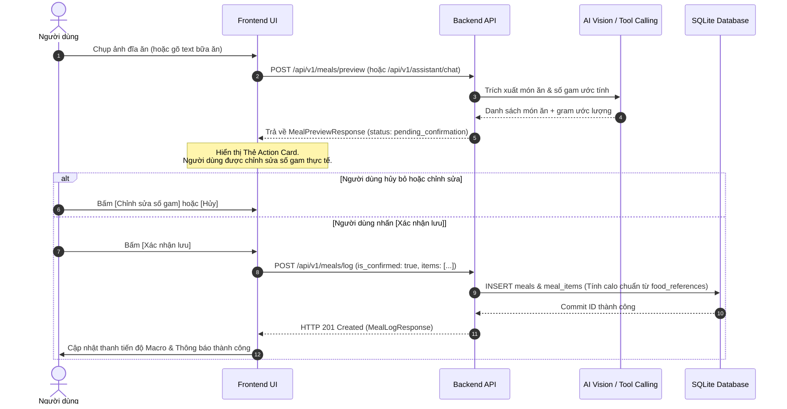

# KIẾN TRÚC HỆ THỐNG & PHÂN ĐỊNH RANH GIỚI LLM - BACKEND
> **Dự án:** NutriSnap - Virtual AI Nutrition Assistant  
> **Học phần:** CSC10014 – Tư duy tính toán (Computational Thinking)  
> **Tài liệu bàn giao:** Milestone 1 (M1) - Phân định ranh giới kiến trúc kỹ thuật & Đặc tả hệ thống

---

## 1. Tổng quan Kiến trúc Hệ thống (System Architecture Overview)
NutriSnap được thiết kế theo mô hình đa tầng phân lập trách nhiệm (Separation of Concerns), đảm bảo Trợ lý ảo AI hoạt động an toàn, chính xác và nhất quán:

```text
[ Người dùng ] 
      │ (Tương tác UI / WebRTC Camera / Voice / Chat)
      ▼
[ Presentation Layer (Frontend - React 18 / Vite / TailwindCSS) ]
      │ (Giao tiếp REST API kèm HttpOnly JWT Cookie, không truyền user_id)
      ▼
[ Application & Routing Layer (Backend - FastAPI 0.115+) ]
      │
      ├───────────────────────────────┬───────────────────────────────┐
      ▼                               ▼                               ▼
[ AI Orchestrator & LLM ]    [ Deterministic Engine ]       [ Persistence Layer ]
- NLU / Intent Recognition   - Tính calo/macro đại số       - SQLite (8 bảng chuẩn)
- Slot Filling & Tool Calls  - BMR / TDEE Calculator       - PRAGMA foreign_keys=ON
- Diễn đạt ngôn ngữ tự nhiên - Lọc nhiễu cân nặng EMA       - Dữ liệu 500 món Việt
- Two-Step Action Cards      - Kiểm định an toàn y tế      - UPSERT chống trùng lặp
```

---

## 2. Ma trận Phân định Trách nhiệm (LLM vs. Backend Responsibility Matrix)

Một trong những sai lầm phổ biến nhất trong các ứng dụng AI Dinh dưỡng là để LLM tự do tính toán lượng Calo hoặc trực tiếp thay đổi cơ sở dữ liệu. NutriSnap áp dụng nguyên tắc **Ranh giới Bất biến (Immutable Boundaries)**:

| Phân hệ / Nghiệp vụ | Trách nhiệm của LLM (AI Assistant) | Trách nhiệm của Backend (Deterministic Engine) | Lý do kiến trúc & An toàn |
| :--- | :--- | :--- | :--- |
| **Xác thực danh tính (Authentication)** | **Tuyệt đối không tham gia.** Không nhận, không truyền, không sinh mã `user_id`. | Trích xuất và giải mã JWT từ **HttpOnly Cookie** (`access_token`). Gán `current_user.id` trong ngữ cảnh request an toàn. | Chống rò rỉ ID, chống giả mạo danh tính (Impersonation) và XSS đánh cắp token. |
| **Nhận diện món ăn & Khẩu phần** | Nhận diện tên món ăn qua thị giác/văn bản (`food_name`), ước lượng số gam (`estimated_grams`) và các gia giảm (ít dầu, không đường). | Tra cứu ID thực phẩm (`food_id`) trong CSDL 500 món ăn Việt Nam (`food_references`). Từ chối món ăn có khối lượng phi lý (>3000g). | LLM giỏi hiểu ngữ cảnh tự nhiên nhưng không có độ tin cậy tuyệt đối về dữ liệu số. |
| **Tính toán Calo & Macro** | **Cấm tính nhẩm.** LLM không được tự bịa số Calo/Đạm/Béo trong câu trả lời. | Áp dụng công thức đại số tất định: $\text{Calories} = \frac{\text{grams}}{100} \times \text{calories\_per\_100g}$. Tương tự cho Protein, Carbs, Fat. | Tránh hiện tượng ảo giác (Hallucination) dẫn đến khuyến nghị sai lệch gây hại sức khỏe. |
| **Mục tiêu & Hạn mức Calo (TDEE/BMR)** | Tiếp nhận thông tin vóc dáng qua hội thoại tự nhiên và gọi Tool `get_daily_target` hoặc gợi ý cập nhật mục tiêu. | Tính BMR theo **Mifflin-St Jeor** (xử lý chuẩn nam/nữ/trung vị giới tính khác). Tính TDEE theo hệ số PAL. Kiểm soát ngưỡng lâm sàng an toàn (TDEE $\le$ 1200 kcal). | Đảm bảo tuân thủ tiêu chuẩn y khoa WHO/NHS. Không để người dùng bị hạ đường huyết hoặc thâm hụt calo cực đoan. |
| **Ghi nhận bữa ăn (Meal Ingestion)** | Sinh Thẻ xác nhận hành động (**Action Confirmation Card**) ở trạng thái nháp (`pending_confirmation` / `pending_user_action`). | Chỉ commit ghi dữ liệu vào bảng `meals` và `meal_items` khi người dùng bấm nút [Xác nhận] (`is_confirmed = True`). Từ chối HTTP 400 nếu `is_confirmed = False`. | Cơ chế **Two-Step Confirmation** bảo vệ tính toàn vẹn dữ liệu, cho phép người dùng sửa đổi trước khi lưu. |
| **Lọc nhiễu cân nặng (Weight EMA)** | Đọc kết quả tóm tắt và giải thích xu hướng cân nặng bằng ngôn ngữ khích lệ, tích cực. | Áp dụng giải thuật làm mịn số học lũy thừa (**Exponential Moving Average - EMA**) $\alpha = 0.2$ để loại bỏ dao động trữ nước hàng ngày. | Tránh hoảng loạn tâm lý cho người dùng khi thấy cân nặng nhảy vọt do nước hoặc natri. |

---

## 3. Ranh giới Bảo mật Zero-Trust (Zero-Trust Security Boundary)

### 3.1. HttpOnly JWT Cookie Architecture
- **Không lưu Token trong LocalStorage / SessionStorage:** Ngăn chặn triệt để lỗ hổng Cross-Site Scripting (XSS).
- **Thuộc tính Cookie:** `HttpOnly=True`, `SameSite=Lax`, `Path=/`, `Max-Age=604800` (7 ngày).
- **Phòng chống CSRF:** Kết hợp cơ chế `SameSite=Lax` với bộ kiểm tra nguồn gốc yêu cầu (`verify_csrf_protection`) trên các HTTP methods thay đổi dữ liệu (`POST`, `PUT`, `DELETE`), đối soát `Origin` và `Referer` với danh sách whitelist cho phép (`ALLOWED_ORIGINS`).

### 3.2. AI Tool Calling Zero-Trust
Trong toàn bộ 4 Function Declarations gửi tới Gemini SDK (`get_daily_summary`, `log_meal`, `recommend_meals`, `get_progress_summary`):
- Tham số `user_id` **hoàn toàn vắng mặt**.
- Tên tham số là duy nhất (không alias trùng lặp: dùng `remaining_calories`, `budget_vnd`, `days_range`).
- Backend tự động gán ngữ cảnh người dùng đang đăng nhập từ session HttpOnly Cookie an toàn.

---

## 4. Quy trình Xác nhận Hai bước (Two-Step Confirmation Workflow)



---

## 5. Động cơ Dinh dưỡng Tất định (Deterministic Nutrition Engine)

### 5.1. Công thức BMR Mifflin-St Jeor
- **Nam (Male):** $\text{BMR} = 10 \times W + 6.25 \times H - 5 \times A + 5$
- **Nữ (Female):** $\text{BMR} = 10 \times W + 6.25 \times H - 5 \times A - 161$
- **Khác (Other):** $\text{BMR} = 10 \times W + 6.25 \times H - 5 \times A - 78$ *(Áp dụng trung vị trung tính y học giữa nam và nữ: $\frac{5 + (-161)}{2} = -78$)*.

### 5.2. Công thức TDEE (Total Daily Energy Expenditure)
$$\text{TDEE} = \text{BMR} \times \text{PAL}$$
Với hệ số PAL (Physical Activity Level) chuẩn WHO/NHS:
- Sedentary (Ít vận động): 1.2
- Light (Nhẹ): 1.375
- Moderate (Vừa phải): 1.55
- Active (Nhiều): 1.725
- Very Active (Rất nhiều): 1.9

### 5.3. Ràng buộc An toàn Y tế & Ngưỡng Lâm sàng
1. **Tốc độ giảm cân an toàn:** $0.25 - 0.75\text{ kg/tuần}$. Bất kỳ giá trị nào ngoài khoảng này đều bị chặn bởi API validation (HTTP 422).
2. **Tốc độ tăng cân/tăng cơ an toàn:** $0.10 - 0.50\text{ kg/tuần}$.
3. **Mục tiêu duy trì cân nặng:** Tốc độ điều chỉnh tự động ép về $0.0\text{ kg/tuần}$.
4. **Ngưỡng lâm sàng TDEE thấp ($\le 1200\text{ kcal}$):**
   Nếu người dùng có thể trạng nhỏ hoặc lớn tuổi khiến $\text{TDEE} \le 1200\text{ kcal}$, Backend **không ép** hạn mức calo lên $1200\text{ kcal}$ (vì lớn hơn TDEE sẽ gây tăng cân trái mục đích) và cũng **không cắt giảm sâu** dưới $1000\text{ kcal}$ gây suy nhược. Backend giữ nguyên $\text{Target} = \text{TDEE}$ và đính kèm cảnh báo an toàn y tế rõ ràng, khuyến nghị người dùng tăng cường vận động thay vì nhịn ăn tiêu cực.

---

## 6. Chính sách Quản trị & Lưu trữ Dữ liệu (Data Governance)

- **Cơ sở dữ liệu:** SQLite kích hoạt bắt buộc `PRAGMA foreign_keys = ON` trên mọi kết nối thông qua engine listener duy nhất.
- **Quan hệ Khóa ngoại & Xóa tầng (Cascade Delete):** Xóa bản ghi `users` sẽ tự động xóa sạch các bản ghi phụ thuộc tại `goals`, `meals`, `weight_logs`, `chat_sessions`, `chat_messages` để ngăn ngừa dữ liệu mồ côi (Orphaned records).
- **Bảo tồn Dữ liệu Tham chiếu (Reference Integrity):** Script seed 500 món ăn sử dụng cú pháp `UPSERT` (`INSERT ... ON CONFLICT(food_name) DO UPDATE`), tuyệt đối không dùng lệnh `DELETE FROM food_references` gây phá hủy quan hệ khóa ngoại với `meal_items`.
- **Lưu trữ ảnh:** Ảnh món ăn chỉ được lưu đường dẫn tĩnh khi người dùng bấm xác nhận bữa ăn. Không lưu dữ liệu ảnh thô hoặc nhạy cảm của người dùng khi chưa có sự xác nhận rõ ràng.
