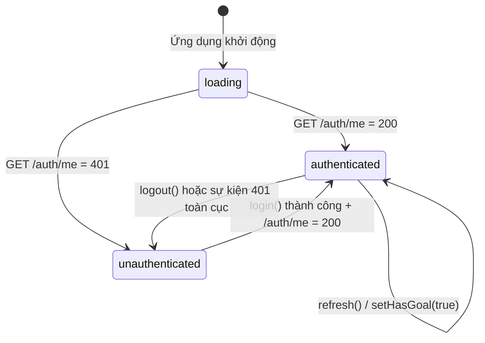
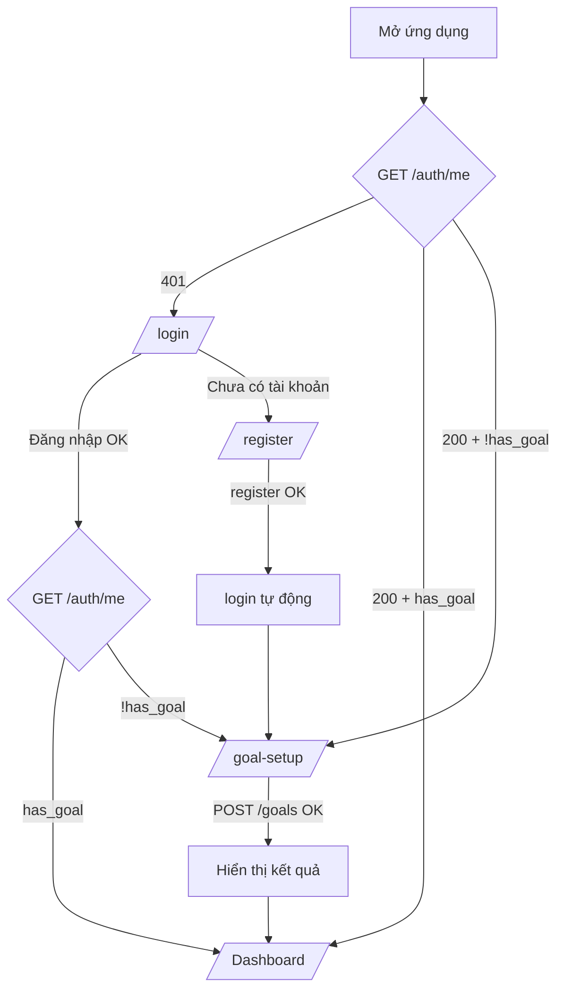

# NUTRISNAP — FRONTEND AUTH & GOAL PLANNER WIZARD
## Kế hoạch Triển khai Tuần 2 (Implementation Plan & Agent Brief)

| Thuộc tính | Giá trị |
|---|---|
| **Mã tài liệu** | `NS-FE-W2-001` · Phiên bản `1.0.0` · Trạng thái: **Ready for Implementation** |
| **Dự án / Môn học** | NutriSnap – Virtual AI Nutrition Assistant · CSC10014 – Tư duy tính toán (FIT – HCMUS) |
| **Người thực hiện (Owner)** | Lê Thành Đạt (25127293) — Cặp 2: Engineering & UI/UX Experience |
| **Reviewer (bắt buộc)** | Kiều Khôi Nguyên (25127107) — thành viên cùng cặp |
| **Phối hợp liên cặp** | Cặp 1 (Backend Auth/Goal: Minh Đức, Việt Huy) · Cặp 3 (QA: Quốc Tuấn) |
| **Nhánh làm việc** | `feat/w2-pair2-auth-goal-wizard` (tách từ `main` mới nhất) |
| **Phạm vi mã nguồn** | Chỉ `src/frontend/` (+ 1 dòng nhật ký trong `docs/ai_use_log.md`) |
| **Vị trí đề xuất của file này** | `docs/03_frontend_auth_goal_wizard_plan.md` |

### Mục lục
0. [Hướng dẫn sử dụng với Antigravity IDE (Agent Brief)](#0-hướng-dẫn-sử-dụng-với-antigravity-ide-agent-brief)
1. [Tóm tắt điều hành](#1-tóm-tắt-điều-hành)
2. [Quyết định kiến trúc (ADR) — **đọc trước khi code**](#2-quyết-định-kiến-trúc-adr--đọc-trước-khi-code)
3. [Phạm vi & Sản phẩm bàn giao](#3-phạm-vi--sản-phẩm-bàn-giao)
4. [Hiện trạng repo (Baseline) & Khoảng cách cần xử lý](#4-hiện-trạng-repo-baseline--khoảng-cách-cần-xử-lý)
5. [Ràng buộc bắt buộc (Guardrails)](#5-ràng-buộc-bắt-buộc-guardrails)
6. [Hợp đồng API mà Frontend sử dụng](#6-hợp-đồng-api-mà-frontend-sử-dụng)
7. [Kiến trúc Frontend mục tiêu](#7-kiến-trúc-frontend-mục-tiêu)
8. [Kế hoạch triển khai từng bước (Step 0 → Step 10)](#8-kế-hoạch-triển-khai-từng-bước-step-0--step-10)
9. [Đặc tả UX/UI & Khả năng truy cập](#9-đặc-tả-uxui--khả-năng-truy-cập-accessibility)
10. [Chiến lược kiểm thử](#10-chiến-lược-kiểm-thử)
11. [Quality Gates & Definition of Done](#11-quality-gates--definition-of-done)
12. [Quy trình Git, Commit Plan & mẫu Pull Request](#12-quy-trình-git-commit-plan--mẫu-pull-request)
13. [Nhật ký sử dụng AI (bắt buộc)](#13-nhật-ký-sử-dụng-ai-bắt-buộc)
14. [Rủi ro, Phụ thuộc & Phối hợp liên cặp](#14-rủi-ro-phụ-thuộc--phối-hợp-liên-cặp)
15. [Phụ lục kỹ thuật (snippets, lệnh chạy, xử lý sự cố)](#15-phụ-lục-kỹ-thuật)

---

## 0. Hướng dẫn sử dụng với Antigravity IDE (Agent Brief)

**Thứ tự đọc bắt buộc đối với Agent** (không bỏ qua file nào):

1. `.antigravityrules` (quy tắc vận hành của repo — luôn ưu tiên cao nhất)
2. File này (`docs/03_frontend_auth_goal_wizard_plan.md`)
3. `docs/01_security_architecture.md` §2–§3 (JWT / HttpOnly Cookie / Zero-Trust)
4. `docs/02_api_contract_and_screen_flows.md` §2.1, §2.2, §3, §4.1, §4.2 (luồng màn hình & contract)
5. `src/backend/schemas/api_contract.py` (nguồn sự thật cho kiểu dữ liệu Request/Response)
6. Toàn bộ `src/frontend/src/` hiện có (xem mục 4)

**Prompt khởi động gợi ý** (dán vào Antigravity):

```text
Bạn là Frontend Engineer của dự án NutriSnap. Hãy đọc .antigravityrules và
docs/03_frontend_auth_goal_wizard_plan.md, sau đó thực hiện TUẦN TỰ Step 0 → Step 10.
Quy tắc làm việc:
- Hoàn thành từng Step, chạy Quality Gate của Step đó (npm run build / npm test) rồi mới sang Step kế.
- Chỉ sửa các file nằm trong "Phạm vi được phép" (mục 3.3). Không sửa backend.
- Gặp tình huống thuộc mục "STOP & ASK" (mục 8.12) thì DỪNG và báo cáo, không tự suy diễn.
- Không đọc/tạo/ghi file .env hoặc .env.local. Chỉ tạo .env.example.
- Mỗi Step tương ứng 1 commit theo Commit Plan (mục 12.2). KHÔNG push lên main.
- Kết thúc: in báo cáo theo mẫu ở mục 8.11 và nhắc tôi cập nhật docs/ai_use_log.md.
```

> **Quy ước ngôn ngữ:** Giao diện người dùng viết **tiếng Việt**; tên biến/hàm/file viết **tiếng Anh**; comment ngắn gọn, ưu tiên giải thích *vì sao* thay vì *làm gì*.

---

## 1. Tóm tắt điều hành

**Mục tiêu Tuần 2 (Cặp 2 – Thành Đạt, phần Frontend):**

| # | Nhiệm vụ | Sản phẩm đầu ra |
|---|---|---|
| T1 | Lập trình `LoginPage.tsx` và `RegisterPage.tsx`; xác thực phiên đăng nhập an toàn và cấu hình **Axios Interceptor** | **Trang Đăng nhập / Đăng ký** |
| T2 | Lập trình `GoalPlannerWizard.tsx` gọi API lưu mục tiêu và hiển thị **TDEE, Protein, Carbs, Fat** ước tính mỗi ngày | **Trang Thiết lập mục tiêu** |

**Kết quả mong đợi:** người dùng mới đăng ký → được tự động đăng nhập → đi qua Wizard 4 bước → thấy hạn mức dinh dưỡng ước tính → vào Dashboard. Người dùng cũ đăng nhập → vào thẳng Dashboard (nếu đã có mục tiêu). Mọi phiên được xác thực bằng **HttpOnly Cookie**, không có token nào xuất hiện trong JavaScript.

---

## 2. Quyết định kiến trúc (ADR) — đọc trước khi code

### ADR-001 — Lưu phiên bằng HttpOnly Cookie, **không** lưu JWT vào `localStorage`

**Bối cảnh.** Bảng phân công cũ (Google Sheet, dòng W2/Thành Đạt) ghi *"lưu JWT vào localStorage và cấu hình Axios Interceptor tự gắn token"*. Điều này **mâu thuẫn** với 4 nguồn chính thức của dự án:

| Nguồn | Nội dung |
|---|---|
| Đặc tả kỹ thuật (PDF) §3.2 Tuần 2 – Cặp 2 | *"cấu hình Axios với `withCredentials: true` để trình duyệt tự động gửi kèm HttpOnly Cookie"* |
| Đặc tả kỹ thuật (PDF) §4.4 | Hướng dẫn **bắt buộc**: ưu tiên HttpOnly Cookie thay `localStorage` để chống XSS |
| `docs/01_security_architecture.md` §2 | Kết luận: lưu JWT trong `localStorage` là kiến trúc **không an toàn** |
| `src/backend/services/auth_guard.py` | `get_current_user` chỉ đọc cookie `access_token`; **không** đọc header `Authorization` |

**Quyết định.** Frontend **không** lưu, không đọc, không gắn JWT thủ công. Trình duyệt tự lưu cookie do server đặt (`Set-Cookie ... HttpOnly; SameSite=Lax`) và tự gửi kèm mỗi request nhờ `withCredentials: true`.

**Hệ quả & cách đáp ứng yêu cầu gốc:**

| Yêu cầu trong bảng phân công | Cách đáp ứng trong kế hoạch này |
|---|---|
| "Lưu JWT vào localStorage" | **Thay thế** bằng HttpOnly Cookie do Backend quản lý. Trạng thái đăng nhập phía UI lấy từ `GET /auth/me`. |
| "Axios Interceptor tự gắn token" | **Đáp ứng bằng cơ chế chuẩn**: `withCredentials: true` (trình duyệt tự gắn cookie) + **request interceptor** (header an toàn, `X-Request-ID`) + **response interceptor** (chuẩn hóa lỗi, xử lý `401` toàn cục). |
| Đầu ra "Trang Đăng nhập/Đăng ký" | Giữ nguyên (T1). |

> Nếu giảng viên/nhóm trưởng yêu cầu **bắt buộc** dùng `localStorage`, phương án đó cần Backend đổi sang đọc `Authorization: Bearer` (ngoài phạm vi Frontend) và phải ghi lại thành ADR riêng kèm phân tích rủi ro XSS. **Agent không tự thực hiện phương án này.**

### ADR-002 — Frontend không tự tính toán dinh dưỡng
Theo Decomposition Guide (PDF §4.2): *Tầng Giao diện chỉ hiển thị, không tự tính dinh dưỡng*. BMR/TDEE/Protein/Carbs/Fat **chỉ** lấy từ response của `POST /api/v1/goals`. Wizard không được tự cài công thức Mifflin-St Jeor hay chia macro.

### ADR-003 — Vị trí file kiểm thử Frontend
`.antigravityrules` §1 quy định test nằm ở `tests/`. Tuy nhiên Vitest cần phân giải `node_modules` của `src/frontend/`; đặt test ngoài package sẽ lỗi module resolution. **Quyết định:** test Frontend đặt tại `src/frontend/src/__tests__/` (thư mục chức năng, không đặt theo tuần/cá nhân nên không vi phạm điều cấm trong §1). Ghi chú này phải xuất hiện trong mô tả PR.

### ADR-004 — Thư viện bổ sung được phê duyệt
Chỉ được thêm các gói sau (giữ nguyên Axios, React Router, Tailwind, Lucide đã có):

| Gói | Phiên bản | Lý do |
|---|---|---|
| `react-hook-form` | `^7.53` | Quản lý form hiệu năng cao, ít re-render |
| `zod` | `^3.23` | Schema validation cùng nguồn cho kiểu + luật |
| `@hookform/resolvers` | `^3.9` | Cầu nối RHF ↔ Zod (**tương thích Zod 3**, không nâng lên Zod 4) |
| `vitest` | `^2.1` | Test runner tương thích **Vite 5** hiện tại |
| `jsdom` | `^25` | Môi trường DOM cho test |
| `@testing-library/react` | `^16` | Component testing |
| `@testing-library/dom` | `^10` | Peer dependency của RTL 16 |
| `@testing-library/user-event` | `^14` | Mô phỏng thao tác người dùng |
| `@testing-library/jest-dom` | `^6` | Matcher DOM (`toBeInTheDocument`, …) |

Gói nào ngoài danh sách → thuộc nhóm **STOP & ASK**.

---

## 3. Phạm vi & Sản phẩm bàn giao

### 3.1. Trong phạm vi (In Scope)
- **P0 (bắt buộc):** `LoginPage.tsx`, `RegisterPage.tsx`, `GoalPlannerWizard.tsx`; Axios client + interceptors; Auth context & route guards; types/schemas; xử lý lỗi/loading; kiểm thử tự động; PR + nhật ký AI.
- **P1 (nên có):** nút Đăng xuất + hiển thị tên người dùng trên `Navbar`; hiển thị mục tiêu hiện có khi người dùng quay lại Wizard; thông báo "phiên hết hạn".
- **P2 (nếu còn thời gian):** thanh đo độ mạnh mật khẩu; hiệu ứng chuyển bước tôn trọng `prefers-reduced-motion`.

### 3.2. Ngoài phạm vi (Out of Scope — **không làm**)
Dashboard, Camera/MealCapture, Chat Drawer (giữ nguyên logic hiện có), Recharts, Docker, Figma, mọi thay đổi ở `src/backend/`, `src/ai/`, `data/`, `scripts/`, tính năng Habit/Report/Offline.

### 3.3. Phạm vi file được phép chỉnh sửa
```text
src/frontend/**                       (trừ node_modules/, dist/)
docs/ai_use_log.md                    (chỉ thêm 1 dòng cho W2 – Thành Đạt)
docs/03_frontend_auth_goal_wizard_plan.md  (file này – chỉ khi cập nhật trạng thái)
```
Cấm: tạo thư mục đặt tên theo tuần (`week-2/`, `w2/`) hoặc theo cá nhân; sửa `.antigravityrules`, `.gitignore`, `requirements.txt`, mọi file `*.py`.

### 3.4. Bảng bàn giao (Deliverables)

| Mã | Sản phẩm | Tiêu chí nghiệm thu rút gọn |
|---|---|---|
| D1 | Trang Đăng nhập (`/login`) | Đăng nhập thành công/thất bại đúng thông báo; điều hướng theo `has_goal`; không còn credential mặc định |
| D2 | Trang Đăng ký (`/register`) | Validate khớp Backend; đăng ký → tự đăng nhập → vào Wizard |
| D3 | Axios client + Interceptors | `withCredentials`, chuẩn hóa lỗi FastAPI, `401` toàn cục, timeout |
| D4 | Wizard Thiết lập mục tiêu (`/goal-setup`) | 4 bước, validate theo contract, hiển thị TDEE + Protein + Carbs + Fat + nhãn "Ước tính" |
| D5 | Bộ kiểm thử | ≥ 25 test case, 0 fail; `npm run build` 0 lỗi |
| D6 | Pull Request + AI-use log | Có review của Khôi Nguyên; log đủ 5 cột |

---

## 4. Hiện trạng repo (Baseline) & Khoảng cách cần xử lý

Kết quả rà soát `src/frontend/` tại thời điểm lập kế hoạch:

| File | Phát hiện | Hành động |
|---|---|---|
| `src/App.tsx` | `useState(true)` cho `isLoggedIn` → **bỏ qua đăng nhập hoàn toàn**; điều hướng bằng state tab, chưa dùng router; chứa toàn bộ Chat Drawer | Thay bằng Router + `AuthProvider`; **di chuyển nguyên trạng** shell + Chat Drawer sang `layouts/AppShell.tsx`, không đổi logic chat |
| `src/pages/LoginPage.tsx` | Điền sẵn `thanhdat` / `Password123`; đọc lỗi từ `err.response.data.message` (FastAPI trả `detail`, không phải `message`); không có link sang đăng ký; không validate | **Viết lại** hoàn toàn theo Step 4 |
| `src/pages/GoalPlannerPage.tsx` | Form 1 trang; chỉ hiển thị BMR/TDEE/Calo/Đạm (**thiếu Carbs & Fat**); `age` max 100, `height` min 100 (lệch contract: tuổi ≤ 120, cao ≥ 80); không validate chéo | **Thay thế** bằng `GoalPlannerWizard.tsx`, xóa file cũ bằng `git rm` |
| `src/api/client.ts` | Đã có `withCredentials: true` ✔; interceptor `401` chỉ `console.warn`; chưa có timeout | Nâng cấp theo Step 2 |
| `src/types/api.ts` | Thiếu `RegisterRequest`, `LoginRequest`, `GoalCreateRequest`, các union type; `AuthResponse.user` chưa tách | Mở rộng theo Step 1 |
| `src/components/Navbar.tsx` | Chưa có tên người dùng/Đăng xuất; điều hướng bằng callback `onSelectTab` | Giữ API props hiện có, bổ sung khu vực người dùng (P1) |
| `package.json` | Có `react-router-dom` nhưng **chưa dùng**; chưa có test tooling; script `build = tsc && vite build` | Thêm dependency theo ADR-004; thêm script `test` |
| `vite-env.d.ts` | Chưa khai báo `ImportMetaEnv` | Khai báo `VITE_API_BASE_URL` |
| Thiếu | `src/frontend/.env.example`; thư mục `__tests__`; `RegisterPage.tsx`; route guard | Tạo mới |

**Quy ước dòng kết thúc:** nhiều file hiện có dùng CRLF. **Giữ nguyên** line ending của file đã tồn tại; file mới dùng LF. Không chạy công cụ reformat toàn repo (tránh diff nhiễu).

---

## 5. Ràng buộc bắt buộc (Guardrails)

### 5.1. MUST (bắt buộc)
- **M1.** Mọi request dùng chung một `apiClient` (`withCredentials: true`). Không gọi `fetch`/`axios` trực tiếp trong component.
- **M2.** Trạng thái đăng nhập **suy ra từ `GET /auth/me`**, không suy ra từ biến cục bộ hay storage.
- **M3.** Validate phía client **trùng khớp** `api_contract.py` + `validators.py` (mục 6.3). Backend vẫn là nguồn xác thực cuối cùng.
- **M4.** Mọi con số dinh dưỡng hiển thị đi kèm nhãn **"Ước tính"** và `DisclaimerBadge`.
- **M5.** Wizard hiển thị nguyên văn ghi chú: **"Đây là công cụ ước tính lộ trình tham khảo, không thay thế chỉ định y khoa."**
- **M6.** Mọi form: trạng thái `loading` (khóa nút, chống double-submit), lỗi cấp field và lỗi cấp form (`role="alert"`).
- **M7.** TypeScript `strict` — không dùng `any`, `@ts-ignore`, `as unknown as`. `catch (e: unknown)` rồi thu hẹp kiểu.
- **M8.** Điều hướng sau đăng nhập chỉ cho phép **đường dẫn nội bộ** (chống open redirect, mục 15.4).
- **M9.** Dùng design token trong `tailwind.config.js` (`nutri-primary`, `nutri-dark`, `nutri-surface`) cho code mới; màu macro theo `docs/02` §1.1: Calo cam `orange`, Đạm `blue`, Tinh bột `amber`, Béo `purple`.

### 5.2. MUST NOT (nghiêm cấm)
- **N1.** `localStorage`, `sessionStorage`, `IndexedDB`, `document.cookie` cho **bất kỳ** token/credential nào.
- **N2.** Gắn header `Authorization` thủ công; đọc/giải mã JWT ở client.
- **N3.** Gửi `user_id` trong URL, query hoặc body (Zero-Trust).
- **N4.** `console.log` mật khẩu, payload đăng nhập, hoặc response có dữ liệu sức khỏe.
- **N5.** `dangerouslySetInnerHTML`; render HTML từ chuỗi do server trả.
- **N6.** Tự tính BMR/TDEE/macro/BMI ở Frontend (ADR-002).
- **N7.** Credential/tài khoản demo hard-code trong mã nguồn (bao gồm giá trị mặc định của input).
- **N8.** Commit `.env`, `node_modules/`, `dist/`, ảnh chụp màn hình thô; push thẳng lên `main`.
- **N9.** Khuyến nghị hay hiển thị nội dung kết luận y khoa; không dùng ngôn từ ép giảm cân cực đoan.

---

## 6. Hợp đồng API mà Frontend sử dụng

`baseURL = import.meta.env.VITE_API_BASE_URL ?? 'http://localhost:8000/api/v1'`

### 6.1. Endpoint

| Method | Path | Request | Response thành công | Ghi chú |
|---|---|---|---|---|
| POST | `/auth/register` | `{ username, email, password }` | `201` `AuthResponse` | Hợp đồng không đảm bảo có `Set-Cookie` → sau đăng ký phải **gọi login** |
| POST | `/auth/login` | `{ username_or_email, password }` | `200` `AuthResponse` + `Set-Cookie: access_token` | Sau đó gọi `/auth/me` để xác nhận cookie |
| GET | `/auth/me` | — | `200` `AuthResponse` | `401` khi chưa đăng nhập (bình thường lúc khởi động) |
| POST | `/auth/logout` | — | `200` `BaseResponse` | Xóa cookie |
| GET | `/goals` | — | `200` `GoalResponse` | Dùng cho P1 (hiển thị mục tiêu hiện có) |
| POST | `/goals` | `GoalCreateRequest` | `200` `GoalResponse` | Tạo/cập nhật mục tiêu |

### 6.2. Cấu trúc lỗi FastAPI (quan trọng)
```jsonc
// HTTPException  → detail là chuỗi
{ "detail": "Phiên đăng nhập không hợp lệ hoặc đã hết hạn." }

// Pydantic 422 → detail là mảng
{ "detail": [ { "loc": ["body", "password"], "msg": "Value error, Mật khẩu phải chứa ít nhất một chữ số.", "type": "value_error" } ] }
```
Quy tắc chuẩn hóa: bỏ tiền tố `"Value error, "`; ánh xạ `loc[1]` → tên field; `detail` chuỗi → lỗi cấp form. **Không** đọc `response.data.message` cho trường hợp lỗi.

| HTTP | Ý nghĩa | Cách hiển thị |
|---|---|---|
| 400 / 409 | Dữ liệu trùng / sai nghiệp vụ | Lỗi cấp form (hoặc field nếu ánh xạ được) |
| 401 | Sai thông tin đăng nhập / hết phiên | Login: "Tên đăng nhập hoặc mật khẩu không đúng." · Nơi khác: kích hoạt xử lý phiên hết hạn |
| 403 | Bị chặn (CSRF/Origin) | "Yêu cầu bị từ chối. Vui lòng tải lại trang." |
| 422 | Sai định dạng | Lỗi theo field |
| 429 | Rate limit (Tuần 6) | "Bạn thao tác quá nhanh, vui lòng thử lại sau ít phút." |
| 5xx | Lỗi máy chủ | "Hệ thống đang bận. Vui lòng thử lại sau." |
| Mất mạng / timeout | Không có `response` | "Không thể kết nối tới máy chủ. Kiểm tra mạng và thử lại." |

### 6.3. Luật validate (client) — khớp contract

**Đăng ký** (`UserRegisterRequest` + `validate_password`)
| Field | Luật |
|---|---|
| `username` | `trim`, 3–50 ký tự |
| `email` | định dạng email hợp lệ |
| `password` | ≥ 8 ký tự, ≥ 1 chữ cái, ≥ 1 chữ số |
| `confirmPassword` | **chỉ ở client**, phải khớp `password`, **không gửi lên server** |

**Đăng nhập:** `username_or_email` và `password` bắt buộc (không áp luật độ mạnh để tránh lộ chính sách).

**Mục tiêu** (`GoalCreateRequest` + `validate_goal_pace`)
| Field | Luật |
|---|---|
| `gender` | `male` \| `female` \| `other` |
| `age` | số nguyên 10–120 |
| `height_cm` | 80–250 |
| `current_weight_kg` / `target_weight_kg` | 25–300 |
| `activity_level` | `sedentary` \| `light` \| `moderate` \| `active` \| `very_active` |
| `goal_type` | `lose_weight` \| `maintain` \| `gain_muscle` |
| `weekly_pace_kg` | `lose_weight`: 0.25–0.75 · `gain_muscle`: 0.10–0.50 · `maintain`: **đúng 0** |
| `daily_budget_vnd` | số nguyên ≥ 10 000 (mặc định 60 000) |
| **Chéo (UX)** | `lose_weight` ⇒ `target < current` · `gain_muscle` ⇒ `target > current` · `maintain` ⇒ `target = current` (ẩn ô, tự gán) |

### 6.4. Khoảng trống Backend đã biết (Frontend **không** sửa — chỉ ghi nhận, xem mục 14)
1. `POST /auth/login` (mock) đặt cookie cố định và chấp nhận mọi thông tin đăng nhập; `auth_guard` chấp nhận mọi token ≥ 15 ký tự.
2. `POST /auth/register` (mock) **không** đặt cookie và không lưu dữ liệu.
3. `GET /goals` (mock) luôn trả dữ liệu cố định; `GoalResponse` **không** phản hồi lại `gender/age/height/...` nên Wizard không thể điền sẵn toàn bộ form.
4. Request dùng `target_weight_kg`, response trả `target_weight` — đặt tên khác nhau (giữ đúng contract).

Frontend phải chạy đúng với **mock hiện tại** và **không cần sửa** khi Backend thật (Tuần 2) thay thế.

---

## 7. Kiến trúc Frontend mục tiêu

### 7.1. Cây thư mục (chỉ liệt kê file thay đổi)
```text
src/frontend/
├── .env.example                          (NEW)  VITE_API_BASE_URL
├── package.json                          (MOD)  deps + script "test"
├── vite.config.ts                        (MOD)  khối `test` cho Vitest
└── src/
    ├── main.tsx                          (MOD)  bọc BrowserRouter + AuthProvider
    ├── App.tsx                           (MOD)  chỉ còn bảng định tuyến
    ├── vite-env.d.ts                     (MOD)  ImportMetaEnv
    ├── api/
    │   ├── client.ts                     (MOD)  interceptors
    │   ├── authApi.ts                    (NEW)  register/login/me/logout
    │   └── goalApi.ts                    (NEW)  getGoal/saveGoal
    ├── context/
    │   └── AuthContext.tsx               (NEW)  AuthProvider + useAuth
    ├── layouts/
    │   └── AppShell.tsx                  (NEW)  Navbar + Outlet + Chat Drawer (di chuyển từ App.tsx)
    ├── components/
    │   ├── ProtectedRoute.tsx            (NEW)
    │   ├── PublicOnlyRoute.tsx           (NEW)
    │   ├── FormField.tsx                 (NEW)  label + input + lỗi (a11y)
    │   ├── PasswordField.tsx             (NEW)  ẩn/hiện mật khẩu
    │   ├── Spinner.tsx                   (NEW)
    │   ├── Navbar.tsx                    (MOD)  tên người dùng + Đăng xuất (P1)
    │   └── goal/
    │       ├── WizardStepper.tsx         (NEW)
    │       ├── StepBody.tsx              (NEW)  bước 1
    │       ├── StepGoal.tsx              (NEW)  bước 2
    │       ├── StepSafety.tsx            (NEW)  bước 3
    │       ├── StepReview.tsx            (NEW)  bước 4
    │       └── GoalResultPanel.tsx       (NEW)  kết quả TDEE/Protein/Carbs/Fat
    ├── pages/
    │   ├── LoginPage.tsx                 (REWRITE)
    │   ├── RegisterPage.tsx              (NEW)
    │   ├── GoalPlannerWizard.tsx         (NEW)  thay GoalPlannerPage.tsx
    │   ├── GoalPlannerPage.tsx           (DELETE)
    │   └── DashboardPage.tsx             (KHÔNG ĐỔI)
    ├── schemas/
    │   ├── authSchemas.ts                (NEW)
    │   └── goalSchemas.ts                (NEW)
    ├── types/api.ts                      (MOD)
    ├── utils/
    │   ├── apiError.ts                   (NEW)  ApiError + normalize
    │   └── safeRedirect.ts               (NEW)
    ├── constants/copy.ts                 (NEW)  disclaimer & chuỗi dùng chung
    └── __tests__/                        (NEW)  xem mục 10
```

### 7.2. Bảng định tuyến

| Path | Component | Bảo vệ | Hành vi |
|---|---|---|---|
| `/login` | `LoginPage` | `PublicOnlyRoute` | Đã đăng nhập → chuyển `/` hoặc `/goal-setup` |
| `/register` | `RegisterPage` | `PublicOnlyRoute` | như trên |
| `/goal-setup` | `GoalPlannerWizard` | `ProtectedRoute` | Trong `AppShell` |
| `/` | `DashboardPage` | `ProtectedRoute` | Trong `AppShell`; `has_goal=false` → gợi ý/đẩy sang `/goal-setup` |
| `*` | Điều hướng về `/` | — | |

### 7.3. Máy trạng thái xác thực



### 7.4. Luồng người dùng chính



---

## 8. Kế hoạch triển khai từng bước (Step 0 → Step 10)

> Mỗi Step = 1 commit. Ước lượng tổng: **~12 giờ làm việc** (tương ứng 1 Pair Session 2,5 giờ + công việc cá nhân).

| Step | Nội dung | Ước lượng | Phụ thuộc |
|---|---|---|---|
| 0 | Chuẩn bị môi trường & nhánh | 0,5 giờ | — |
| 1 | Dependencies, cấu hình test, types | 1 giờ | 0 |
| 2 | `apiError` + Axios client/interceptors | 1,5 giờ | 1 |
| 3 | `authApi`, `goalApi`, `AuthContext`, route guards | 1,5 giờ | 2 |
| 4 | `LoginPage` | 1 giờ | 3 |
| 5 | `RegisterPage` | 1 giờ | 3 |
| 6 | Schema + khối dựng Wizard | 1,5 giờ | 1 |
| 7 | `GoalPlannerWizard` + `GoalResultPanel` | 2 giờ | 3, 6 |
| 8 | Router, `AppShell`, Navbar, dọn code cũ | 1 giờ | 4, 5, 7 |
| 9 | Kiểm thử tự động | 1,5 giờ | 8 |
| 10 | Tài liệu, nhật ký AI, PR | 0,5 giờ | 9 |

### Step 0 — Chuẩn bị môi trường & nhánh
**Việc làm**
1. `git checkout main && git pull origin main`
2. `git checkout -b feat/w2-pair2-auth-goal-wizard`
3. Xác nhận Node ≥ 18 (khuyến nghị 20 LTS): `node -v`.
4. Backend để kiểm thử tích hợp (chạy từ **thư mục gốc repo**): `python -m uvicorn src.backend.main:app --reload --port 8000`
5. `cd src/frontend && npm install && npm run build` — xác nhận **baseline build xanh** trước khi sửa.

**Nghiệm thu:** nhánh đúng tên; baseline build 0 lỗi; Swagger mở được tại `http://localhost:8000/docs`.
> ⚠️ Dùng **`localhost` nhất quán** (cả trang web lẫn API). Trộn `127.0.0.1` và `localhost` khiến cookie bị coi là cross-site và bị chặn (xem 15.5).

### Step 1 — Dependencies, cấu hình test, types
**Việc làm**
1. Cài đặt đúng phiên bản theo ADR-004:
   ```bash
   npm i react-hook-form@^7.53 zod@^3.23 @hookform/resolvers@^3.9
   npm i -D vitest@^2.1 jsdom@^25 @testing-library/react@^16 @testing-library/dom@^10 @testing-library/user-event@^14 @testing-library/jest-dom@^6
   ```
2. `package.json` → thêm scripts: `"test": "vitest run"`, `"test:watch": "vitest"`.
3. `vite.config.ts`: thêm khối `test` (`environment: 'jsdom'`, `globals: true`, `setupFiles: ['./src/__tests__/setup.ts']`, `css: false`). Dùng `import { defineConfig } from 'vitest/config'`.
4. `src/__tests__/setup.ts`: import `@testing-library/jest-dom/vitest`; `afterEach(cleanup)`.
5. `tsconfig.json`: thêm `"types": ["vitest/globals", "@testing-library/jest-dom"]` vào `compilerOptions` (giữ nguyên các tùy chọn khác).
6. `vite-env.d.ts`: khai báo `interface ImportMetaEnv { readonly VITE_API_BASE_URL?: string }`.
7. Tạo `src/frontend/.env.example` với `VITE_API_BASE_URL=http://localhost:8000/api/v1`. **Không** tạo/đọc `.env`.
8. Mở rộng `types/api.ts` theo snippet 15.1 (giữ nguyên các type đã có).

**Nghiệm thu:** `npm run build` ✔; `npm test` chạy được (chưa có test cũng không lỗi cấu hình: dùng `--passWithNoTests` tạm thời hoặc 1 smoke test).

### Step 2 — Chuẩn hóa lỗi & Axios client / Interceptors
**File:** `utils/apiError.ts`, `api/client.ts`

**`utils/apiError.ts`**
- `class ApiError extends Error { status?: number; fieldErrors: Record<string,string>; isNetworkError: boolean }`
- `normalizeAxiosError(error: unknown): ApiError` xử lý: lỗi mạng/timeout; `detail` chuỗi; `detail` mảng 422 (bỏ `"Value error, "`, ánh xạ `loc[1]`); mã trạng thái → thông điệp mặc định theo bảng 6.2.
- `isApiError(e: unknown): e is ApiError`.

**`api/client.ts`** (xem snippet 15.2)
- `axios.create({ baseURL, withCredentials: true, timeout: 15_000, headers })`.
- **Request interceptor:** `config.withCredentials = true` (đảm bảo không bị ghi đè), thêm `X-Requested-With: XMLHttpRequest` (phòng thủ chiều sâu, Backend hiện bỏ qua) và `X-Request-ID` (`crypto.randomUUID()`) phục vụ truy vết. **Không** gắn `Authorization`.
- **Response interceptor:** `reject(normalizeAxiosError(error))`; nếu `status === 401` và URL **không** thuộc `['/auth/login','/auth/register','/auth/me']` → `window.dispatchEvent(new Event(UNAUTHORIZED_EVENT))`.
- Export `UNAUTHORIZED_EVENT = 'nutrisnap:unauthorized'`.

**Nghiệm thu:** unit test `apiError` (≥ 6 ca: network, 401 chuỗi, 422 mảng, tiền tố "Value error", 5xx, field ánh xạ); `npm run build` ✔.

### Step 3 — API modules, AuthContext, Route guards
**File:** `api/authApi.ts`, `api/goalApi.ts`, `context/AuthContext.tsx`, `components/ProtectedRoute.tsx`, `components/PublicOnlyRoute.tsx`, `utils/safeRedirect.ts`

- `authApi`: `register(body)`, `login(body)`, `me()`, `logout()` — trả `data` đã định kiểu.
- `goalApi`: `getGoal()`, `saveGoal(body: GoalCreateRequest)`.
- `AuthContext` cung cấp: `status: 'loading' | 'authenticated' | 'unauthenticated'`, `user`, `hasGoal`, `login(credentials)`, `register(payload)`, `logout()`, `refresh()`, `setHasGoal(v)`.
  - Khi mount: gọi `me()` **đúng một lần** (cẩn thận `React.StrictMode` gọi effect 2 lần ở dev: dùng cờ `ignore`/AbortController để không set state sau unmount).
  - `login()`: gọi `authApi.login` → **luôn gọi `me()`** để xác nhận cookie đã được trình duyệt chấp nhận → cập nhật state. Nếu `me()` lỗi 401 sau khi login "thành công" → ném lỗi có thông điệp: "Không thể thiết lập phiên đăng nhập. Hãy kiểm tra cookie của trình duyệt."
  - `register()`: gọi `authApi.register` → **gọi `login()` với cùng thông tin** → `hasGoal=false`.
  - `logout()`: gọi API (kể cả khi lỗi mạng vẫn xóa state cục bộ) → `unauthenticated`.
  - Lắng nghe `UNAUTHORIZED_EVENT` → đặt `unauthenticated` và lưu cờ `sessionExpired` trong state (không dùng storage) để `LoginPage` hiển thị banner.
- `ProtectedRoute`: `loading` → màn hình chờ toàn trang (`Spinner` + "Đang kiểm tra phiên đăng nhập…"); `unauthenticated` → `<Navigate to="/login" replace state={{ from: location }} />`.
- `PublicOnlyRoute`: đã đăng nhập → `<Navigate to={hasGoal ? '/' : '/goal-setup'} replace />`.
- `safeRedirect(from, fallback)`: chỉ chấp nhận chuỗi bắt đầu bằng `/` và **không** bắt đầu bằng `//`, không chứa `://` hoặc `\`.

**Nghiệm thu:** test AuthContext (bootstrap 200/401, login gọi `me`, register gọi `login`, logout, sự kiện 401); `safeRedirect` ≥ 6 ca (bao gồm `//evil.com`, `https://x`, `/\evil`).

### Step 4 — `LoginPage.tsx`  *(D1)*
**Yêu cầu chức năng**
- Form: `username_or_email`, `password` (`PasswordField` có nút ẩn/hiện, `aria-pressed`).
- **Không** điền sẵn giá trị; `autoComplete="username"` / `"current-password"`.
- Submit → `useAuth().login(...)`; thành công → điều hướng: `safeRedirect(state.from) ?? (hasGoal ? '/' : '/goal-setup')`.
- Lỗi: `401` → "Tên đăng nhập hoặc mật khẩu không đúng." (không tiết lộ tài khoản có tồn tại); lỗi khác theo bảng 6.2. Banner "Phiên đăng nhập đã hết hạn" khi `sessionExpired`.
- Link "Chưa có tài khoản? **Đăng ký**" → `/register`.
- Dòng trấn an: "Phiên đăng nhập được bảo vệ bằng HttpOnly Cookie." (giữ phong cách hiện có) + `DisclaimerBadge`.
- Bỏ `onLoginSuccess` prop (điều hướng do router xử lý).

**Nghiệm thu:** validate rỗng; nút khóa khi đang gửi; focus vào ô lỗi đầu tiên; test component (≥ 5 ca).

### Step 5 — `RegisterPage.tsx`  *(D2)*
**Yêu cầu chức năng**
- Field: `username`, `email`, `password`, `confirmPassword` (RHF + `registerSchema`), `mode: 'onTouched'`.
- `autoComplete`: `username`, `email`, `new-password`, `new-password`.
- Hiển thị quy tắc mật khẩu dưới ô (≥ 8 ký tự, có chữ, có số) và cập nhật trạng thái đạt/chưa đạt theo thời gian thực (`aria-live="polite"`).
- Submit → `useAuth().register({ username, email, password })` (**không** gửi `confirmPassword`).
- Thành công → `/goal-setup` (nội dung: toast/banner "Tạo tài khoản thành công. Hãy thiết lập mục tiêu của bạn.").
- Lỗi `409`/`400` về trùng → hiển thị tại field phù hợp nếu ánh xạ được, nếu không → lỗi cấp form. Lỗi 422 → ánh xạ `fieldErrors` bằng `setError`.
- Nếu `register` OK nhưng `login` tự động lỗi → chuyển `/login` kèm thông báo "Đăng ký thành công, vui lòng đăng nhập."
- Link "Đã có tài khoản? **Đăng nhập**".

**Nghiệm thu:** test (≥ 6 ca): mật khẩu yếu, confirm không khớp, payload không có `confirmPassword`, luồng thành công gọi `register` rồi `login`, lỗi 409, double-submit bị chặn.

### Step 6 — Schema & khối dựng Wizard
**File:** `schemas/goalSchemas.ts`, `components/goal/*` (trừ `GoalResultPanel`), `constants/copy.ts`

- `goalSchema` (Zod) theo bảng 6.3, dùng `superRefine` cho luật chéo và `weekly_pace_kg` phụ thuộc `goal_type` (snippet 15.3). Số nhập từ `<input type="number">` dùng `valueAsNumber`; ô trống → thông báo "Vui lòng nhập …" (không hiển thị `NaN`).
- Mỗi Step component nhận `form` (RHF `UseFormReturn<GoalFormValues>`) và chỉ render field của bước đó. Danh sách field theo bước dùng để `trigger()` trước khi `Next`.
- `WizardStepper`: 4 mốc, `aria-current="step"`, bước đã xong có dấu ✓; trên mobile thu gọn thành "Bước 2/4".
- `constants/copy.ts`: `DISCLAIMER_ESTIMATE`, `DISCLAIMER_WIZARD` (đúng nguyên văn M5), nhãn mức vận động kèm mô tả.

**Nghiệm thu:** test `goalSchema` (≥ 10 ca: biên 0.25/0.75/0.10/0.50, maintain khác 0, chéo target/current, tuổi 9/10/120/121, chiều cao 79/80/250/251).

### Step 7 — `GoalPlannerWizard.tsx` + `GoalResultPanel.tsx`  *(D4)*

**Bốn bước (theo `docs/02` §2.2):**

| Bước | Tiêu đề | Field | Ghi chú |
|---|---|---|---|
| 1 | Thông số cơ thể | `gender`, `age`, `height_cm`, `current_weight_kg`, `activity_level` | `activity_level` dạng thẻ chọn (radio group) kèm mô tả ngắn |
| 2 | Mục tiêu | `goal_type`, `target_weight_kg` | `maintain` → ẩn ô, tự gán = cân nặng hiện tại; đổi `goal_type` → đặt lại `weekly_pace_kg` mặc định (lose 0.5 / gain 0.25 / maintain 0) |
| 3 | Kiểm tra an toàn | `weekly_pace_kg`, `daily_budget_vnd` | Slider có giới hạn theo mục tiêu, hiển thị khoảng an toàn, ngân sách mặc định 60 000 VNĐ. **Không** tính BMR/TDEE ở bước này (ADR-002) |
| 4 | Xác nhận | — | Tóm tắt toàn bộ lựa chọn (có nút "Sửa" quay về bước tương ứng) + nút **Lưu mục tiêu** |

**Hành vi**
- `Next` chỉ cho đi tiếp khi `trigger(fieldsOfStep)` hợp lệ; `Back` giữ nguyên dữ liệu.
- Submit ở bước 4: `goalApi.saveGoal(values)`; payload **chỉ** gồm 9 field của `GoalCreateRequest` — kiểm tra bằng test: không có `user_id`.
- Thành công → `setHasGoal(true)` → hiển thị **`GoalResultPanel`** (trạng thái "result" của Wizard, không đổi route).
- Lỗi → banner lỗi cấp form, giữ nguyên dữ liệu, cho phép gửi lại.
- Nếu `hasGoal === true` khi mở Wizard (P1): hiển thị thẻ "Mục tiêu hiện tại" từ `GET /goals` và dòng cảnh báo "Lưu mới sẽ thay thế mục tiêu hiện tại." — nếu `GET /goals` lỗi thì bỏ qua êm lặng, không chặn Wizard.

**`GoalResultPanel` — nội dung bắt buộc hiển thị** (giá trị lấy trực tiếp từ response, định dạng `vi-VN`, 0–1 chữ số thập phân):

| Thẻ | Trường | Màu | Nhãn phụ |
|---|---|---|---|
| **TDEE** (nổi bật nhất) | `tdee_calories` kcal | xanh thương hiệu | "Tổng năng lượng tiêu hao mỗi ngày · Ước tính" |
| BMR | `bmr_calories` kcal | slate | "Năng lượng nghỉ ngơi · Ước tính" |
| Hạn mức Calo/ngày | `target_calories` kcal | cam | "Mục tiêu hằng ngày · Ước tính" |
| **Protein (Đạm)** | `target_protein_g` g | xanh dương | — |
| **Carbs (Tinh bột)** | `target_carbs_g` g | vàng mật ong | — |
| **Fat (Chất béo)** | `target_fat_g` g | tím | — |
| Ngân sách | `daily_budget_vnd` | slate | định dạng tiền VNĐ |

- Dưới panel: `DisclaimerBadge` với `disclaimer` do server trả về (nếu rỗng dùng `DISCLAIMER_ESTIMATE`). Nếu `disclaimer` chứa cảnh báo bổ sung (ví dụ TDEE thấp), hiển thị trong khối thông tin riêng (`role="note"`), **không** cắt bớt.
- CTA chính: "Vào trang Tổng quan" → `/`; CTA phụ: "Chỉnh lại mục tiêu" → quay về bước 1 giữ dữ liệu.

**Nghiệm thu:** test (≥ 8 ca): chặn Next khi lỗi; maintain ẩn ô target; đổi goal_type reset pace; payload đúng 9 field; hiển thị đủ TDEE/Protein/Carbs/Fat sau khi lưu; hiển thị cảnh báo từ `disclaimer`; lỗi API giữ nguyên dữ liệu.

### Step 8 — Router, AppShell, Navbar, dọn dẹp
1. `main.tsx`: `<BrowserRouter><AuthProvider><App/></AuthProvider></BrowserRouter>` (giữ `React.StrictMode`).
2. `layouts/AppShell.tsx`: **di chuyển nguyên trạng** Navbar + `<main>` + Chat Drawer từ `App.tsx`. Thay state tab bằng `NavLink`/`useNavigate`; giữ **nguyên** logic chat (`handleSendChat`, `handleConfirmActionCard`). Lời chào chat dùng `user.username` thay vì tên hard-code "Thành Đạt".
3. `App.tsx`: chỉ còn `<Routes>` theo mục 7.2.
4. `Navbar`: giữ props hiện có cho tương thích, thêm khu vực người dùng (avatar chữ cái đầu + username) và nút **Đăng xuất** (`useAuth().logout()` → `/login`). Tab "Mục tiêu" trỏ `/goal-setup`.
5. `git rm src/pages/GoalPlannerPage.tsx`; xóa mọi import mồ côi (`noUnusedLocals` sẽ báo).
6. `/` với `hasGoal === false`: hiển thị banner dẫn tới `/goal-setup` (không chặn cứng Dashboard).

**Nghiệm thu:** `npm run build` ✔ (không còn lỗi unused); chạy tay luồng đầy đủ (mục 10.3).

### Step 9 — Kiểm thử tự động
Thực hiện toàn bộ ma trận ở mục 10.1–10.2. Dùng `vi.mock('../api/authApi')` / `goalApi` để cô lập mạng. Chạy `npm test` và `npm run build`.

### Step 10 — Tài liệu, nhật ký AI, Pull Request
1. Thêm 1 dòng vào `docs/ai_use_log.md` (mục 13).
2. (Tùy chọn) Cập nhật `README.md` gốc? **Không** — thuộc Cặp 1. Chỉ ghi lệnh chạy Frontend vào mô tả PR.
3. `git status` kiểm tra không có `.env`, `node_modules/`, `dist/`.
4. Push nhánh và mở PR theo mẫu mục 12.3; gắn Khôi Nguyên làm reviewer.

### 8.11. Mẫu báo cáo cuối của Agent
```text
## Báo cáo hoàn thành W2 – Frontend
- Steps hoàn thành: 0..10 (liệt kê Step bị bỏ/hoãn nếu có + lý do)
- File mới / sửa / xóa: <danh sách>
- Kết quả: npm run build = <pass/fail>, npm test = <X passed / Y failed>
- Sai khác so với kế hoạch: <nếu có>
- Phát hiện về Backend cần báo Cặp 1: <danh sách>
- Việc cần người thực hiện: cập nhật docs/ai_use_log.md, mở PR, xin review
```

### 8.12. STOP & ASK — Agent phải dừng và hỏi khi
1. Contract Backend thực tế khác mục 6 (đổi tên field, đổi cơ chế cookie, thêm bước CSRF token).
2. Cần sửa file ngoài mục 3.3 hoặc thêm gói ngoài ADR-004.
3. Yêu cầu nào mâu thuẫn `.antigravityrules` hoặc ADR-001.
4. Test không thể xanh mà không làm yếu assertion hoặc xóa test.
5. Cookie không được lưu dù đã làm đúng mục 15.5.

---

## 9. Đặc tả UX/UI & Khả năng truy cập (Accessibility)

**Hình ảnh & thương hiệu:** nền `#F8FAFC`, thẻ trắng bo `rounded-2xl`, đổ bóng `shadow-sm`, nút chính `bg-nutri-primary hover:bg-nutri-dark`, font **Inter** (đã nạp trong `index.html`).

**Trạng thái bắt buộc cho mỗi màn hình:** mặc định · đang tải · lỗi cấp form · lỗi cấp field · thành công · rỗng (nếu có).

**Chuẩn truy cập (WCAG 2.2 AA – các điểm kiểm tra tối thiểu)**
- Mọi input có `<label htmlFor>` hiển thị; lỗi gắn `aria-invalid="true"` + `aria-describedby`.
- Banner lỗi: `role="alert"`; thông báo thành công/đổi bước: `aria-live="polite"`.
- Sau submit lỗi: đưa focus về field lỗi đầu tiên (`setFocus`).
- Toàn bộ thao tác dùng được bằng bàn phím; thứ tự Tab hợp lý; vòng focus nhìn thấy rõ (`focus-visible:ring-2`).
- Tương phản chữ/nền ≥ 4.5:1; không chỉ dùng màu để truyền đạt trạng thái (kèm icon/chữ).
- Mục tiêu chạm ≥ 40×40 px trên mobile; bố cục mobile-first, kiểm tra ở 360px, 768px, 1280px.
- Tôn trọng `prefers-reduced-motion` (tắt animation chuyển bước).
- `autoComplete` đúng cho trình quản lý mật khẩu; ô mật khẩu có nút ẩn/hiện.
- Thông điệp ngắn, thân thiện, không đổ lỗi ("Vui lòng nhập…" thay vì "Bạn nhập sai").

**Tone nội dung (Responsible UX):** không dùng ngôn từ hù dọa/ép giảm cân; luôn nhấn mạnh đây là ước tính tham khảo; không chẩn đoán.

---

## 10. Chiến lược kiểm thử

### 10.1. Tự động — đơn vị (Vitest)

| Nhóm | Tệp gợi ý | Số ca tối thiểu |
|---|---|---|
| `apiError` | `__tests__/apiError.test.ts` | 6 |
| `safeRedirect` | `__tests__/safeRedirect.test.ts` | 6 |
| `authSchemas` | `__tests__/authSchemas.test.ts` | 6 |
| `goalSchemas` | `__tests__/goalSchemas.test.ts` | 10 |

### 10.2. Tự động — component/tích hợp (RTL + user-event)

| Màn hình | Ca bắt buộc |
|---|---|
| `LoginPage` | render; validate rỗng; submit thành công gọi `login` rồi điều hướng theo `hasGoal`; 401 hiện thông điệp chung; nút khóa khi loading; link sang đăng ký |
| `RegisterPage` | mật khẩu yếu; confirm không khớp; payload **không** chứa `confirmPassword`; thành công gọi `register`→`login`→`/goal-setup`; 409; 422 ánh xạ field |
| `AuthContext`/guards | bootstrap 200/401; `ProtectedRoute` chuyển `/login`; `PublicOnlyRoute` chuyển khi đã đăng nhập; sự kiện 401 toàn cục |
| `GoalPlannerWizard` | chặn Next khi lỗi; maintain ẩn ô target; đổi `goal_type` reset pace; payload đúng 9 field, không `user_id`; hiển thị TDEE/Protein/Carbs/Fat; hiển thị nhãn "Ước tính" + ghi chú M5; lỗi API giữ dữ liệu |
| **Bảo mật** | spy `Storage.prototype.setItem` → **không** được gọi trong toàn bộ luồng login/register/goal; không có header `Authorization` trong request config |

**Mục tiêu:** ≥ **25 test case**, 0 fail. (Không đặt ngưỡng coverage cứng; ưu tiên kiểm tra hành vi.)

### 10.3. Kiểm thử thủ công (chạy cùng Backend mock)

| # | Kịch bản | Kết quả mong đợi |
|---|---|---|
| 1 | Mở `/` khi chưa đăng nhập | Chuyển `/login` |
| 2 | Đăng nhập hợp lệ | DevTools → Application → Cookies có `access_token` (**HttpOnly ✔**); **Local Storage rỗng** |
| 3 | Đăng nhập → refresh trang | Vẫn đăng nhập (nhờ `/auth/me`) |
| 4 | Đăng ký với mật khẩu `abcdefgh` | Báo thiếu chữ số |
| 5 | Đăng ký hợp lệ | Tự đăng nhập → vào `/goal-setup` |
| 6 | Wizard: bỏ trống tuổi → Next | Báo lỗi, không sang bước 2 |
| 7 | Chọn `lose_weight`, target > current | Báo lỗi chéo |
| 8 | Chọn `maintain` | Ô target ẩn, pace = 0 |
| 9 | Lưu mục tiêu | Thấy TDEE, Protein, Carbs, Fat + "Ước tính" + disclaimer |
| 10 | Tab Network → `POST /goals` | Payload có đúng 9 field, **không** `user_id`, không `Authorization` |
| 11 | Tắt Backend rồi submit | Thông báo mất kết nối, form giữ dữ liệu |
| 12 | Đăng xuất | Cookie bị xóa, chuyển `/login` |
| 13 | Màn hình 360px | Không tràn ngang; Stepper thu gọn |
| 14 | Điều hướng bàn phím toàn luồng | Hoàn tất không cần chuột |

---

## 11. Quality Gates & Definition of Done

**Quality Gate theo Step:** `npm run build` (gồm `tsc` strict) = 0 lỗi; `npm test` = 0 fail.

**Definition of Done (toàn bộ phải ✔ trước khi xin review):**

- [ ] D1–D6 (mục 3.4) hoàn tất, khớp tiêu chí nghiệm thu
- [ ] ADR-001 được tuân thủ: **0** lần dùng `localStorage`/`sessionStorage`/`document.cookie` cho token (`grep -rn "localStorage\|sessionStorage\|document.cookie" src/frontend/src` → không có kết quả trong mã nguồn ứng dụng; chỉ được xuất hiện trong test để **kiểm chứng không dùng**)
- [ ] Không còn credential/tên người dùng hard-code (`grep -rn "Password123\|thanhdat" src/frontend/src` → rỗng, ngoại trừ dữ liệu giả trong test)
- [ ] Không có `any`, `@ts-ignore`; không `console.log` dữ liệu nhạy cảm
- [ ] `GoalPlannerPage.tsx` đã bị xóa; không còn import mồ côi
- [ ] Mọi số dinh dưỡng đều có nhãn "Ước tính" + `DisclaimerBadge`; có ghi chú M5
- [ ] Kiểm thử thủ công 14/14 đạt (ghi kết quả vào mô tả PR)
- [ ] Đã cập nhật `docs/ai_use_log.md`
- [ ] `git status` sạch: không `.env`, `node_modules/`, `dist/`
- [ ] PR có ≥ 1 Approve từ Khôi Nguyên; xung đột với `main` đã được giải quyết

---

## 12. Quy trình Git, Commit Plan & mẫu Pull Request

### 12.1. Quy tắc
- **Không** commit/push trực tiếp lên `main` (branch protection). Mỗi thành viên có PR riêng.
- Commit nhỏ, đơn nghĩa, theo **Conventional Commits**; thông điệp tiếng Anh không dấu hoặc tiếng Việt không dấu (nhất quán với lịch sử repo).

### 12.2. Commit Plan (1 Step = 1 commit)

| # | Commit message |
|---|---|
| 1 | `chore(frontend): add form validation and vitest tooling, extend api types` |
| 2 | `feat(frontend): normalize api errors and harden axios client with interceptors` |
| 3 | `feat(frontend): add auth api modules, AuthContext and route guards` |
| 4 | `feat(frontend): implement LoginPage with validation and safe redirect` |
| 5 | `feat(frontend): implement RegisterPage with auto login flow` |
| 6 | `feat(frontend): add goal schemas and wizard building blocks` |
| 7 | `feat(frontend): implement GoalPlannerWizard and result panel (TDEE, macros)` |
| 8 | `refactor(frontend): wire router and AppShell, add logout, remove GoalPlannerPage` |
| 9 | `test(frontend): add unit and component tests for auth and goal flows` |
| 10 | `docs(ai-log): record W2 frontend AI usage` |

### 12.3. Mẫu Pull Request
```markdown
## Mô tả
Triển khai Trang Đăng nhập/Đăng ký và Wizard Thiết lập mục tiêu (Tuần 2 – Cặp 2).

## Phạm vi thay đổi
- Frontend: Login, Register, GoalPlannerWizard, Axios interceptors, AuthContext, route guards
- Docs: dòng W2 trong docs/ai_use_log.md

## Quyết định kiến trúc cần reviewer lưu ý
- ADR-001: dùng HttpOnly Cookie (withCredentials), KHÔNG dùng localStorage — khác với dòng cũ trong bảng phân công, theo PDF §3.2/§4.4 và docs/01_security_architecture.md.
- ADR-003: test Frontend đặt tại src/frontend/src/__tests__/ (lý do module resolution).

## Cách kiểm thử
1. python -m uvicorn src.backend.main:app --reload --port 8000   (từ thư mục gốc)
2. cd src/frontend && npm install && npm run dev  → http://localhost:5173
3. npm run build && npm test
(Đính kèm kết quả kiểm thử thủ công 14/14 và ảnh chụp màn hình Login / Register / Wizard / Kết quả)

## Checklist
- [ ] build 0 lỗi · [ ] test 0 fail · [ ] không dùng localStorage cho token
- [ ] không có .env / node_modules / dist · [ ] đã cập nhật ai_use_log.md

## Phát hiện về Backend (báo Cặp 1)
<liệt kê theo mục 6.4>

Reviewer: @<github-khoi-nguyen>
```
Lệnh tạo PR (nếu đã cài GitHub CLI): `gh pr create --base main --head feat/w2-pair2-auth-goal-wizard --title "feat(frontend): auth pages and goal planner wizard (W2)" --body-file <file>`

---

## 13. Nhật ký sử dụng AI (bắt buộc)

Theo quy định liêm chính học thuật, **người thực hiện** (không phải Agent) kiểm tra và hoàn thiện dòng sau trong `docs/ai_use_log.md`:

| Tuần / Thành viên | Công cụ AI | Nội dung yêu cầu (Prompt tóm tắt) | Phần giữ lại & Phần đã chỉnh sửa thủ công | Cách thức kiểm thử xác minh (Verification) |
|---|---|---|---|---|
| **W2 – Thành Đạt** | Antigravity AI | Sinh LoginPage, RegisterPage, GoalPlannerWizard, Axios interceptors, AuthContext theo kế hoạch NS-FE-W2-001 | *(điền sau khi review: phần giữ nguyên; phần tự sửa — ví dụ thông điệp lỗi, luật validate, bố cục mobile)* | `npm run build` 0 lỗi; `npm test` *(số)* ca pass; kiểm thử thủ công 14/14; kiểm tra DevTools: cookie HttpOnly, Local Storage rỗng, payload không có `user_id` |

> Không điền số liệu "pass" khi chưa chạy thật.

---

## 14. Rủi ro, Phụ thuộc & Phối hợp liên cặp

### 14.1. Phụ thuộc vào Cặp 1 (Backend)

| Hạng mục Backend (Tuần 2) | Người phụ trách | Tác động lên Frontend | Cách giảm thiểu |
|---|---|---|---|
| Đăng ký/đăng nhập thật, băm mật khẩu, JWT HttpOnly | Minh Đức | Mock hiện tại chấp nhận mọi tài khoản | Frontend chỉ phụ thuộc contract; không sửa khi chuyển sang thật |
| `get_current_user` giải mã JWT thật | Minh Đức | Mock `auth_guard` chấp nhận token ≥ 15 ký tự | Sau khi Backend thật, chạy lại kiểm thử thủ công #1–#3, #12 |
| `goal_service.py` (BMR/TDEE/macro) | Việt Huy | Hiện `main.py` tính tạm | Frontend chỉ hiển thị giá trị server trả |
| Trả lại `gender/age/height/...` trong `GoalResponse` | Việt Huy | Cần để điền sẵn form khi chỉnh sửa mục tiêu | Đề xuất bổ sung field (không chặn W2) |

### 14.2. Ma trận rủi ro

| Rủi ro | Khả năng | Tác động | Giảm thiểu |
|---|---|---|---|
| Cookie không được lưu (localhost ↔ 127.0.0.1, CORS, `SameSite`) | Cao | Cao | Mục 15.5; luôn gọi `/auth/me` sau login để phát hiện sớm |
| Hiểu nhầm yêu cầu `localStorage` | Trung bình | Cao | ADR-001; báo lại giảng viên/nhóm trưởng nếu cần đổi |
| Backend đổi contract giữa tuần | Trung bình | Trung bình | Types tập trung ở `types/api.ts`; thay đổi 1 chỗ |
| Agent tự thêm tính năng/thư viện ngoài phạm vi | Trung bình | Trung bình | Mục 3.3, ADR-004, STOP & ASK |
| Diff nhiễu do CRLF/LF | Cao | Thấp | Giữ line ending file cũ; không reformat hàng loạt |
| `StrictMode` gọi effect hai lần gây request `/auth/me` kép | Cao | Thấp | Cờ `ignore` trong effect (Step 3) |

### 14.3. Việc cần báo ngay cho Backend khi phát hiện
Ghi vào mô tả PR hoặc nhắn trực tiếp Minh Đức/Việt Huy: các mục ở 6.4, kèm bước tái hiện.

---

## 15. Phụ lục kỹ thuật

### 15.1. `types/api.ts` — phần bổ sung (giữ nguyên type cũ)
```ts
export type Gender = 'male' | 'female' | 'other';
export type ActivityLevel = 'sedentary' | 'light' | 'moderate' | 'active' | 'very_active';
export type GoalType = 'lose_weight' | 'maintain' | 'gain_muscle';

export interface RegisterRequest { username: string; email: string; password: string }
export interface LoginRequest { username_or_email: string; password: string }

export interface GoalCreateRequest {
  gender: Gender;
  age: number;
  height_cm: number;
  current_weight_kg: number;
  target_weight_kg: number;
  activity_level: ActivityLevel;
  goal_type: GoalType;
  weekly_pace_kg: number;
  daily_budget_vnd: number;
}
// GoalData (đã có) tương ứng GoalResponse — giữ nguyên tên để không ảnh hưởng code khác.
```

### 15.2. `api/client.ts` — khung tham chiếu
```ts
import axios, { AxiosError } from 'axios';
import { normalizeAxiosError } from '../utils/apiError';

export const UNAUTHORIZED_EVENT = 'nutrisnap:unauthorized';
const AUTH_PROBE_PATHS = ['/auth/login', '/auth/register', '/auth/me'];

export const apiClient = axios.create({
  baseURL: import.meta.env.VITE_API_BASE_URL ?? 'http://localhost:8000/api/v1',
  withCredentials: true, // trình duyệt tự gắn HttpOnly cookie
  timeout: 15_000,
  headers: { 'Content-Type': 'application/json' },
});

apiClient.interceptors.request.use((config) => {
  config.withCredentials = true;
  config.headers.set('X-Requested-With', 'XMLHttpRequest');
  config.headers.set('X-Request-ID', crypto.randomUUID());
  return config; // KHÔNG gắn Authorization
});

apiClient.interceptors.response.use(
  (res) => res,
  (error: AxiosError) => {
    const url = error.config?.url ?? '';
    if (error.response?.status === 401 && !AUTH_PROBE_PATHS.some((p) => url.endsWith(p))) {
      window.dispatchEvent(new Event(UNAUTHORIZED_EVENT));
    }
    return Promise.reject(normalizeAxiosError(error));
  },
);
```

### 15.3. `schemas/goalSchemas.ts` — luật chéo (khung tham chiếu)
```ts
import { z } from 'zod';

const num = (label: string) =>
  z.number({ required_error: `Vui lòng nhập ${label}`, invalid_type_error: `Vui lòng nhập ${label}` });

export const goalSchema = z
  .object({
    gender: z.enum(['male', 'female', 'other']),
    age: num('tuổi').int('Tuổi phải là số nguyên').min(10, 'Tuổi tối thiểu 10').max(120, 'Tuổi tối đa 120'),
    height_cm: num('chiều cao').min(80, 'Chiều cao tối thiểu 80 cm').max(250, 'Chiều cao tối đa 250 cm'),
    current_weight_kg: num('cân nặng hiện tại').min(25, 'Tối thiểu 25 kg').max(300, 'Tối đa 300 kg'),
    target_weight_kg: num('cân nặng mục tiêu').min(25, 'Tối thiểu 25 kg').max(300, 'Tối đa 300 kg'),
    activity_level: z.enum(['sedentary', 'light', 'moderate', 'active', 'very_active']),
    goal_type: z.enum(['lose_weight', 'maintain', 'gain_muscle']),
    weekly_pace_kg: num('tốc độ thay đổi'),
    daily_budget_vnd: num('ngân sách').int().min(10_000, 'Ngân sách tối thiểu 10.000 VNĐ/ngày'),
  })
  .superRefine((v, ctx) => {
    const add = (path: keyof typeof v, message: string) => ctx.addIssue({ code: 'custom', path: [path], message });
    if (v.goal_type === 'lose_weight') {
      if (v.weekly_pace_kg < 0.25 || v.weekly_pace_kg > 0.75) add('weekly_pace_kg', 'Giảm cân an toàn: 0,25–0,75 kg/tuần');
      if (v.target_weight_kg >= v.current_weight_kg) add('target_weight_kg', 'Cân nặng mục tiêu phải thấp hơn cân nặng hiện tại');
    } else if (v.goal_type === 'gain_muscle') {
      if (v.weekly_pace_kg < 0.1 || v.weekly_pace_kg > 0.5) add('weekly_pace_kg', 'Tăng cơ an toàn: 0,1–0,5 kg/tuần');
      if (v.target_weight_kg <= v.current_weight_kg) add('target_weight_kg', 'Cân nặng mục tiêu phải cao hơn cân nặng hiện tại');
    } else if (v.weekly_pace_kg !== 0) {
      add('weekly_pace_kg', 'Duy trì cân nặng: tốc độ thay đổi phải bằng 0');
    }
  });

export type GoalFormValues = z.infer<typeof goalSchema>;
```
> Lưu ý số thực: so sánh biên dùng giá trị từ slider `step=0.05` (có thể sinh sai số dấu phẩy động) → làm tròn `Math.round(x * 100) / 100` trước khi kiểm tra/gửi.

### 15.4. Chống Open Redirect — `safeRedirect`
Chấp nhận khi: `typeof from === 'string' && from.startsWith('/') && !from.startsWith('//') && !from.includes('\\') && !from.includes('://')`. Ngược lại dùng `fallback`.

### 15.5. Xử lý sự cố cookie
| Triệu chứng | Nguyên nhân thường gặp | Cách xử lý |
|---|---|---|
| Login `200` nhưng `/auth/me` trả `401` | Mở trang bằng `127.0.0.1:5173` còn API ở `localhost:8000` (hoặc ngược lại) | Dùng **cùng host `localhost`** cho cả hai |
| Trình duyệt báo CORS về credentials | `allow_origins` không chứa origin hiện tại | Origin phải nằm trong danh sách ở `src/backend/main.py` (5173/3000); báo Cặp 1 nếu cần thêm |
| Không thấy cookie trong DevTools | Request không có `withCredentials` | Kiểm tra `apiClient`; không dùng `fetch` trực tiếp |
| `403 CSRF Protection` | Origin/Referer không nằm trong `ALLOWED_ORIGINS` | Như trên |
| `crypto.randomUUID is not a function` (HTTP không phải localhost) | Chỉ có trên secure context | Dùng `localhost`; hoặc fallback tạo ID ngẫu nhiên đơn giản |

### 15.6. Lệnh tham khảo nhanh
```bash
# Backend (từ thư mục gốc repo)
python -m uvicorn src.backend.main:app --reload --port 8000

# Frontend
cd src/frontend
npm install
npm run dev          # http://localhost:5173
npm run build        # tsc strict + vite build
npm test             # vitest run

# Kiểm tra vi phạm ADR-001 / N7
grep -rn "localStorage\|sessionStorage\|document.cookie" src          # PowerShell: Select-String -Path src\* -Pattern ... -Recurse
grep -rn "Password123\|thanhdat" src
```

### 15.7. Tài liệu tham chiếu
- Đặc tả kỹ thuật & Cẩm nang thực thi (PDF): §1.1, §3.2 (Tuần 2 – Cặp 2), §4.1, §4.2, §4.4, §4.7
- `docs/01_security_architecture.md` · `docs/02_api_contract_and_screen_flows.md` · `docs/qa_evaluation_plan.md`
- `src/backend/schemas/api_contract.py` · `src/backend/services/validators.py` · `src/backend/services/auth_guard.py`
- `.antigravityrules`

---
*Hết tài liệu NS-FE-W2-001 v1.0.0. Mọi thay đổi phạm vi phải được ghi lại bằng ADR mới và được reviewer đồng ý trước khi triển khai.*
