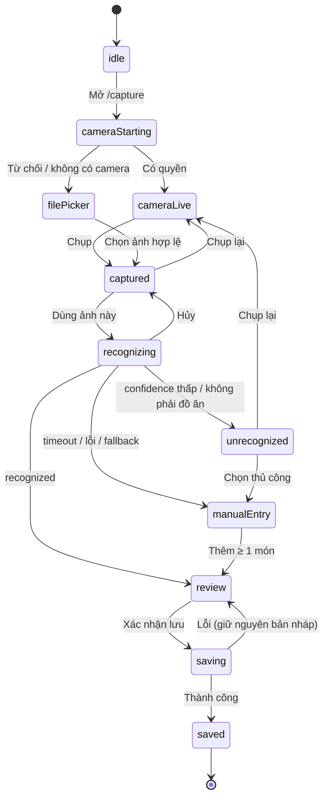

# NUTRISNAP — MỐC PoC TUẦN 3: LUỒNG CHỤP & XÁC NHẬN MÓN ĂN, DASHBOARD CƠ BẢN, FIGMA 100%
## Kế hoạch Triển khai Cặp 2 (Implementation Plan & Agent Brief)

| Thuộc tính | Giá trị |
|---|---|
| **Mã tài liệu** | `NS-FE-W3-001` · Phiên bản `1.0.0` · Trạng thái: **Ready for Implementation** |
| **Dự án / Môn học** | NutriSnap – Virtual AI Nutrition Assistant · CSC10014 – Tư duy tính toán (FIT – HCMUS) |
| **Mốc đánh giá** | **MỐC ĐÁNH GIÁ 1 – Báo cáo Demo Giao diện, Figma & PoC (Tuần 3)** |
| **Hạng mục Cặp 2** | (1) Hoàn tất 100% Figma Prototype & ghép nối giao diện Camera / xác nhận khẩu phần / Dashboard · (2) `MealCaptureFlow.tsx` · (3) `BasicDashboard.tsx` |
| **Đầu ra yêu cầu** | **Web Demo & Figma 100%** · **Luồng Chụp & Xác nhận món** · **Giao diện Dashboard cơ bản** |
| **Pair Session 3** | 3,0 giờ (theo đặc tả PDF) — MỐC PoC |
| **Design Owner** | Kiều Khôi Nguyên (25127107) |
| **Implementation Owner** | Lê Thành Đạt (25127293) |
| **Backend đã hoàn thành (theo bảng phân công)** | `nutrition_service.py`, `POST /meals/log`, `GET /meals/daily-dashboard`, dữ liệu mẫu 3 tài khoản demo (Việt Huy) · `POST /ai/recognize-food` + Fuzzy Matching + Fallback (Phú Hiếu) |
| **Tài liệu tiền đề** | `NS-FE-W2-001` (`docs/03_...`) · `NS-FE-W2-002` (`docs/04_...`) |
| **Nhánh làm việc** | `feat/w3-pair2-meal-capture-dashboard` (tách từ `main` mới nhất) |
| **Vị trí file** | `docs/08_poc_meal_capture_and_dashboard_plan.md` *(số 06, 07 dành cho `06_security_and_risk_pack.md`, `07_evaluation_report.md` theo đặc tả)* |

### Mục lục
0. [Hướng dẫn sử dụng với Antigravity IDE (Agent Brief)](#0-hướng-dẫn-sử-dụng-với-antigravity-ide-agent-brief)
1. [Tóm tắt điều hành & Bối cảnh](#1-tóm-tắt-điều-hành--bối-cảnh)
2. [Quyết định kiến trúc (ADR)](#2-quyết-định-kiến-trúc-adr--đọc-trước-khi-code)
3. [Phạm vi, Sản phẩm bàn giao & Phân vai (RACI)](#3-phạm-vi-sản-phẩm-bàn-giao--phân-vai-raci)
4. [Tiêu chí nghiệm thu PoC & độ mượt (PSC)](#4-tiêu-chí-nghiệm-thu-poc--độ-mượt-psc)
5. [Ràng buộc bắt buộc (Guardrails)](#5-ràng-buộc-bắt-buộc-guardrails)
6. [Lịch trình Pair Session 3 (180 phút)](#6-lịch-trình-pair-session-3-180-phút)
7. [Track A — Figma 100% & Bàn giao thiết kế](#7-track-a--figma-100--bàn-giao-thiết-kế)
8. [Track B — Kế hoạch triển khai (Step 0 → Step 11)](#8-track-b--kế-hoạch-triển-khai-step-0--step-11)
9. [Đặc tả chi tiết các màn hình](#9-đặc-tả-chi-tiết-các-màn-hình)
10. [Chiến lược kiểm thử](#10-chiến-lược-kiểm-thử)
11. [Runbook Demo PoC & Gói đầu vào cho Báo cáo/Slide](#11-runbook-demo-poc--gói-đầu-vào-cho-báo-cáoslide)
12. [Quality Gates & Definition of Done](#12-quality-gates--definition-of-done)
13. [Quy trình Git, Commit Plan & mẫu Pull Request](#13-quy-trình-git-commit-plan--mẫu-pull-request)
14. [Nhật ký sử dụng AI (bắt buộc)](#14-nhật-ký-sử-dụng-ai-bắt-buộc)
15. [Rủi ro, Phụ thuộc & Giao thức xử lý blocker](#15-rủi-ro-phụ-thuộc--giao-thức-xử-lý-blocker)
16. [Phụ lục kỹ thuật](#16-phụ-lục-kỹ-thuật)

---

## 0. Hướng dẫn sử dụng với Antigravity IDE (Agent Brief)

**Thứ tự đọc bắt buộc đối với Agent** (không bỏ qua file nào):

1. `.antigravityrules` (luôn ưu tiên cao nhất)
2. File này, rồi `docs/03_frontend_auth_goal_wizard_plan.md` và `docs/04_ui_api_integration_and_design_handoff_plan.md` (ADR, Guardrails, Contract Guard đã thiết lập)
3. `docs/01_security_architecture.md` · `docs/02_api_contract_and_screen_flows.md` §1, §2.3, §2.4, §3, §4.3, §4.4
4. **Mã Backend thực tế (chỉ ĐỌC):** `src/backend/main.py`, `src/backend/routers/**`, `src/backend/schemas/api_contract.py`, `src/backend/services/nutrition_service.py`, `src/ai/vision_recognition.py`, `scripts/seed_*` — và `http://localhost:8000/openapi.json` khi backend đang chạy
5. Toàn bộ `src/frontend/src/` và `src/frontend/package.json`

**Phân biệt hai luồng công việc — rất quan trọng**

| Luồng | Người thực hiện | Nội dung |
|---|---|---|
| **Track A – Figma 100% & bàn giao** | **Con người** (Khôi Nguyên chủ trì) | Hoàn tất prototype tương tác toàn bộ màn hình (kể cả Chat UI), nhãn "Ước tính", nghiệm thu độ khớp. **Agent không chỉnh sửa Figma.** |
| **Track B – Frontend Integration** | **Agent (Antigravity)** dưới giám sát của Thành Đạt | Khám phá hợp đồng API thật, xây `MealCaptureFlow`, `BasicDashboard`, kiểm thử, báo cáo, PR |

**Prompt khởi động gợi ý** (dán vào Antigravity):

```text
Bạn là Frontend Engineer của dự án NutriSnap. Hãy đọc .antigravityrules,
docs/03_..., docs/04_... và docs/08_poc_meal_capture_and_dashboard_plan.md.
Chỉ thực hiện TRACK B (mục 8), tuần tự Step 0 → Step 11.
Quy tắc:
- Backend của Cặp 1 và Cặp 3 ĐÃ hoàn thành: chạy với backend THẬT. Step 1 là KHÁM PHÁ HỢP ĐỒNG CHỈ-ĐỌC:
  đọc mã backend + openapi.json, lập "Contract Map" và "Assumption Register", rồi DỪNG và báo cáo
  trước khi sửa bất kỳ file nào. KHÔNG đoán tên endpoint/field.
- Không sửa src/backend, src/ai, data, scripts. Không thêm thư viện mới (mục ADR-W3-06).
- Frontend KHÔNG tự tính calo/macro (ADR-W3-02): mọi con số dinh dưỡng lấy từ backend.
- Mỗi Step = 1 commit theo Commit Plan (mục 13.2); chạy Quality Gate (npm run build, npm test) trước khi sang Step kế.
- Không đọc/tạo/ghi .env hoặc .env.local. Không commit ảnh người dùng, ảnh chụp màn hình, ảnh mẫu benchmark.
- Không điền số liệu đo (thời gian, Lighthouse, độ chính xác) nếu chưa đo thật; ghi "Pending".
- Gặp tình huống STOP & ASK (mục 8.13) thì DỪNG và báo cáo.
- Kết thúc: in báo cáo theo mẫu mục 8.12 và nhắc tôi cập nhật docs/ai_use_log.md.
```

> **Quy ước ngôn ngữ:** giao diện tiếng Việt; tên biến/hàm/file tiếng Anh; comment ngắn, giải thích *vì sao*. **Giữ nguyên line ending** của file đã tồn tại (nhiều file dùng CRLF); file mới dùng LF.

---

## 1. Tóm tắt điều hành & Bối cảnh

### 1.1. Mục tiêu Tuần 3 (phần Cặp 2)

| # | Nhiệm vụ | Sản phẩm đầu ra |
|---|---|---|
| T1 | Hoàn tất **100% Figma Prototype** (liên kết tương tác mượt, gồm cả Chat UI, nhãn "Giá trị ước tính") và ghép nối giao diện chụp ảnh, sửa khẩu phần, Dashboard | **Web Demo & Figma 100%** |
| T2 | `MealCaptureFlow.tsx`: mở camera → chụp → nhận diện → **sửa gam / đổi tên / xóa món sai** → **Xác nhận lưu** | **Luồng Chụp & Xác nhận món** |
| T3 | `BasicDashboard.tsx`: **vòng tròn calo**, **3 thanh tiến trình Macro**, **danh sách bữa ăn trong ngày** | **Giao diện Dashboard cơ bản** |

### 1.2. Luồng cốt lõi phải chạy được tại Mốc PoC (theo đặc tả PDF §3.3)

```
Đăng nhập → Chụp ảnh món ăn → AI nhận diện → Người dùng chỉnh sửa & xác nhận khẩu phần
        → Backend tính dinh dưỡng ước tính từ DB → Cập nhật Dashboard cơ bản
```

### 1.3. Trạng thái các hạng mục liên quan (theo bảng phân công, người dùng xác nhận hoàn thành)

| Hạng mục | Chủ sở hữu | Trạng thái | Cách Frontend xử lý |
|---|---|---|---|
| `services/nutrition_service.py` (công thức đại số từ `food_references`) | Việt Huy | ☑ Hoàn thành | Frontend **không** tự tính; chỉ hiển thị kết quả backend |
| `POST /api/v1/meals/log`, `GET /api/v1/meals/daily-dashboard`, dữ liệu mẫu 3 tài khoản | Việt Huy | ☑ Hoàn thành | Bind theo hợp đồng thật (Step 1) |
| `POST /api/v1/ai/recognize-food` + Fuzzy Matching + Fallback | Phú Hiếu | ☑ Hoàn thành | Xử lý đủ: `nhận diện được`, `unrecognized`, `timeout/lỗi`, `chưa khớp CSDL` |
| Figma 100% | Khôi Nguyên | ☐ **Hạng mục Track A** | Nghiệm thu độ khớp ở Step 10 |
| Auth thật, `get_current_user` JWT | Minh Đức | *(đã kiểm ở Pair Session 2; Step 1 xác minh lại)* | Cookie HttpOnly như `NS-FE-W2-001` |

> "Hoàn thành" ở đây là theo bảng phân công. **Step 1 xác minh bằng cách chạy thật**, không tin tuyệt đối vào trạng thái trong bảng.

### 1.4. Hai điểm lệch tài liệu cần xử lý ngay (đã phát hiện khi đối chiếu)

| # | `docs/02` (hợp đồng Cặp 2 đã soạn Tuần 1) | Đặc tả Tuần 3 (backend triển khai) | Xử lý |
|---|---|---|---|
| X1 | Nhận diện ảnh: `POST /api/v1/meals/preview` | `POST /api/v1/ai/recognize-food` | Gom về **một** bản đồ endpoint (`api/endpoints.ts`); đối chiếu `openapi.json` ở Step 1; cập nhật `docs/02` cho khớp thực tế |
| X2 | Dashboard: `GET /api/v1/dashboard/daily` (mã `DashboardPage.tsx` hiện đang gọi) | `GET /api/v1/meals/daily-dashboard` | Như trên |

### 1.5. Hiện trạng mã Frontend cần xử lý (từ lần rà soát trước; **Step 1 kiểm lại**)
- `DashboardPage.tsx` dùng **số liệu giả làm dự phòng** (`target_calories || 1800`, `consumed || 1250`, `remaining || 550`, macro mặc định…) → khi API lỗi vẫn hiện số "đẹp" như thật. **Vi phạm tính trung thực của dữ liệu sức khỏe** → phải loại bỏ hoàn toàn.
- Chưa có Camera/MealCapture. Chat Drawer có thẻ xác nhận gọi `/meals/log` (giữ nguyên; xem mục 3.2).

---

## 2. Quyết định kiến trúc (ADR) — đọc trước khi code

| ADR | Quyết định | Lý do |
|---|---|---|
| **ADR-W3-01** | **Contract-first với backend thật.** Step 1 lập *Contract Map* (endpoint → request → response → khác biệt so với `docs/02`) và *Assumption Register* (mục 8, Step 1). Mọi giả định trong tài liệu này phải được xác minh trước khi code. | Tránh đoán sai tên field/endpoint; tận dụng Contract Guard đã có |
| **ADR-W3-02** | **Frontend không tự tính dinh dưỡng** (tiếp nối ADR-002 của `NS-FE-W2-001`). Khi người dùng đổi gam/đổi món, số calo/macro được **backend tính lại** qua bản xem trước (preview). | Phân tầng (PDF §4.2) + công thức DB là nguồn sự thật duy nhất (Zero-Hallucination Math) |
| **ADR-W3-03** | **Hai bước xác nhận (Two-Step Confirmation).** Bước 1: `is_confirmed=false` → backend trả bản xem trước đã tính. Bước 2: người dùng bấm **Xác nhận lưu** → `is_confirmed=true`. Nếu backend **không** hỗ trợ preview qua `is_confirmed=false` → **STOP & ASK** (không tự tính ở Frontend). | `.antigravityrules` §4; PDF §1.1 |
| **ADR-W3-04** | **Máy trạng thái tường minh cho `MealCaptureFlow`** (`useReducer` + union type phân biệt) — không dùng cờ boolean rời rạc. Logic thuần (reducer) tách khỏi UI để kiểm thử xác định. | Giảm lỗi trạng thái chéo; dễ bảo trì |
| **ADR-W3-05** | **Quyền riêng tư ảnh (NĐ 13/2023).** Ảnh chỉ tồn tại trong bộ nhớ: không `localStorage`/`sessionStorage`/`IndexedDB`; thu nhỏ & mã hóa lại bằng canvas (xóa EXIF/GPS); thu hồi `ObjectURL`; dừng mọi `MediaStreamTrack` khi rời màn hình. | Ảnh bữa ăn + metadata là dữ liệu cá nhân |
| **ADR-W3-06** | **Không thêm thư viện mới.** Vòng calo = SVG tự viết; server-state = hook nhỏ + sự kiện `meal-logged`; không dùng Recharts cho Dashboard cơ bản (dành cho Tuần 5), không React Query/Playwright/axe. | Giảm rủi ro, bundle gọn; mọi thứ cần thiết đều có sẵn trong trình duyệt |
| **ADR-W3-07** | **Mọi thứ lỗi phải nói thật.** Không số liệu giả, không "thành công giả". Lỗi → thông điệp rõ + đường thoát (thử lại / nhập tay). | Responsible UX; trung thực với giám khảo |
| **ADR-W3-08** | **Ngày theo giờ địa phương (UTC+7).** Dùng `toLocalISODate()`; **không** dùng `toISOString().slice(0,10)` (sai ngày khoảng 00:00–07:00 giờ Việt Nam). Test cố định `TZ=Asia/Ho_Chi_Minh`. | Lỗi lệch ngày làm Dashboard "mất dữ liệu" đúng lúc demo |
| **ADR-W3-09** | **Tuân thủ `.antigravityrules` §1:** không tạo thư mục theo tuần/cá nhân; test Frontend giữ ở `src/frontend/src/__tests__/` (ADR-003 của `NS-FE-W2-001`). | Nhất quán |

---

## 3. Phạm vi, Sản phẩm bàn giao & Phân vai (RACI)

### 3.1. Trong phạm vi
- **P0 (bắt buộc cho Mốc PoC):** `MealCaptureFlow` (camera + tải ảnh dự phòng, nhận diện, sửa gam / đổi món / xóa món / thêm món, xác nhận lưu, đường dự phòng khi AI lỗi) · `BasicDashboard` (vòng calo, 3 thanh macro, danh sách bữa ăn, trạng thái rỗng/lỗi/tải) · Contract Guard cho endpoint mới · kiểm thử · báo cáo · PR.
- **P1 (nên có):** chọn ngày xem lịch sử (dữ liệu mẫu 7 ngày) · hoàn tác khi xóa món (5 giây) · huy hiệu "Cần kiểm tra" cho món độ tin cậy thấp · `performance.mark` phục vụ đo đạc của QA.
- **P2 (nếu còn thời gian):** xóa cả bữa ăn (`DELETE /meals/{id}`) · hiệu ứng đếm số.

### 3.2. Ngoài phạm vi
`src/backend/**`, `src/ai/**`, `data/`, `scripts/` · Chat Drawer (giữ nguyên; kết nối làm mới Dashboard khi xác nhận thẻ chat thuộc **Tuần 4** — Tuần này chỉ chuẩn bị sẵn sự kiện `meal-logged`) · Food Swap, Voice Modifier, EMA, Habit, Report, Offline (Tuần 5–6) · Docker (Tuần 7).

### 3.3. Phạm vi file được phép chỉnh sửa
```text
src/frontend/**                                    (trừ node_modules/, dist/)
docs/02_api_contract_and_screen_flows.md           (CHỈ cập nhật endpoint/field cho khớp thực tế — X1, X2)
docs/09_poc_e2e_report.md                          (NEW — báo cáo tích hợp & đo đạc)
docs/ai_use_log.md                                 (chỉ thêm 1 dòng)
docs/08_poc_meal_capture_and_dashboard_plan.md     (chỉ cập nhật trạng thái)
```
Cấm: sửa `src/backend/**`, `src/ai/**`, `data/**`, `scripts/**`, `.antigravityrules`, `.gitignore`, `requirements.txt`; thư mục theo tuần/cá nhân; commit ảnh (người dùng, màn hình, benchmark).

### 3.4. Sản phẩm bàn giao

| Mã | Sản phẩm | Chủ trì | Tiêu chí nghiệm thu rút gọn |
|---|---|---|---|
| **D1** | **Figma Prototype 100%** | Khôi Nguyên | Đạt checklist mục 7.2; link *view-only* trong báo cáo |
| **D2** | **Contract Map + Assumption Register** | Thành Đạt (Agent) | Mọi giả định có kết quả xác minh; `docs/02` khớp thực tế |
| **D3** | **`MealCaptureFlow.tsx`** (luồng Chụp & Xác nhận) | Thành Đạt (Agent) | Mục 9.1; PSC-1…PSC-9 |
| **D4** | **`BasicDashboard.tsx`** | Thành Đạt (Agent) | Mục 9.2; PSC-10…PSC-14; **0** số liệu giả |
| **D5** | **Bộ kiểm thử** | Thành Đạt (Agent) | ≥ 60 test mới, 0 fail; `npm run build` 0 lỗi |
| **D6** | **Báo cáo E2E & đo đạc** `docs/09_poc_e2e_report.md` | Cặp 2 (+ Tuấn dùng số liệu) | Số thật hoặc `Pending` |
| **D7** | **Gói đầu vào Báo cáo PoC & Slide** (cho Đức & Huy) | Thành Đạt | Mục 11.3 |
| **D8** | **Nghiệm thu độ khớp thiết kế** | Khôi Nguyên | 0 lệch *Major* |
| **D9** | **PR + AI-use log** | Thành Đạt | Có Approve của Khôi Nguyên |

### 3.5. Ma trận RACI

| Hoạt động | Khôi Nguyên | Thành Đạt | Agent | Việt Huy | Phú Hiếu | Quốc Tuấn | Minh Đức |
|---|---|---|---|---|---|---|---|
| Figma 100% + nhãn "Ước tính" | **A/R** | C | — | — | — | — | — |
| Contract Map (Step 1) | I | **A** | **R** | C | C | — | — |
| `MealCaptureFlow`, `BasicDashboard` (Step 2–8) | C | **A** | **R** | — | — | — | — |
| Kiểm thử tự động (Step 9) | I | **A** | **R** | — | — | C | — |
| E2E PoC & đo đạc (Step 10) | C | **R** | S | S | S | **A/R** | — |
| Fidelity Review (D8) | **A/R** | C | — | — | — | — | — |
| Sửa lỗi hợp đồng backend | I | I | — | **A/R** (meals, dashboard) | **A/R** (recognize) | I | — |
| Báo cáo PoC + Slide | C | R (cung cấp D7) | — | **R** | — | C | **A/R** |
| Review PR | **R** | **A** | — | — | — | — | — |

*(R = Responsible, A = Accountable, C = Consulted, I = Informed, S = Support)*

---

## 4. Tiêu chí nghiệm thu PoC & độ mượt (PSC)

> **Ngưỡng là mục tiêu; kết quả chỉ ghi khi đã đo thật** (tinh thần `docs/qa_evaluation_plan.md`: tách *Target* và *Measured*).

### 4.1. Luồng Chụp & Xác nhận

| Mã | Tiêu chí | Cách kiểm |
|---|---|---|
| **PSC-1** | Bấm "Chụp" → thấy phản hồi (đóng băng khung hình + trạng thái) trong **< 100 ms** | Performance panel |
| **PSC-2** | Mở camera: xin quyền → hiển thị luồng video **< 1,5 s** sau khi cấp quyền (máy thường) | Đo thủ công × 3 |
| **PSC-3** | Mất quyền camera / không có camera → **tự chuyển** sang tải ảnh, không bao giờ "kẹt" | Thủ công |
| **PSC-4** | Nhận diện đang chạy: luôn có chỉ báo tiến trình + nút **Hủy**; sau **5 s** hiện gợi ý "mất nhiều thời gian hơn bình thường" | Throttle / Network |
| **PSC-5** | AI lỗi / quá 5 s / `unrecognized` → luôn có đường **nhập tay** (tìm món từ CSDL) và **chụp lại** | Tắt Wi-Fi / ảnh không phải đồ ăn |
| **PSC-6** | Đổi gam → số liệu cập nhật sau **debounce ≤ 400 ms** + chỉ báo "đang tính…", **không nhảy bố cục** | Quan sát + CLS |
| **PSC-7** | Xóa món → hoàn tác trong 5 s; lưu bị khóa khi 0 món hoặc còn món chưa khớp CSDL | Thủ công + test |
| **PSC-8** | Lưu lỗi → **giữ nguyên bản nháp**, cho thử lại; không lưu trùng khi bấm đúp | Test + thủ công |
| **PSC-9** | Rời màn hình/Hủy → **mọi track camera dừng** (đèn camera tắt), `ObjectURL` được thu hồi | Thủ công + test |

### 4.2. Dashboard & tổng thể

| Mã | Tiêu chí | Cách kiểm |
|---|---|---|
| **PSC-10** | Sau khi lưu: Dashboard cập nhật **không tải lại trang**, vòng calo chuyển động ≤ 600 ms | Thủ công |
| **PSC-11** | Tải Dashboard: skeleton đúng kích thước, **CLS < 0,1** | Lighthouse |
| **PSC-12** | Trạng thái **rỗng / lỗi / chưa có mục tiêu / vượt hạn mức** đều có thiết kế và thông điệp trung tính | Thủ công |
| **PSC-13** | **0 số liệu giả**: tắt backend → Dashboard hiện lỗi + Thử lại, không hiện con số nào | Thủ công + test |
| **PSC-14** | Ngày: ca tải lúc 00:30 (UTC+7) vẫn lấy đúng ngày hôm nay | Test với `TZ` cố định |
| **PSC-15** | Lighthouse (mobile, `build + preview`) `/` và `/capture`: Perf **≥ 90**, A11y **≥ 95**, BP **≥ 95** | DevTools (người thực hiện) |
| **PSC-16** | Console sạch lỗi/cảnh báo trong luồng chuẩn; không request trùng ngoài `StrictMode` | Console / Network |

---

## 5. Ràng buộc bắt buộc (Guardrails)

### 5.1. MUST
- **M1.** Mọi request qua duy nhất `apiClient` (`withCredentials: true`); không `fetch`/`axios` trực tiếp trong component.
- **M2.** Mọi response mới đi qua **Contract Guard** (Tolerant Reader — trường UI bắt buộc không được optional).
- **M3.** Mọi con số dinh dưỡng đến từ backend; gắn nhãn **"Giá trị ước tính (Estimated)"** (component `EstimatedBadge`) và `DisclaimerBadge`.
- **M4.** Mọi màn hình hiển thị kết quả nhận diện/định lượng có dòng nguyên văn: *"Kết quả nhận diện món ăn và định lượng calo là giá trị ước tính dựa trên hình ảnh và cơ sở dữ liệu tham chiếu."* và nhắc *"AI có thể nhận diện sai — hãy kiểm tra lại tên món và khối lượng."*
- **M5.** Mỗi `meal_item` gửi lên phải có **`food_id` hợp lệ** (khóa ngoại `food_references`); món chưa khớp buộc người dùng chọn lại.
- **M6.** Payload ghi bữa ăn **không** chứa `user_id`, **không** `Authorization` (Zero-Trust).
- **M7.** Trạng thái UI đầy đủ: mặc định · tải · rỗng · lỗi · thành công · mất kết nối · không quyền camera · `unrecognized`.
- **M8.** TypeScript `strict`; không `any`, `@ts-ignore`; `catch (e: unknown)`; union type phân biệt cho trạng thái.
- **M9.** Truy cập (WCAG 2.2 AA): nhãn cho mọi input, `role`/`aria-*` đúng cho vòng calo & thanh tiến trình, điều khiển được bằng bàn phím, kích thước chạm ≥ 40 px, tôn trọng `prefers-reduced-motion`.
- **M10.** Màu theo `docs/02` §1.1: Calo cam `#EA580C`, Đạm xanh dương `#2563EB`, Tinh bột vàng `#D97706`, Béo tím `#7C3AED`; thương hiệu `#107C41`; dùng token Tailwind.

### 5.2. MUST NOT
- **N1.** Tự tính calo/macro/BMI ở Frontend (kể cả nhân gam × calo/100g).
- **N2.** Số liệu giả/mặc định cho dữ liệu sức khỏe (`|| 1800`, v.v.); hiển thị "thành công" khi chưa lưu.
- **N3.** `localStorage`/`sessionStorage`/`IndexedDB`/`document.cookie`; lưu ảnh/blob vào storage; gửi ảnh gốc chưa xử lý.
- **N4.** `console.log` ảnh, payload bữa ăn, dữ liệu sức khỏe.
- **N5.** Sửa `src/backend/**`/`src/ai/**`; "vá" lỗi backend ở Frontend (chỉ báo cáo).
- **N6.** Ngôn từ phán xét/hù dọa; màu đỏ báo động khi vượt hạn mức; gợi ý nhịn ăn/bù trừ calo (PDF §1.3, §4.7).
- **N7.** `dangerouslySetInnerHTML`; tin tưởng tên món do AI trả về khi render (luôn render dạng text).
- **N8.** Làm yếu/xóa test để build xanh; điền số đo chưa thực hiện; commit ảnh/`.env`/`node_modules`/`dist`; push thẳng `main`.

---

## 6. Lịch trình Pair Session 3 (180 phút)

| Thời gian | Nội dung | Khôi Nguyên | Thành Đạt (+ Agent) | Đầu ra |
|---|---|---|---|---|
| **0:00–0:15** | Khởi động, chốt phạm vi PoC | Xác nhận danh sách frame | Step 0; đọc kết quả khám phá hợp đồng | Biên bản ngắn |
| **0:15–0:40** | **Khám phá hợp đồng thật** | — | Step 1 (Agent chạy, Thành Đạt đối chiếu với Huy/Hiếu qua `openapi.json`) | D2 bản nháp |
| **0:40–1:05** | **Bàn giao Figma 100%** | Trình bày prototype: luồng Chụp, Dashboard, Chat, nhãn Estimated | Đối chiếu token, khoảng trống thiết kế | D1 bản nháp + Design Delta |
| **1:05–2:15** | **Xây dựng** | Review từng commit trên giao diện | Step 2 → Step 8 | D3, D4 |
| **2:15–2:45** | **Kiểm thử & E2E** | Fidelity Review ở 360/768/1280 px | Step 9–10; chạy kịch bản E2E cùng Tuấn | D5, D6, D8 nháp |
| **2:45–3:00** | **Chốt Mốc PoC** | Ký nghiệm thu thiết kế | Step 11: PR, AI-log, gói đầu vào cho Đức & Huy | D7, D9 |

> Hết giờ chưa xong → ưu tiên: **D3 (luồng lõi) → D4 → D2 → D8 → D5 → D6 → P1**. Phần còn lại ghi vào "Việc chuyển tiếp".

---

## 7. Track A — Figma 100% & Bàn giao thiết kế

> **Đối tượng: con người (Khôi Nguyên).** Agent chỉ đọc kết quả (nếu có bản xuất) để lập bảng token/Design Delta.

### 7.1. Danh mục frame bắt buộc

| Màn hình | Trạng thái/biến thể (Desktop 1280 + Mobile 360) |
|---|---|
| **Chụp ảnh món ăn** | Xin quyền camera · Luồng camera trực tiếp · Không có/mất quyền camera → tải ảnh · Đã chụp (Chụp lại / Dùng ảnh này) · Đang nhận diện (tiến trình + Hủy + gợi ý >5 s) |
| **Kết quả nhận diện & Xác nhận khẩu phần** | Danh sách món (sửa gam, đổi tên/chọn món, xóa, hoàn tác) · Món độ tin cậy thấp "Cần kiểm tra" · Món chưa khớp CSDL · Đang tính lại · Thêm món thủ công (ô tìm kiếm) · Tổng calo + macro **kèm nhãn Estimated** · Đang lưu · Lỗi lưu |
| **Đường dự phòng** | `unrecognized` ("Không nhận ra món ăn": Chụp lại / Chọn thủ công) · AI timeout/lỗi mạng (thông báo + khung tìm món từ CSDL) |
| **Dashboard cơ bản** | Skeleton · Có dữ liệu (vòng calo, 3 thanh macro, danh sách bữa) · Rỗng (CTA chụp bữa đầu tiên) · Chưa có mục tiêu · Vượt hạn mức (trung tính, không đỏ) · Lỗi + Thử lại · Chọn ngày |
| **Chat UI (Virtual AI Assistant)** | Khung trượt · Gợi ý nhanh · Thẻ Xác nhận thao tác (`[Xác nhận lưu]`/`[Chỉnh sửa]`) · Đang suy nghĩ · Lỗi |
| **Dùng chung** | Huy hiệu **"Giá trị ước tính (Estimated)"** cạnh mọi số calo · Toast/hoàn tác · Màn hình mất kết nối |

### 7.2. Checklist "Figma Prototype 100%" (D1) — đủ mới ký

| # | Hạng mục | ☐ |
|---|---|---|
| 1 | **Mọi màn hình** của sản phẩm (Đăng nhập, Đăng ký, Goal Wizard, Camera/Xác nhận, Dashboard, Chat) có frame cho từng trạng thái ở bảng 7.1 | ☐ |
| 2 | **Liên kết tương tác (Prototype flows)** nối đủ: Đăng nhập → Wizard → Dashboard → Chụp → Xác nhận → Dashboard; Dashboard ↔ Chat; điểm bắt đầu (*Flow starting point*) đặt đúng | ☐ |
| 3 | **Smart Animate** cho chuyển cảnh chính; thời lượng 150–300 ms, easing nhất quán; có biến thể giảm chuyển động | ☐ |
| 4 | **Huy hiệu "Giá trị ước tính (Estimated)"** cạnh mọi con số calo trên mọi màn hình | ☐ |
| 5 | Đủ **thiết bị mẫu** (Desktop 1280, Mobile 360) và Auto Layout/Constraints cho co giãn | ☐ |
| 6 | **Thư viện component + token** (màu, chữ, khoảng cách, bo góc, bóng) đã chuẩn hóa — khớp bảng 7.3 | ☐ |
| 7 | **Copy deck** tiếng Việt đầy đủ (nhãn, lỗi, trợ giúp, disclaimer nguyên văn) | ☐ |
| 8 | **Ghi chú truy cập** (thứ tự Tab, tương phản AA, kích thước chạm ≥ 40 px) | ☐ |
| 9 | Liên kết chia sẻ **View-only** đã kiểm tra mở được bằng tài khoản ngoài nhóm | ☐ |
| 10 | Bộ ảnh xuất (PNG) các màn hình chính cho Báo cáo/Slide | ☐ |

### 7.3. Bảng ánh xạ Design Token (Khôi Nguyên điền cột Figma; Agent lập ở Step 2)

| Token | Giá trị trong mã | Giá trị Figma | Khớp? |
|---|---|---|---|
| Primary / hover | `#107C41` / `#0B522B` | ☐ | ☐ |
| Background / Card | `#F8FAFC` / `#FFFFFF` + `shadow-sm` | ☐ | ☐ |
| Calo / Đạm / Tinh bột / Béo | `#EA580C` / `#2563EB` / `#D97706` / `#7C3AED` | ☐ | ☐ |
| Trạng thái: thông tin / thành công / cảnh báo / lỗi | `sky` / `emerald` / `amber` / `red` | ☐ | ☐ |
| Font & bo góc & khoảng cách | Inter · `rounded-2xl/xl` · bội số 4 px | ☐ | ☐ |

### 7.4. Fidelity Review (D8)
Khôi Nguyên so sánh UI thật với Figma ở **360 / 768 / 1280 px**, từng màn hình × trạng thái. Mức: **Major** (sai bố cục/thành phần/màu thương hiệu/copy, thiếu trạng thái hoặc **thiếu nhãn "Ước tính"**) → bắt buộc sửa · **Minor** (lệch ≤ 4 px, sắc độ nhỏ) → ghi nhận · **Info** (khác biệt nền tảng). Mẫu bảng ở 16.6; ảnh so sánh đính kèm **PR**, không commit vào repo.

---

## 8. Track B — Kế hoạch triển khai (Step 0 → Step 11)

> Mỗi Step = 1 commit. Ước lượng tổng: **~17 giờ làm việc** (Step 0–8 là phần cốt lõi của Pair Session 3).

| Step | Nội dung | Ước lượng | Phụ thuộc |
|---|---|---|---|
| 0 | Chuẩn bị nhánh, chạy backend thật, baseline | 0,5 giờ | — |
| 1 | **Khám phá hợp đồng** (Contract Map, Assumption Register) + kiểm toán Frontend | 1,5 giờ | 0 |
| 2 | Nền tảng: endpoints, types, Contract Guard, tiện ích (ngày, ảnh, định dạng), token | 1,5 giờ | 1 |
| 3 | Lớp API & hook dữ liệu | 1,5 giờ | 2 |
| 4 | Lớp camera & xử lý ảnh | 2 giờ | 2 |
| 5 | Bản nháp bữa ăn & giao diện xác nhận | 3 giờ | 3 |
| 6 | `MealCaptureFlow.tsx` (máy trạng thái, đường dự phòng) | 2 giờ | 4, 5 |
| 7 | `BasicDashboard.tsx` | 2,5 giờ | 3 |
| 8 | Tích hợp, điều hướng, hiệu năng, truy cập | 1,5 giờ | 6, 7 |
| 9 | Kiểm thử tự động | 3 giờ | 8 |
| 10 | E2E PoC, đo đạc, báo cáo | 1,5 giờ | 9 |
| 11 | Tài liệu, gói đầu vào PoC, AI-log, PR | 0,5 giờ | 10 |

### Step 0 — Chuẩn bị & baseline
1. `git checkout main && git pull origin main && git checkout -b feat/w3-pair2-meal-capture-dashboard`
2. Backend (từ **thư mục gốc**): `python -m uvicorn src.backend.main:app --reload --port 8000`; mở `http://localhost:8000/docs`; `curl http://localhost:8000/api/v1/health`.
3. **Không** đọc `.env`. Nếu backend báo thiếu khóa (ví dụ `GEMINI_API_KEY`) → báo người dùng; không tự tạo.
4. `cd src/frontend && npm install && npm run build && npm test` — **ghi baseline đúng thực tế** (số test, kích thước chunk) vào `docs/09_poc_e2e_report.md` §2 (tạo khung theo 16.5).
5. Dùng **`localhost` nhất quán** cho web và API (không `127.0.0.1`).

**Nghiệm thu:** nhánh đúng tên; backend chạy; baseline được ghi.

### Step 1 — Khám phá hợp đồng thật & kiểm toán *(CHỈ ĐỌC — dừng và báo cáo sau bước này)*

**1.1. Khám phá backend**
```bash
curl -s http://localhost:8000/openapi.json -o /tmp/openapi.json     # PowerShell: Invoke-WebRequest ... -OutFile
grep -rnE "recognize-food|daily-dashboard|meals/log|foods/search|dashboard" src/backend src/ai
ls src/backend/routers src/backend/services scripts
```
Đọc: router meals/ai/dashboard/foods, `schemas/api_contract.py`, `services/nutrition_service.py`, `src/ai/vision_recognition.py`, script seed dữ liệu demo.

**1.2. Contract Map** (điền vào báo cáo §3) — mỗi endpoint một dòng:

| Endpoint | Method | Auth | Request (field, kiểu, ràng buộc) | Response (field) | Lỗi có thể | Khác `docs/02`? |
|---|---|---|---|---|---|---|
| nhận diện ảnh | POST | cookie | *(multipart? tên field ảnh? kích thước tối đa?)* | *(status, items[], confidence…)* | *(5 s fallback…)* | |
| xem trước / ghi bữa ăn | POST | cookie | *(meal_type, items[], is_confirmed)* | *(preview? tổng calo/macro?)* | | |
| dashboard ngày | GET | cookie | *(tham số ngày?)* | *(target/consumed/remaining, macros, meals_summary)* | | |
| tìm món | GET | cookie | *(q, limit)* | *(id, food_name, calories_per_100g…)* | | |
| *(tùy chọn)* xóa bữa | DELETE | cookie | | | | |

**1.3. Assumption Register** — mọi giả định phải được xác minh (✔/✖/⚠) **trước** Step 2:

| # | Giả định của kế hoạch | Cách xác minh | Kết quả |
|---|---|---|---|
| AS-1 | Nhận diện nhận ảnh dạng **multipart** (tên field ảnh cần xác định) | `openapi.json` + thử gọi | |
| AS-2 | Phản hồi nhận diện có: trạng thái (`recognized`/`unrecognized`), danh sách món (tên, gam ước tính, độ tin cậy), và **`food_id` đã khớp CSDL hoặc null** | Gọi bằng ảnh thật | |
| AS-3 | Timeout phía server ≈ 5 s rồi trả fallback có **cờ/mã** để UI phân biệt | Đọc `recognize` + thử tắt mạng | |
| AS-4 | `POST /meals/log` với `is_confirmed=false` trả **bản xem trước đã tính** (tổng calo/macro + từng món); `true` mới ghi CSDL | Thử gọi | |
| AS-5 | Dashboard trả `target/consumed/remaining`, `macros{protein,carbs,fat}` (consumed/target/progress_percent) và `meals_summary` | Thử gọi bằng tài khoản demo | |
| AS-6 | Tham số chọn ngày của dashboard (tên, định dạng `YYYY-MM-DD`) | Đọc router | |
| AS-7 | Ràng buộc gam mỗi món (min/max) và số món tối đa mỗi bữa | Đọc `api_contract.py` / thử biên | |
| AS-8 | Cách phục vụ ảnh bữa ăn (`image_path` có URL truy cập được không) | Thử mở | |
| AS-9 | Hành vi khi **chưa có mục tiêu** (mã lỗi hoặc dữ liệu rỗng) | Tài khoản mới | |
| AS-10 | Thông tin tài khoản demo (tên đăng nhập) lấy từ script seed — **không hard-code trong mã** | Đọc script seed | |
| AS-11 | `/foods/search` hỗ trợ tìm theo tên có dấu/không dấu | Thử gọi | |
| AS-12 | Mã lỗi/`detail` khi `food_id` sai hoặc gam vượt ràng buộc | Thử gọi | |

**1.4. Kiểm toán Frontend** (so với `NS-FE-W2-001/002`): cơ chế phiên (cookie, không localStorage), `apiClient`/Contract Guard/`AuthContext`/route guard/lazy route có sẵn không; nơi nào đang dùng số liệu giả (`grep -rnE "\|\| *[0-9]{3,}" src/frontend/src`); tổng quan thư mục `components/`, `pages/`, `hooks/`, `utils/`, `__tests__/`.

**1.5. Quyết định sau khám phá**

| Kết quả | Hành động |
|---|---|
| AS-4 ✖ (không có preview) | **STOP & ASK** — không tự tính ở Frontend. Đề xuất: Việt Huy bổ sung preview, hoặc hiển thị "sẽ tính khi xác nhận" |
| AS-2 ✖ (không có `food_id`/thiếu độ tin cậy) | Báo Phú Hiếu; UI coi mọi món là "chưa khớp" → người dùng chọn qua tìm kiếm |
| AS-3 ✖ (không phân biệt được fallback) | Phân loại theo thời gian chờ + mã HTTP; ghi vào Open Dependencies |
| Endpoint khác `docs/02` | Cập nhật `api/endpoints.ts` + sửa `docs/02` cho khớp (X1, X2) |
| Hợp đồng khác kế hoạch theo cách **không** dung hòa được bằng Tolerant Reader | **STOP & ASK** |

> **Dừng lại, báo cáo Contract Map + Assumption Register + kết quả kiểm toán cho người dùng** trước khi sang Step 2.

### Step 2 — Nền tảng (endpoints, types, Contract Guard, tiện ích, token)
**File:** `api/endpoints.ts`, `types/api.ts` (bổ sung), `api/contracts.ts` (bổ sung schema), `utils/date.ts`, `utils/image.ts`, `utils/format.ts`, `constants/copy.ts`, `components/common/EstimatedBadge.tsx`, `tailwind.config.js` (token macro nếu thiếu).

1. **`api/endpoints.ts`:** hằng số duy nhất cho đường dẫn (theo Contract Map), ví dụ `RECOGNIZE_FOOD`, `MEAL_LOG`, `DAILY_DASHBOARD`, `FOOD_SEARCH`. Cấm rải chuỗi đường dẫn trong component/hook.
2. **Contract Guard:** thêm schema Zod cho *recognize*, *meal preview/log*, *daily dashboard*, *food search* theo **Contract Map thật** (khung ở 16.2). Trường UI bắt buộc (tổng/macro/`food_id`/gam) không optional; trường không đảm bảo → optional/default.
3. **`utils/date.ts`:** `toLocalISODate(d = new Date())` theo giờ địa phương; `formatVNDate`. (ADR-W3-08.)
4. **`utils/image.ts`:** hàm thuần, có thể tiêm phụ thuộc để test (xem 16.3): `validateImageFile(file)` (loại `image/jpeg|png|webp`, ≤ 10 MB gốc), `prepareImageForUpload(source, opts)` — giải mã đúng hướng (`createImageBitmap` với `imageOrientation: 'from-image'`), thu nhỏ cạnh dài ≤ **1280 px**, xuất JPEG chất lượng **0,8** (xóa EXIF/GPS), trả `Blob` + kích thước; mục tiêu ≤ ~1 MB.
5. **`utils/format.ts`:** `formatKcal`, `formatGram` (vi-VN, tối đa 1 chữ số thập phân).
6. **`constants/copy.ts`:** disclaimer nguyên văn (M4), nhãn bữa (Sáng/Trưa/Tối/Phụ), thông điệp lỗi chuẩn.
7. **`EstimatedBadge`:** nhãn nhỏ "Giá trị ước tính (Estimated)" dùng chung (tooltip không bắt buộc; có `aria-label`).
8. Lập **bảng ánh xạ token** (7.3) trong báo cáo §4; chỉ chỉnh `tailwind.config.js` ở dòng lệch **đã được Khôi Nguyên xác nhận**.

**Nghiệm thu:** `npm run build` ✔; test `date` (≥ 6 ca gồm `2026-10-23T18:30:00Z` → 24/10 giờ VN), `image` với phụ thuộc giả (≥ 6 ca), schema (≥ 8 ca, dùng JSON mẫu thật từ Step 1).

### Step 3 — Lớp API & hook dữ liệu
**File:** `api/aiApi.ts`, `api/mealApi.ts`, `api/foodApi.ts`, `api/dashboardApi.ts`, `hooks/useRecognizeFood.ts`, `hooks/useFoodSearch.ts`, `hooks/useMealPreview.ts`, `hooks/useDailyDashboard.ts`, `utils/mealEvents.ts`.

- **`aiApi.recognizeFood(blob, signal)`:** multipart `FormData` (không đặt thủ công `Content-Type` — để trình duyệt thêm boundary), `timeout` riêng **15 s** (lớn hơn ngưỡng 5 s của backend), hỗ trợ `AbortSignal`. **Không retry** (POST nặng).
- **`mealApi.previewMeal(draft, signal)` / `mealApi.logMeal(draft)`:** cùng endpoint, khác `is_confirmed`; payload **chỉ** gồm `meal_type` + `items[{food_id, estimated_gram}]` (+ trường khác theo Contract Map); không `user_id`.
- **`foodApi.search(q, signal)`**; **`dashboardApi.getDaily(date, signal)`** (GET idempotent: tận dụng retry 1 lần của interceptor).
- **Hooks:**
  - `useRecognizeFood`: `run(blob)`, `cancel()`, trạng thái `idle|pending|slow(>5s)|success|unrecognized|failed`; huỷ khi unmount; **gợi ý chậm sau 5 s** bằng timer có dọn dẹp.
  - `useMealPreview(items)`: **debounce 400 ms**, hủy request cũ khi có thay đổi mới, chỉ gửi khi mọi món có `food_id` và gam hợp lệ; trả `{ preview, status: idle|calculating|ready|error }`.
  - `useFoodSearch(q)`: debounce 300 ms, tối thiểu 2 ký tự, hủy request cũ, giới hạn kết quả (≈ 8).
  - `useDailyDashboard(date)`: tải, hủy khi đổi ngày/unmount, `refetch()`, tự `refetch` khi nhận sự kiện `meal-logged`; trạng thái `loading|ready|empty|noGoal|error` (suy ra theo Contract Map).
- **`utils/mealEvents.ts`:** `emitMealLogged()` / `onMealLogged(cb)` bằng `window` `CustomEvent('nutrisnap:meal-logged')` (Chat Drawer Tuần 4 sẽ phát cùng sự kiện này).

**Nghiệm thu:** test hook (≥ 10 ca): debounce & hủy, slow sau 5 s, hủy khi unmount, preview chỉ gửi khi hợp lệ, refetch khi có sự kiện, không retry POST.

### Step 4 — Lớp camera & xử lý ảnh
**File:** `hooks/useCamera.ts`, `components/meal/CameraView.tsx`, `components/meal/ImagePicker.tsx`, `components/meal/CapturePreview.tsx`.

- **`useCamera`:** `start()` gọi `navigator.mediaDevices.getUserMedia({ video: { facingMode: { ideal: 'environment' }, width: { ideal: 1920 }, height: { ideal: 1080 } }, audio: false })`; trạng thái `idle|requesting|live|denied|unavailable|error`; ánh xạ lỗi (`NotAllowedError`→denied, `NotFoundError`/`OverconstrainedError`→unavailable); **luôn dừng toàn bộ track** khi `stop()`/unmount/đổi trạng thái; chống gọi `start()` kép; `capture()` vẽ khung hình hiện tại lên canvas ẩn → trả `Blob` thông qua `prepareImageForUpload`.
- **`CameraView`:** `<video playsInline muted autoPlay>`; khung ngắm; nút chụp lớn (≥ 56 px); nút đổi camera (nếu có nhiều); nút **Tải ảnh lên** luôn hiển thị; gợi ý "Đặt cả đĩa ăn vào khung, đủ sáng"; thông báo quyền riêng tư ngắn: *"Ảnh chỉ được gửi tới máy chủ để nhận diện món ăn."*
- **`ImagePicker`:** `<input type="file" accept="image/*" capture="environment">` — **đường dự phòng chạy được trên HTTP/điện thoại**; kiểm tra bằng `validateImageFile`; thông báo lỗi rõ khi quá lớn/sai định dạng.
- **`CapturePreview`:** ảnh đã chụp (từ `ObjectURL`, **thu hồi** khi thay/rời), nút **Chụp lại**, **Dùng ảnh này**; chọn **loại bữa** (mặc định theo giờ địa phương: 5–10 h Sáng, 10–14 h Trưa, 17–21 h Tối, còn lại Phụ; người dùng đổi được).
- **Lưu ý môi trường:** `getUserMedia` chỉ hoạt động ở `https` hoặc `localhost`. Truy cập qua IP mạng LAN dạng `http://192.168.x.x` sẽ bị chặn → UI phải tự rơi về `ImagePicker` (PSC-3).

**Nghiệm thu:** test (≥ 10 ca, dùng mock ở 16.3): `denied`/`unavailable` → hiện `ImagePicker`; dừng track khi unmount; chống `start()` kép; file sai loại/quá lớn bị từ chối; `ObjectURL` bị thu hồi; loại bữa mặc định theo giờ (đặt giờ giả).

### Step 5 — Bản nháp bữa ăn & giao diện xác nhận
**File:** `components/meal/mealDraftReducer.ts`, `MealReviewList.tsx`, `MealItemRow.tsx`, `FoodSearchCombobox.tsx`, `MealTotalsBar.tsx`, `ConfirmBar.tsx`.

- **`mealDraftReducer`** (thuần, có test): `items[]` với `{ key, food_id | null, name, estimated_gram, confidence?, source: 'ai' | 'manual', status }`; hành động `SET_GRAM`, `SWAP_FOOD`, `REMOVE_ITEM` (đẩy vào `undoStack`), `UNDO_REMOVE`, `ADD_ITEM`, `RESET`, `LOAD_RECOGNIZED`. Mỗi món có `key` ổn định (không dùng chỉ số mảng). `isSavable` = có ≥ 1 món **và** mọi món có `food_id` **và** gam hợp lệ.
- **`MealItemRow`:** tên món (nút mở `FoodSearchCombobox` để **đổi tên/chọn món** từ CSDL), ô **gam** (`type=number`, bước 5, ràng buộc theo AS-7, `inputMode="decimal"`), nút **Xóa** (có nhãn truy cập "Xóa món {tên}"), calo của món **từ preview** kèm `EstimatedBadge`, huy hiệu **"Cần kiểm tra"** khi độ tin cậy thấp (ngưỡng theo backend, mặc định < 0,6 nếu không có quy ước — **xác nhận ở Step 1**), huy hiệu **"Chưa khớp CSDL"** khi `food_id = null` (khóa nút Lưu).
- **`FoodSearchCombobox`:** chuẩn ARIA combobox (`role="combobox"`, `aria-expanded`, `aria-activedescendant`, danh sách `role="listbox"`); điều khiển bàn phím (↑/↓/Enter/Esc); debounce; trạng thái đang tìm/không có kết quả/lỗi; **đóng khi click ra ngoài**; hiển thị tên + calo/100g **như dữ liệu tham chiếu do backend trả** (không nhân gam).
- **Hoàn tác xóa:** thanh thông báo "Đã xóa {tên} — **Hoàn tác**" trong 5 s (`role="status"`), xóa timer khi unmount.
- **`MealTotalsBar`:** tổng calo + Đạm/Tinh bột/Béo **lấy từ preview**; khi đang tính hiển thị skeleton giữ nguyên kích thước (không nhảy bố cục); lỗi preview → thông báo + "Thử lại"; luôn kèm `EstimatedBadge` + disclaimer M4.
- **`ConfirmBar`:** nút **Xác nhận lưu** (khóa khi `!isSavable` hoặc đang tính/đang lưu; `aria-busy`), nút **Hủy** (hỏi xác nhận nếu đã có chỉnh sửa), thông báo lý do khi khóa ("Còn 1 món chưa khớp cơ sở dữ liệu").

**Nghiệm thu:** test reducer (≥ 12 ca) + component (≥ 12 ca): sửa gam → preview gọi lại đúng payload; xóa → hoàn tác; thêm món; không lưu được khi 0 món/chưa khớp; điều khiển combobox bằng bàn phím.

### Step 6 — `MealCaptureFlow.tsx` (orchestrator)
**File:** `pages/MealCaptureFlow.tsx` (+ `components/meal/RecognitionProgress.tsx`, `UnrecognizedPanel.tsx`, `ManualEntryPanel.tsx`, `SaveSuccess.tsx`).

**Máy trạng thái** (xem sơ đồ 9.1; union type ở 16.1):
`idle → cameraStarting → cameraLive → captured → recognizing → review → saving → saved`
cùng nhánh: `permissionDenied/noCamera → filePicker`, `unrecognized`, `recognizeFailed(timeout|network|server) → manualEntry`, `previewError`, `saveError`.

**Quy tắc điều hướng giữa trạng thái**
- `recognizing`: gọi `useRecognizeFood`; có **Hủy** (trở về `captured`); sau 5 s hiện gợi ý chậm; kết quả:
  - `recognized` → nạp vào `mealDraftReducer` → `review` (kích hoạt preview).
  - `unrecognized` → `UnrecognizedPanel`: **Chụp lại** hoặc **Chọn món thủ công**.
  - lỗi/timeout/fallback → thông báo thật + `ManualEntryPanel` (ô tìm món từ CSDL, thêm từng món + gam).
- `review`: danh sách món (Step 5); preview tự động; **Xác nhận lưu** → `saving` → thành công → `emitMealLogged()` → `SaveSuccess` ("Đã lưu {n} món vào nhật ký") với hai lối: **Xem Dashboard** (`/`) · **Chụp bữa khác**.
- `saveError`: **giữ nguyên bản nháp**, hiển thị lỗi (phân biệt mạng / 4xx dữ liệu / 5xx), cho **Thử lại**; không lưu trùng khi bấm đúp (nút khóa + cờ in-flight).
- **Dọn dẹp:** rời trang/Hủy → dừng camera, hủy request đang chạy, thu hồi `ObjectURL`; điều hướng khi có bản nháp chưa lưu → hộp xác nhận ("Bạn có thay đổi chưa lưu").
- **Đo đạc (P1):** `performance.mark/measure` tên `ns:capture`, `ns:recognize`, `ns:preview`, `ns:save` (chỉ ghi thời gian, **không** ghi dữ liệu) để QA đọc trong DevTools.
- Lazy route `/capture` (chunk riêng).

**Nghiệm thu:** test luồng (≥ 12 ca, mock API): xem 10.2.

### Step 7 — `BasicDashboard.tsx`
**File:** `pages/BasicDashboard.tsx` (+ `components/dashboard/CalorieRing.tsx`, `MacroBar.tsx`, `MealTimeline.tsx`, `MealCard.tsx`, `DashboardSkeleton.tsx`, `DashboardEmpty.tsx`, `NoGoalNotice.tsx`, `DateNavigator.tsx`).

Đặc tả đầy đủ ở **mục 9.2**. Điểm bắt buộc:
- Thay `DashboardPage.tsx` bằng `BasicDashboard.tsx` (`git rm` file cũ + cập nhật route/import); **xóa toàn bộ giá trị dự phòng giả**.
- Dữ liệu từ `useDailyDashboard(toLocalISODate())`; tự làm mới khi nhận `meal-logged`.
- Trạng thái: `loading` (skeleton), `ready`, `empty`, `noGoal`, `error` (+ Thử lại), `over` (vượt hạn mức, trung tính).

**Nghiệm thu:** test (≥ 14 ca): xem 10.2.

### Step 8 — Tích hợp, điều hướng, hiệu năng, truy cập
1. **Điều hướng:** route `/capture` (bảo vệ, trong `AppShell`); nút **Chụp bữa ăn** nổi bật trên Dashboard và Navbar (mobile: FAB 56 px, `aria-label="Chụp bữa ăn"`); sau khi lưu → Dashboard tự cập nhật.
2. **Lazy route:** `MealCaptureFlow`, `BasicDashboard` (giữ cơ chế `Suspense` + splash trì hoãn 150 ms của `NS-FE-W2-002`); prefetch chunk `/capture` khi hover/focus nút chụp.
3. **Hiệu năng:** `React.memo` cho `MealItemRow`/`MacroBar`/`MealCard`; callback ổn định; không `watch`/state toàn cục gây re-render dây chuyền; animation chỉ dùng `transform/opacity`; tắt khi `prefers-reduced-motion`.
4. **Truy cập:** quản lý focus (đổi trạng thái → focus tiêu đề; mở combobox → focus ô tìm; đóng → trả focus nút gọi); vùng thông báo `aria-live="polite"` cho "đang nhận diện/đã tính xong/đã lưu"; kiểm tra Tab-order toàn luồng.
5. **Dọn dẹp:** không còn import mồ côi (`noUnusedLocals`); `grep` kiểm tra vi phạm N1–N4.

**Nghiệm thu:** `npm run build` ✔; số chunk tăng đúng kỳ vọng; chạy tay luồng PoC hoàn chỉnh trên backend thật.

### Step 9 — Kiểm thử tự động
Thực hiện toàn bộ ma trận mục 10.1–10.3. Dùng mock hạ tầng ở 16.3. Đặt `process.env.TZ = 'Asia/Ho_Chi_Minh'` trong `setup.ts` để xác định. `npm test` và `npm run build` phải xanh; **không** làm yếu assertion.

### Step 10 — E2E PoC, đo đạc, báo cáo
1. Chạy **kịch bản E2E** (mục 10.4) với backend thật và tài khoản demo (tên đăng nhập lấy từ script seed — **không** hard-code); phối hợp Quốc Tuấn (E2E + 30 ảnh benchmark).
2. Điền ma trận PSC vào `docs/09_poc_e2e_report.md` §6 bằng **kết quả thật**; ô chưa đo = `Pending`.
3. **Người thực hiện:** Lighthouse (PSC-15), đo PSC-2, PSC-6, PSC-10 (≥ 3 lần, lấy trung vị, ghi môi trường đo).
4. Ghi các lỗi nhận diện sai quan sát được (đưa cho Tuấn/Hiếu) — **không** diễn giải thành kết luận độ chính xác (việc của Tuần 7).
5. Cập nhật bảng **Open Dependencies** (15.3).

### Step 11 — Tài liệu, gói đầu vào PoC, AI-log, PR
1. Hoàn thiện `docs/09_poc_e2e_report.md`; đồng bộ `docs/02` với endpoint thật (X1, X2).
2. Soạn **gói đầu vào cho Đức & Huy** (mục 11.3) trong báo cáo §8.
3. Thêm 1 dòng vào `docs/ai_use_log.md` (mục 14).
4. `git status` kiểm tra: không `.env`, `node_modules/`, `dist/`, ảnh.
5. Push nhánh, mở PR theo mẫu 13.3; Khôi Nguyên review (thiết kế + mã).

### 8.12. Mẫu báo cáo cuối của Agent
```text
## Báo cáo hoàn thành — Tuần 3 (Track B)
- Contract Map: <đã lập / khác docs/02 ở: ...> · Assumption Register: <✔/✖/⚠ từng AS>
- Steps hoàn thành: <liệt kê> · Hoãn + lý do: <...>
- File mới / sửa / xóa: <danh sách>
- npm run build: <pass/fail> · npm test: <X passed / Y failed> (mới: <n>)
- Kích thước bundle: baseline <...> → hiện tại <...>
- E2E trên backend thật: <Pass/Fail từng bước của kịch bản 10.4>
- PSC: <n đạt / n Pending> (liệt kê Pending)
- Phát hiện về Backend/AI: <...>
- Sai khác so với kế hoạch: <...>
- Việc cần người thực hiện: Lighthouse/đo đạc, Fidelity Review, cập nhật ai_use_log.md, mở PR
```

### 8.13. STOP & ASK — Agent phải dừng và hỏi khi
1. Backend **không** hỗ trợ preview (AS-4 ✖) hoặc không trả `food_id` để lưu hợp lệ (AS-2 ✖ và không có cách chọn món).
2. Hợp đồng thật khác kế hoạch theo cách không dung hòa được bằng Tolerant Reader/`endpoints.ts`.
3. Cần sửa `src/backend`, `src/ai`, `data`, `scripts`, `.gitignore`, `.antigravityrules` hoặc thêm thư viện.
4. Phải làm yếu/xóa test, hoặc cần điền số đo chưa thực hiện.
5. Backend thật không chạy được/thiếu khóa API (không tự tạo `.env`).
6. Figma mâu thuẫn `docs/02` §1.1 (cần quyết định của Khôi Nguyên).
7. Cookie/phiên không hoạt động dù đã làm đúng hướng dẫn ở `NS-FE-W2-002` (14.3).

---

## 9. Đặc tả chi tiết các màn hình

### 9.1. `MealCaptureFlow` — luồng & trạng thái



**Bố cục màn hình xác nhận (review)**
1. Ảnh thu nhỏ + loại bữa (đổi được) + dòng nhắc *"AI có thể nhận diện sai — hãy kiểm tra lại tên món và khối lượng."*
2. Danh sách món: mỗi hàng gồm *[tên món ▾ đổi]* · *[gam ± ]* · *[calo ước tính + EstimatedBadge]* · *[Xóa]* · huy hiệu trạng thái.
3. Nút **+ Thêm món** (mở ô tìm kiếm CSDL).
4. Thanh tổng: Calo, Đạm, Tinh bột, Béo (từ preview) + disclaimer nguyên văn (M4).
5. Thanh hành động cố định đáy (mobile): **Hủy** · **Xác nhận lưu**.

**Văn bản chuẩn (không đổi nghĩa khi chỉnh sửa)**
- Đang nhận diện: *"Đang nhận diện món ăn…"* · Chậm (>5 s): *"Việc này đang mất nhiều thời gian hơn bình thường. Bạn có thể chờ thêm hoặc nhập món thủ công."*
- Không nhận ra: *"Chúng tôi chưa nhận ra món ăn trong ảnh. Bạn có thể chụp lại ở nơi đủ sáng hoặc chọn món thủ công."*
- AI lỗi: *"Không thể nhận diện tự động lúc này. Bạn vẫn có thể tìm và thêm món từ cơ sở dữ liệu."*
- Lưu thành công: *"Đã lưu {n} món vào nhật ký hôm nay."* · Lưu lỗi: *"Chưa lưu được. Bản nháp của bạn vẫn còn — hãy thử lại."*

### 9.2. `BasicDashboard` — đặc tả

**Bố cục (desktop 2 cột / mobile 1 cột)**
- **Hàng đầu:** tiêu đề "Hôm nay" + `DateNavigator` (P1: ◀ ngày ▶, không cho vượt quá hôm nay) + nút **Chụp bữa ăn**.
- **Khối vòng calo (`CalorieRing`):** SVG tròn; số lớn ở giữa = **"còn lại {X} kcal"** (từ `remaining_calories`), dòng nhỏ "{consumed} / {target} kcal" + `EstimatedBadge`. Cung tiến độ bằng `stroke-dasharray`/`stroke-dashoffset` (toán trình bày: chu vi × tỷ lệ), màu cam `#EA580C`; có `role="img"` và `aria-label` đầy đủ ("Đã nạp 1.250 trên 1.800 kilocalo, còn lại 550").
- **Khối 3 thanh Macro (`MacroBar`):** Đạm (xanh dương) · Tinh bột (vàng) · Béo (tím); mỗi thanh: nhãn, "{consumed} / {target} g", `role="progressbar"` + `aria-valuenow/min/max` + `aria-valuetext`; độ rộng = tỷ lệ **do backend cung cấp** (`progress_percent`), chỉ **kẹp 0–100 để vẽ**, còn số hiển thị là số thật.
- **Danh sách bữa ăn (`MealTimeline`):** theo thời gian; mỗi `MealCard`: biểu tượng + nhãn bữa, giờ (giờ địa phương), tổng calo + `EstimatedBadge`, ảnh thu nhỏ (nếu có; **ảnh lỗi → placeholder**), mở rộng xem từng món (tên, gam, calo). Thứ tự ổn định, không nhảy khi làm mới.
- **Chân trang:** `DisclaimerBadge` + câu M4.

**Trạng thái**
| Trạng thái | Hiển thị |
|---|---|
| `loading` | `DashboardSkeleton` đúng kích thước (vòng + 3 thanh + 3 thẻ) |
| `empty` (chưa có bữa nào) | Thông điệp thân thiện + CTA "Chụp bữa ăn đầu tiên"; vòng vẫn hiển thị hạn mức |
| `noGoal` | `NoGoalNotice`: "Hãy thiết lập mục tiêu để xem hạn mức" + nút tới `/goal-setup`; danh sách bữa vẫn hiển thị nếu có |
| `over` (vượt hạn mức) | Vòng đầy, đổi sang màu **trung tính** (không đỏ), thông điệp: *"Hôm nay bạn đã nạp vượt hạn mức khoảng {X} kcal (ước tính). Không sao — hạn mức các ngày sau không thay đổi."* Không khuyên nhịn ăn/bù trừ |
| `error` | "Không tải được dữ liệu hôm nay" + **Thử lại**; **không hiển thị con số nào** |
| `ready` | Theo bố cục trên; chuyển động vòng ≤ 600 ms (tắt khi `prefers-reduced-motion`) |

**Làm mới dữ liệu:** `useDailyDashboard` tự `refetch` khi nhận `meal-logged`; khi tab lấy lại focus sau > 60 s có thể làm mới êm (không hiện skeleton, chỉ cập nhật số).

---

## 10. Chiến lược kiểm thử

### 10.1. Tự động — đơn vị

| Nhóm | Ca tối thiểu |
|---|---|
| `utils/date` (gồm biên 00:00–07:00 UTC+7, `TZ` cố định) | 6 |
| `utils/image` (tiêm phụ thuộc giả: validate, thu nhỏ, định dạng, hướng) | 8 |
| `utils/format` | 4 |
| Contract schemas (JSON mẫu thật từ Step 1; thiếu trường bắt buộc → lỗi; trường thừa → bỏ qua) | 10 |
| `mealDraftReducer` (sửa gam, đổi món, xóa/hoàn tác, thêm, `isSavable`, key ổn định) | 12 |
| `mealEvents` | 3 |

### 10.2. Tự động — hook & component (RTL + user-event)

| Nhóm | Ca bắt buộc |
|---|---|
| `useRecognizeFood` | thành công · `unrecognized` · lỗi · hủy · slow sau 5 s (fake timers) · dọn timer khi unmount |
| `useMealPreview` | debounce 400 ms · hủy request cũ · không gửi khi món chưa khớp · lỗi → `error` |
| `useFoodSearch` | tối thiểu 2 ký tự · debounce · hủy request cũ |
| `useCamera` | `denied`/`unavailable` · dừng track khi unmount · chống `start()` kép |
| `FoodSearchCombobox` | điều khiển bàn phím · đóng khi click ngoài · trạng thái rỗng/lỗi |
| `MealReviewList`/`MealItemRow` | sửa gam → preview đúng payload · xóa + hoàn tác · thêm món · khóa lưu khi 0 món/chưa khớp · huy hiệu "Cần kiểm tra" |
| `MealCaptureFlow` (mock API) | camera → chụp → nhận diện → sửa gam → lưu → phát `meal-logged` · camera bị từ chối → chọn file · `unrecognized` → chụp lại/thủ công · timeout → nhập tay → lưu · lưu lỗi giữ bản nháp & thử lại · bấm đúp không lưu trùng · rời trang có bản nháp → hỏi xác nhận · dừng camera & thu hồi `ObjectURL` khi thoát |
| `BasicDashboard` | skeleton → dữ liệu · `empty` · `noGoal` · `error` không hiển thị số · `over` (không dùng lớp màu đỏ, có thông điệp trung tính) · `aria` của vòng & thanh · tự làm mới khi nhận `meal-logged` · đổi ngày |
| Nội dung | Mọi chỗ hiển thị calo có `EstimatedBadge`; có câu M4 ở màn hình xác nhận và Dashboard |

### 10.3. Tự động — bảo mật & quyền riêng tư
- Spy `Storage.prototype.setItem` **không** được gọi trong toàn luồng; request config **không** có `Authorization`.
- Payload ghi bữa ăn **không** chứa `user_id`; ảnh gửi đi là JPEG đã thu nhỏ (không phải `File` gốc).
- Sau khi rời `/capture`: mọi `track.stop()` đã được gọi; `URL.revokeObjectURL` được gọi cho mọi URL đã tạo.
- Không `console.log` dữ liệu bữa ăn (spy console, kỳ vọng 0 lần với payload).

**Mục tiêu:** ≥ **60 test mới**, 0 fail, không flaky (chạy `npm test` 3 lần liên tiếp đều xanh); không dùng `setTimeout` thật dài — dùng fake timers.

### 10.4. Kịch bản E2E thủ công trên backend thật (Step 10)

| # | Bước | Kết quả mong đợi |
|---|---|---|
| E1 | Đăng nhập tài khoản demo (lấy từ script seed) | Vào Dashboard có dữ liệu mẫu 7 ngày |
| E2 | Dashboard hôm nay | Vòng calo, 3 thanh macro, danh sách bữa; nhãn Ước tính |
| E3 | Đổi ngày về hôm qua | Dữ liệu ngày đó (không nhấp nháy trắng) |
| E4 | `/capture` → cấp quyền camera | Luồng video; PSC-2 |
| E5 | Chụp đĩa ăn rõ (ảnh trong bộ benchmark) | Danh sách món + gam ước tính |
| E6 | Sửa gam một món | "Đang tính…" rồi số mới từ backend (PSC-6) |
| E7 | Đổi tên một món sang món khác từ CSDL | Calo/macro cập nhật |
| E8 | Xóa một món → Hoàn tác | Món trở lại đúng vị trí |
| E9 | Xác nhận lưu | `SaveSuccess` → Dashboard cập nhật không tải lại (PSC-10) |
| E10 | Chụp ảnh **không phải đồ ăn** | `unrecognized` → chụp lại / thủ công |
| E11 | Tắt mạng/Backend rồi nhận diện | Thông báo thật + nhập tay; vẫn lưu được khi mạng trở lại |
| E12 | Từ chối quyền camera | Tự chuyển tải ảnh (PSC-3) |
| E13 | Tải Dashboard khi backend tắt | Lỗi + Thử lại, **không có số nào** (PSC-13) |
| E14 | Tài khoản mới chưa có mục tiêu | `noGoal` rõ ràng |
| E15 | Nhập bữa vượt hạn mức | Thông điệp trung tính, không đỏ |
| E16 | Mobile 360 px & bàn phím | Không tràn ngang; hoàn tất luồng không cần chuột |

---

## 11. Runbook Demo PoC & Gói đầu vào cho Báo cáo/Slide

### 11.1. Checklist trước giờ demo (T-30 phút)
- [ ] Backend chạy; `/api/v1/health` OK; khóa API Vision đã nạp (không đọc/hiển thị `.env`)
- [ ] Dữ liệu mẫu đã nạp; **đăng nhập thử cả 3 tài khoản demo**
- [ ] Mở demo bằng `http://localhost:5173` (**cùng host `localhost`** với API); trình duyệt đã cấp quyền camera trước
- [ ] Bộ ảnh demo (từ benchmark của Tuấn): 3 ảnh nhận diện tốt, 1 ảnh khó, 1 ảnh không phải đồ ăn
- [ ] Đã chạy thử **toàn bộ luồng** ≥ 2 lần trong 30 phút gần nhất
- [ ] Figma mở sẵn ở chế độ trình chiếu (Prototype) ở tab riêng
- [ ] Màn hình 1280 px; tắt thông báo hệ thống; pin/nguồn ổn định

### 11.2. Kịch bản demo đề xuất (~5 phút)
1. *(30 s)* Giới thiệu kiến trúc: LLM chỉ phân tích — Backend tính toán (1 slide).
2. *(60 s)* Đăng nhập → Dashboard tài khoản có dữ liệu.
3. *(90 s)* Chụp ảnh → nhận diện → **sửa gam** → **xóa món sai** → xác nhận lưu.
4. *(30 s)* Dashboard cập nhật ngay (vòng calo, macro, danh sách).
5. *(45 s)* **Đường dự phòng:** ảnh không phải đồ ăn → chụp lại/nhập tay (nhấn mạnh *trung thực khi AI lỗi*).
6. *(30 s)* Mở Figma 100%: luồng tương tác & nhãn "Giá trị ước tính".
7. *(15 s)* Nhắc minh bạch: số liệu là ước tính; công thức DB chính xác, sai số đến từ nhận diện đầu vào.

### 11.3. Gói đầu vào cho Báo cáo PoC & Slide (D7 → Minh Đức, Việt Huy)
| Mục | Nội dung Cặp 2 cung cấp | Ghi chú |
|---|---|---|
| Sơ đồ luồng người dùng | Sơ đồ 9.1 (xuất ảnh) + luồng Auth→Goal→Capture→Dashboard | Dùng nguyên cho slide kiến trúc |
| Ảnh màn hình | Login, Wizard kết quả, Camera, Xác nhận khẩu phần, Dashboard, trạng thái lỗi/`unrecognized`, Chat, Figma | Chụp từ bản chạy thật; **không** chứa dữ liệu cá nhân thật |
| Số liệu đo | PSC thực đo (độ trễ nhận diện, thời gian lưu…) | Chỉ số thật; chưa đo = ghi rõ "chưa đo" |
| Giới hạn đã biết | Danh sách trung thực (xem 11.4) | Đưa vào mục "Hạn chế & hướng phát triển" |
| Ánh xạ trách nhiệm | Frontend không tính dinh dưỡng; mọi số từ backend | Hỗ trợ phần "ranh giới LLM–Backend" |

### 11.4. Giới hạn cần nói thật trong PoC
Số calo/gam là **ước tính** từ ảnh 2D (sai số đến từ nhận diện nhầm món/ước lượng thể tích, không phải công thức DB) · dữ liệu 3 tài khoản là **dữ liệu mẫu** · độ chính xác nhận diện chưa được đánh giá chính thức (thực hiện ở Tuần 7) · chưa có chế độ ngoại tuyến (Tuần 6).

---

## 12. Quality Gates & Definition of Done

**Quality Gate theo Step:** `npm run build` (gồm `tsc` strict) = 0 lỗi; `npm test` = 0 fail.

**Definition of Done — toàn bộ phải ✔ trước khi xin review:**

- [ ] **D1** Figma 100%: checklist 7.2 đạt 10/10; link view-only mở được
- [ ] **D2** Contract Map + Assumption Register đầy đủ; `docs/02` khớp endpoint thật
- [ ] **D3** Luồng Chụp & Xác nhận: sửa gam / đổi món / xóa (hoàn tác) / thêm món / lưu; đủ đường dự phòng; PSC-1…PSC-9 đạt hoặc `Pending` có lý do
- [ ] **D4** Dashboard: vòng calo + 3 macro + danh sách bữa; 5 trạng thái; **0 số liệu giả**; PSC-10…PSC-14 đạt
- [ ] **D5** ≥ 60 test mới, 0 fail, không flaky; không làm yếu test cũ
- [ ] **D6** `docs/09_poc_e2e_report.md` đầy đủ, số thật hoặc `Pending`
- [ ] **D7** Gói đầu vào PoC đã gửi Đức & Huy
- [ ] **D8** Fidelity Review: 0 lệch *Major*
- [ ] Không tự tính dinh dưỡng ở Frontend; payload không `user_id`/`Authorization`; ảnh không vào storage (grep + test)
- [ ] `grep -rnE "localStorage|sessionStorage|document\.cookie|Authorization" src/frontend/src` → rỗng (ngoại trừ test kiểm chứng *không dùng*)
- [ ] `grep -rnE "\|\| *[0-9]{3,}" src/frontend/src` → không còn giá trị dự phòng giả; `DashboardPage.tsx` đã bị xóa
- [ ] Camera dừng & `ObjectURL` thu hồi khi rời màn hình (test + thủ công)
- [ ] Không `any`, `@ts-ignore`, `console.log` dữ liệu nhạy cảm; không import mồ côi
- [ ] Không sửa `src/backend|src/ai|data|scripts`; không thêm thư viện; `git status` sạch (không `.env`, `node_modules/`, `dist/`, ảnh)
- [ ] Đã cập nhật `docs/ai_use_log.md`; **D9** PR có ≥ 1 Approve của Khôi Nguyên

---

## 13. Quy trình Git, Commit Plan & mẫu Pull Request

### 13.1. Quy tắc
Không commit/push trực tiếp `main`; mỗi thành viên PR riêng; commit nhỏ, Conventional Commits (nhất quán lịch sử repo); **không** bao giờ commit ảnh bữa ăn/ảnh người dùng.

### 13.2. Commit Plan (1 Step = 1 commit)

| # | Commit message |
|---|---|
| 1 | `docs(report): add PoC e2e report skeleton and record baseline` |
| 2 | `docs(report): record backend contract map and assumption register` |
| 3 | `feat(frontend): add endpoints map, contracts, date/image/format utils and estimated badge` |
| 4 | `feat(frontend): add recognize, meal preview/log, food search and dashboard hooks` |
| 5 | `feat(frontend): add camera hook, file picker fallback and capture preview` |
| 6 | `feat(frontend): add meal draft reducer and review UI with food search combobox` |
| 7 | `feat(frontend): implement MealCaptureFlow state machine with fallbacks` |
| 8 | `feat(frontend): implement BasicDashboard with calorie ring, macro bars and meal timeline` |
| 9 | `refactor(frontend): wire capture route, remove DashboardPage and fake fallback data` |
| 10 | `test(frontend): add unit, hook, component and privacy tests for capture and dashboard` |
| 11 | `docs(report): record e2e results, PSC measurements and PoC input pack` |
| 12 | `docs(ai-log): record W3 AI usage` |

### 13.3. Mẫu Pull Request
```markdown
## Mô tả
Mốc PoC Tuần 3 (Cặp 2): luồng Chụp & Xác nhận món (MealCaptureFlow), Dashboard cơ bản (BasicDashboard), kết nối backend thật; Figma 100%.

## Bối cảnh
Backend (nutrition_service, /meals/log, /meals/daily-dashboard, /ai/recognize-food, dữ liệu mẫu) đã hoàn thành → chạy trên backend thật. Frontend không tự tính dinh dưỡng; mọi số liệu lấy từ backend.

## Thay đổi chính
- MealCaptureFlow: camera + tải ảnh dự phòng · nhận diện · sửa gam/đổi món/xóa (hoàn tác)/thêm món · hai bước xác nhận · đường dự phòng (unrecognized, timeout, lỗi)
- BasicDashboard: vòng calo, 3 thanh macro, danh sách bữa; trạng thái rỗng/chưa có mục tiêu/vượt hạn mức/lỗi; loại bỏ số liệu giả
- Contract Guard mở rộng; endpoints.ts; docs/02 đồng bộ endpoint thật
- Quyền riêng tư ảnh: thu nhỏ + xóa EXIF, không lưu storage, dừng camera, thu hồi ObjectURL

## Kết quả kiểm chứng (số liệu thật)
- build: <pass> · test: <X passed> (mới <n>)
- E2E (backend thật) E1–E16: <n Pass / n Fail / n Pending>
- PSC đã đo: <liệt kê> · Pending: <liệt kê>
- Bundle: baseline <...> → <...>
(Đính kèm ảnh/ghi hình: luồng chụp → lưu → Dashboard; trạng thái lỗi; so sánh Figma 360/768/1280)

## Fidelity Review
Major: 0 · Minor: <n> · Info: <n>

## Phát hiện về Backend/AI (báo Cặp 1/Cặp 3)
<danh sách + bước tái hiện>

## Checklist
- [ ] build 0 lỗi · [ ] test 0 fail (chạy 3 lần) · [ ] không tự tính dinh dưỡng ở FE
- [ ] không localStorage/Authorization/user_id · [ ] ảnh không vào storage
- [ ] không sửa backend/ai/data/scripts · [ ] không có .env/node_modules/dist/ảnh
- [ ] đã cập nhật ai_use_log.md · [ ] số liệu đo là thật hoặc "Pending"

Reviewer: @<github-khoi-nguyen> (thiết kế + mã)
```

---

## 14. Nhật ký sử dụng AI (bắt buộc)

**Người thực hiện** (không phải Agent) kiểm tra và hoàn thiện dòng sau trong `docs/ai_use_log.md`:

| Tuần / Thành viên | Công cụ AI | Nội dung yêu cầu (Prompt tóm tắt) | Phần giữ lại & Phần đã chỉnh sửa thủ công | Cách thức kiểm thử xác minh (Verification) |
|---|---|---|---|---|
| **W3 – Thành Đạt** | Antigravity AI | Khám phá hợp đồng backend; xây MealCaptureFlow (camera, nhận diện, sửa/xóa món, xác nhận 2 bước), BasicDashboard (vòng calo, macro, danh sách bữa), kiểm thử & báo cáo PoC theo NS-FE-W3-001 | *(điền sau review: phần giữ nguyên; phần tự sửa — ví dụ ngưỡng "Cần kiểm tra", thông điệp lỗi, bố cục mobile)* | `npm run build` 0 lỗi; `npm test` *(số)* ca pass ×3 lần; E2E E1–E16 *(n Pass)*; DevTools: Local Storage rỗng, payload không `user_id`, camera tắt khi rời trang; Fidelity Review *(Major = 0)* |

> Không điền số "pass"/điểm Lighthouse/thời gian khi chưa chạy thật.

---

## 15. Rủi ro, Phụ thuộc & Giao thức xử lý blocker

### 15.1. Ma trận rủi ro

| Rủi ro | Khả năng | Tác động | Giảm thiểu |
|---|---|---|---|
| Hợp đồng backend khác giả định (preview, `food_id`, tên field) | Trung bình | Cao | Step 1 + Assumption Register + `endpoints.ts` + Contract Guard; STOP & ASK |
| Vision API chậm/lỗi đúng lúc demo | Trung bình | Cao | Đường nhập tay đầy đủ; runbook 11; ảnh demo đã thử trước; trình bày fallback như một tính năng |
| Camera bị chặn (HTTP/IP LAN, quyền) | Cao | Trung bình | `ImagePicker` dự phòng luôn sẵn; demo bằng `localhost` |
| Lệch ngày UTC/UTC+7 làm Dashboard trống | Trung bình | Cao | ADR-W3-08 + test `TZ` cố định |
| Lệch tài liệu `docs/02` ↔ backend (X1, X2) | Cao | Trung bình | Đồng bộ ở Step 11; báo Cặp 1/3 |
| Ảnh lớn làm chậm tải lên | Trung bình | Trung bình | Thu nhỏ 1280 px + JPEG 0,8 |
| Rò rỉ quyền riêng tư ảnh (EXIF/GPS, lưu trữ) | Thấp | Cao | ADR-W3-05 + test riêng |
| Test flaky do timer/camera | Trung bình | Trung bình | Fake timers, mock hạ tầng 16.3, chạy 3 lần |
| Agent mở rộng phạm vi/thêm thư viện | Trung bình | Trung bình | Mục 3.3, ADR-W3-06, STOP & ASK |
| Diff nhiễu do CRLF/LF | Cao | Thấp | Giữ line ending file cũ |
| Hết thời gian Pair Session | Trung bình | Trung bình | Thứ tự ưu tiên ở mục 6 |

### 15.2. Phụ thuộc theo người

| Phụ thuộc | Chủ sở hữu | Cần gì | Tác động |
|---|---|---|---|
| Preview tính toán qua `/meals/log` (`is_confirmed=false`) | Việt Huy | Phản hồi có tổng và từng món | Nếu thiếu → STOP & ASK |
| Nhận diện: `food_id` + độ tin cậy + cờ fallback | Phú Hiếu | Phân biệt được trạng thái | Nếu thiếu → UI coi là "chưa khớp" |
| Bộ ảnh demo + E2E | Quốc Tuấn | Ảnh thật có nhãn | Dùng cho E5, E10, demo |
| Báo cáo PoC + Slide | Minh Đức, Việt Huy | Gói đầu vào D7 | Hạn chót trước buổi trình bày |

### 15.3. Bảng Open Dependencies (điền trong báo cáo §9)

| ID | Phụ thuộc | Chủ sở hữu | Cần gì | Từ ngày | Tác động lên Frontend | Giải pháp tạm | Trạng thái |
|---|---|---|---|---|---|---|---|
| OD-1 | *(vd) Preview qua is_confirmed=false* | Việt Huy | | | | | ☐ Mở |
| OD-2 | *(vd) Cờ phân biệt fallback* | Phú Hiếu | | | | | ☐ Mở |
| OD-3 | *(vd) URL phục vụ ảnh bữa ăn* | Việt Huy | | | | Placeholder | ☐ Mở |

### 15.4. Giao thức leo thang
1. **Hằng ngày:** cập nhật OD-x trong báo cáo.
2. **> 24 giờ không tiến triển:** nhắn trực tiếp chủ sở hữu kèm bước tái hiện và tham chiếu Contract Map.
3. **> 48 giờ hoặc sát buổi Mốc PoC:** báo trưởng nhóm; mọi thay đổi backend đi qua PR của Cặp 1/Cặp 3 (không sửa từ nhánh này).
4. **Ngày trước Mốc PoC:** chạy tổng duyệt E1–E16 + runbook 11.1; nếu phần nào chưa đạt, trình bày **trung thực** (không trình bày mock/giả lập như chức năng thật).

---

## 16. Phụ lục kỹ thuật

### 16.1. Union type cho trạng thái `MealCaptureFlow` (khung tham chiếu)
```ts
export type CaptureState =
  | { kind: 'idle' }
  | { kind: 'cameraStarting' }
  | { kind: 'cameraLive' }
  | { kind: 'filePicker'; reason: 'denied' | 'unavailable' | 'user' }
  | { kind: 'captured'; blob: Blob; previewUrl: string }
  | { kind: 'recognizing'; slow: boolean }
  | { kind: 'unrecognized' }
  | { kind: 'manualEntry'; reason: 'timeout' | 'network' | 'server' | 'user' }
  | { kind: 'review' }
  | { kind: 'saving' }
  | { kind: 'saveError'; message: string }
  | { kind: 'saved'; itemCount: number };

export type CaptureAction =
  | { type: 'OPEN_CAMERA' } | { type: 'CAMERA_READY' } | { type: 'CAMERA_FAILED'; reason: 'denied' | 'unavailable' }
  | { type: 'CAPTURED'; blob: Blob; previewUrl: string } | { type: 'RETAKE' }
  | { type: 'RECOGNIZE_START' } | { type: 'RECOGNIZE_SLOW' }
  | { type: 'RECOGNIZE_OK' } | { type: 'RECOGNIZE_EMPTY' } | { type: 'RECOGNIZE_FAILED'; reason: 'timeout' | 'network' | 'server' }
  | { type: 'ENTER_MANUAL' } | { type: 'SAVE_START' } | { type: 'SAVE_OK'; itemCount: number } | { type: 'SAVE_FAILED'; message: string }
  | { type: 'CANCEL' };
// Reducer thuần: (state, action) => state — mọi chuyển trạng thái hợp lệ nằm một chỗ, có bảng test.
```

### 16.2. Schemas Zod — **chỉ là khung; phải căn chỉnh theo Contract Map thật ở Step 1**
```ts
import { z } from 'zod';

export const recognizedItemSchema = z.object({
  name: z.string(),                           // render dạng text (N7)
  estimated_gram: z.number().positive(),
  confidence_score: z.number().min(0).max(1).optional(),
  food_id: z.number().nullable().optional(),  // null/thiếu => "chưa khớp CSDL"
  matched_name: z.string().nullable().optional(),
});
export const recognizeResponseSchema = z.object({
  status: z.string(),                         // ví dụ recognized | unrecognized — xác nhận ở Step 1
  items: z.array(recognizedItemSchema).default([]),
  message: z.string().default(''),
});

export const dashboardSchema = z.object({
  date: z.string().optional(),
  target_calories: z.number(),
  consumed_calories: z.number(),
  remaining_calories: z.number(),
  macros: z.object({
    protein: macroSchema, carbs: macroSchema, fat: macroSchema,   // macroSchema: {consumed,target,unit?,progress_percent?}
  }),
  meals_summary: z.array(mealSummarySchema).default([]),
  disclaimer: z.string().default(''),
});
```
> Tên field ở trên là **giả định** từ `docs/02` và `types/api.ts`; thay bằng tên thật theo `openapi.json`.

### 16.3. Mock hạ tầng cho jsdom (`__tests__/utils/mocks.ts`) — khung tham chiếu
```ts
export function installMediaMocks(opts: { permission: 'granted' | 'denied' | 'notfound' }) {
  const stop = vi.fn();
  const track = { stop, kind: 'video' } as unknown as MediaStreamTrack;
  const stream = { getTracks: () => [track], getVideoTracks: () => [track] } as unknown as MediaStream;
  Object.defineProperty(navigator, 'mediaDevices', {
    configurable: true,
    value: {
      getUserMedia: vi.fn(async () => {
        if (opts.permission === 'denied') throw new DOMException('denied', 'NotAllowedError');
        if (opts.permission === 'notfound') throw new DOMException('none', 'NotFoundError');
        return stream;
      }),
    },
  });
  HTMLMediaElement.prototype.play = vi.fn().mockResolvedValue(undefined);
  URL.createObjectURL = vi.fn(() => 'blob:mock');
  URL.revokeObjectURL = vi.fn();
  return { stop };
}
// utils/image.ts nhận hàm giải mã/vẽ/xuất qua tham số (decode, drawToCanvas, toBlob) để test không phụ thuộc canvas thật.
```

### 16.4. Công thức vòng calo (toán *trình bày*, không phải dinh dưỡng)
```ts
const R = 54, C = 2 * Math.PI * R;             // chu vi
const ratio = Math.min(1, Math.max(0, consumed / target)); // chỉ để VẼ cung; số hiển thị là số thật từ backend
const dashOffset = C * (1 - ratio);             // <circle strokeDasharray={C} strokeDashoffset={dashOffset} … />
```

### 16.5. Khung báo cáo `docs/09_poc_e2e_report.md`
```markdown
# BÁO CÁO TÍCH HỢP & E2E MỐC PoC (TUẦN 3) — NS-FE-W3-001
> Số liệu chỉ điền khi đã đo thật; chưa đo = `Pending`.
## 1. Tóm tắt & trạng thái backend
## 2. Baseline (build, test, bundle)
## 3. Contract Map (endpoint → request → response → khác docs/02)
## 4. Assumption Register (AS-1…AS-12) & Bảng ánh xạ token
## 5. Kết quả E2E (E1–E16): Pass/Fail/Pending + bằng chứng
## 6. PSC-1…PSC-16: mục tiêu · kết quả đo · môi trường · trạng thái
## 7. Lỗi nhận diện quan sát được (chuyển Tuấn/Hiếu — không kết luận độ chính xác)
## 8. Gói đầu vào Báo cáo PoC & Slide (D7)
## 9. Open Dependencies
## 10. Fidelity Review (tóm tắt) & Việc chuyển tiếp
```

### 16.6. Mẫu Fidelity Review & biên bản ký nghiệm thu

| Màn hình / Trạng thái | Breakpoint | Hạng mục lệch | Figma | Thực tế | Mức | Hành động | Đã xử lý |
|---|---|---|---|---|---|---|---|
| Dashboard / Có dữ liệu | 360 | *(vd: khoảng cách thẻ bữa ăn)* | 16 px | 12 px | Minor | Chỉnh `gap-4` | ☐ |

| Hạng mục | Kết quả | Người xác nhận | Ngày |
|---|---|---|---|
| Figma Prototype 100% (10/10) | ☐ Đạt ☐ Chưa | Khôi Nguyên | |
| Fidelity Review: 0 lệch Major | ☐ Đạt ☐ Chưa | Khôi Nguyên | |
| Luồng Chụp & Xác nhận + Dashboard chạy trên backend thật | ☐ Đạt ☐ Chưa | Thành Đạt | |
| Gói đầu vào PoC đã gửi Đức & Huy | ☐ Đã gửi | Thành Đạt | |

### 16.7. Lệnh tham khảo nhanh
```bash
# Backend (từ thư mục gốc)
python -m uvicorn src.backend.main:app --reload --port 8000
curl -s http://localhost:8000/openapi.json -o openapi.json     # chỉ để đọc, KHÔNG commit

# Frontend
cd src/frontend && npm install
npm run dev                          # http://localhost:5173  (dùng localhost, không dùng 127.0.0.1)
npm run build && npm test            # chạy test 3 lần liên tiếp trước khi mở PR
npm run build && npm run preview     # đo Lighthouse trên bản production

# Kiểm tra vi phạm
grep -rnE "localStorage|sessionStorage|document\.cookie|Authorization" src/frontend/src
grep -rnE "\|\| *[0-9]{3,}" src/frontend/src                    # giá trị dự phòng giả
grep -rnE "user_id" src/frontend/src                            # chỉ được xuất hiện ở type phản hồi/test kiểm chứng
```

### 16.8. Tài liệu tham chiếu
- Đặc tả kỹ thuật (PDF): §1.1, §1.3, §3.3 (Tuần 3 – Cặp 1/2/3, Mốc đánh giá 1), §4.2, §4.7
- `docs/01_security_architecture.md` · `docs/02_api_contract_and_screen_flows.md` · `docs/03_...` · `docs/04_...` · `docs/qa_evaluation_plan.md`
- `src/backend/schemas/api_contract.py` · `src/backend/services/nutrition_service.py` · `src/ai/vision_recognition.py`
- `.antigravityrules`

---
*Hết tài liệu NS-FE-W3-001 v1.0.0. Mọi thay đổi phạm vi phải được ghi lại bằng ADR mới và được Design Owner/Implementation Owner đồng ý trước khi triển khai.*
