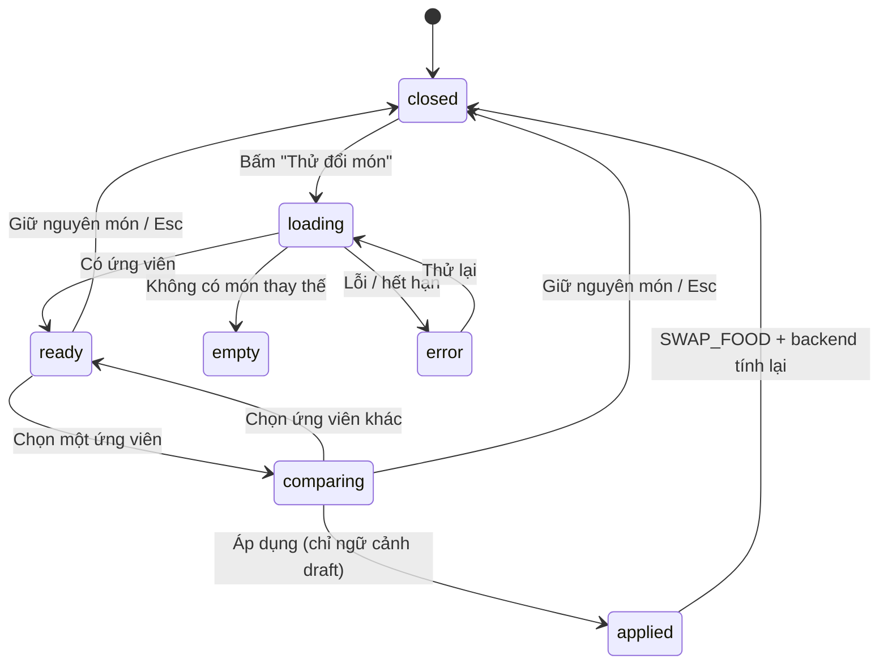
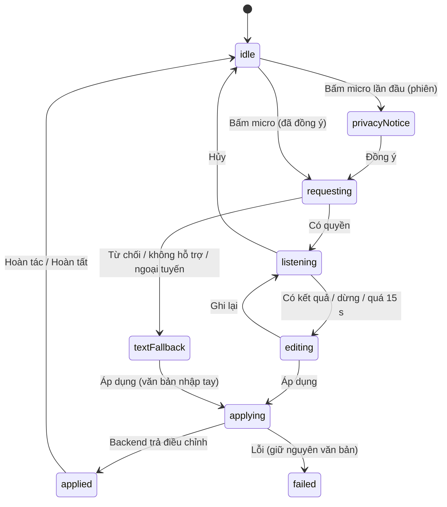

# NUTRISNAP — TUẦN 5: PHÂN TÍCH TIẾN ĐỘ (RECHARTS), FOOD SWAP SIMULATOR & GHI ÂM GIA VỊ ẨN
## Kế hoạch Triển khai Cặp 2 (Implementation Plan & Agent Brief)

| Thuộc tính | Giá trị |
|---|---|
| **Mã tài liệu** | `NS-FE-W5-001` · Phiên bản `1.0.0` · Trạng thái: **Ready for Implementation** |
| **Dự án / Môn học** | NutriSnap – Virtual AI Nutrition Assistant · CSC10014 – Tư duy tính toán (FIT – HCMUS) |
| **Hạng mục Cặp 2 (Tuần 5)** | **Task 55 (Pair Session 5):** Food Swap Simulator · nút ghi âm gia vị ẩn · biểu đồ phân tích tiến độ — **Task 57:** `ProgressAnalyticsPage.tsx` (Dual Line Chart cân nặng/EMA + Bar Chart calo đa tuần) |
| **Đầu ra yêu cầu** | **UI Food Swap & Đồ thị Tiến độ** · **Trang Phân tích Tiến độ** |
| **Pair Session 5** | 2,5 giờ (theo đặc tả PDF) |
| **Design Owner** | Kiều Khôi Nguyên (25127107) — đã dựng khung `FoodSwapModal.tsx` & nút micro |
| **Implementation Owner** | Lê Thành Đạt (25127293) — Recharts, `ProgressAnalyticsPage`, Pattern Insights, kết nối Food Swap với API, gắn luồng ghi âm vào màn hình xác nhận bữa ăn |
| **Backend sẵn sàng** | `analyze_user_patterns()` · API món thay thế (Food Swap) · `voice_modifier.py` · AI Assistant nâng cao — đã hoàn thành & kiểm thử tự động |
| **Backend CHƯA hoàn tất** | **`services/weight_trend.py` (EMA)** — Frontend áp dụng **Zero-Math + Tolerant Reader**: `ema_weight` là `nullable/optional`; thiếu thì vẫn vẽ cân nặng thực tế + nhãn "đang chờ", **tuyệt đối không tự cài EMA** |
| **Tài liệu tiền đề** | `NS-FE-W2-001/002` (`docs/03_`, `docs/04_`) · `NS-FE-W3-001` (`docs/08_`) · `NS-FE-W4-001` (`docs/10_`) |
| **Nhánh làm việc** | `feat/w5-pair2-progress-swap-voice` (tách từ `main` mới nhất) |
| **Vị trí file** | `docs/12_progress_analytics_food_swap_voice_plan.md` |

### Mục lục
0. [Hướng dẫn sử dụng với Antigravity IDE (Agent Brief)](#0-hướng-dẫn-sử-dụng-với-antigravity-ide-agent-brief)
1. [Tóm tắt điều hành & Bối cảnh](#1-tóm-tắt-điều-hành--bối-cảnh)
2. [Quyết định kiến trúc (ADR)](#2-quyết-định-kiến-trúc-adr--đọc-trước-khi-code)
3. [Phạm vi, Sản phẩm bàn giao & Phân vai (RACI)](#3-phạm-vi-sản-phẩm-bàn-giao--phân-vai-raci)
4. [Tiêu chí nghiệm thu & độ mượt (ASC)](#4-tiêu-chí-nghiệm-thu--độ-mượt-asc)
5. [Ràng buộc bắt buộc (Guardrails)](#5-ràng-buộc-bắt-buộc-guardrails)
6. [Lịch trình Pair Session 5 (150 phút)](#6-lịch-trình-pair-session-5-150-phút)
7. [Track A — Hoàn thiện thiết kế](#7-track-a--hoàn-thiện-thiết-kế)
8. [Track B — Kế hoạch triển khai (Step 0 → Step 11)](#8-track-b--kế-hoạch-triển-khai-step-0--step-11)
9. [Đặc tả chi tiết các màn hình & luồng](#9-đặc-tả-chi-tiết-các-màn-hình--luồng)
10. [Chiến lược kiểm thử](#10-chiến-lược-kiểm-thử)
11. [Ma trận xác minh Mode A / Mode B](#11-ma-trận-xác-minh-mode-a--mode-b)
12. [Quality Gates & Definition of Done](#12-quality-gates--definition-of-done)
13. [Quy trình Git, Commit Plan & mẫu Pull Request](#13-quy-trình-git-commit-plan--mẫu-pull-request)
14. [Nhật ký sử dụng AI (bắt buộc)](#14-nhật-ký-sử-dụng-ai-bắt-buộc)
15. [Rủi ro, Phụ thuộc & Giao thức xử lý blocker](#15-rủi-ro-phụ-thuộc--giao-thức-xử-lý-blocker)
16. [Phụ lục kỹ thuật](#16-phụ-lục-kỹ-thuật)

---

## 0. Hướng dẫn sử dụng với Antigravity IDE (Agent Brief)

**Thứ tự đọc bắt buộc đối với Agent** (không bỏ qua file nào):

1. `.antigravityrules` (luôn ưu tiên cao nhất)
2. File này; sau đó `docs/03_...`, `docs/04_...`, `docs/08_...`, `docs/10_...` (ADR, Guardrails, Contract Guard, `mealEvents`, `mealDraftReducer`, `MealReviewList`, `useMealPreview`, hạ tầng test đã có)
3. `docs/01_security_architecture.md` · `docs/02_api_contract_and_screen_flows.md` (§1 màu/typography, các mục Progress/Analytics nếu có)
4. **Mã Backend/AI thực tế (chỉ ĐỌC):** `src/backend/main.py`, `src/backend/routers/**`, `src/backend/schemas/api_contract.py`, `src/backend/services/analytics_service.py` (`analyze_user_patterns`), logic Food Swap, `src/backend/services/weight_trend.py` (có thể chưa có/chưa hoàn tất), `src/ai/voice_modifier.py`, `src/ai/orchestrator.py` — và `http://localhost:8000/openapi.json` khi backend chạy
5. Toàn bộ `src/frontend/src/` — đặc biệt `FoodSwapModal.tsx`, nút micro trên màn hình chụp ảnh, `components/meal/*`, `pages/MealCaptureFlow.tsx`, `pages/BasicDashboard.tsx`, `layouts/AppShell.tsx`, `package.json`

**Phân biệt hai luồng công việc — rất quan trọng**

| Luồng | Người thực hiện | Nội dung |
|---|---|---|
| **Track A – Hoàn thiện thiết kế** | **Con người** (Khôi Nguyên chủ trì) | Bổ sung frame còn thiếu (trang Tiến độ, biểu đồ, thẻ Pattern Insights, trạng thái Food Swap/Voice), nghiệm thu độ khớp. **Agent không chỉnh sửa Figma và không tự ý đổi thiết kế đã bàn giao.** |
| **Track B – Frontend Integration** | **Agent (Antigravity)** dưới giám sát của Thành Đạt | Khám phá hợp đồng thật, cài Recharts, dựng trang Tiến độ, nối Food Swap & Voice, kiểm thử, báo cáo, PR |

**Prompt khởi động gợi ý** (dán vào Antigravity):

```text
Bạn là Frontend Engineer của dự án NutriSnap. Hãy đọc .antigravityrules,
docs/03_..., docs/04_..., docs/08_..., docs/10_... và docs/12_progress_analytics_food_swap_voice_plan.md.
Chỉ thực hiện TRACK B (mục 8), tuần tự Step 0 → Step 11.
Quy tắc:
- Step 1 là KHÁM PHÁ CHỈ-ĐỌC: đọc backend, openapi.json, FoodSwapModal/nút micro hiện có, lập Contract Map +
  Assumption Register, rồi DỪNG và báo cáo trước khi sửa bất kỳ file nào. KHÔNG đoán tên endpoint/field.
- ZERO-MATH (ADR-W5-01): Frontend KHÔNG tự tính EMA, trung bình, tổng, chênh lệch dinh dưỡng/cân nặng, BMI, xu hướng.
  Mọi số lấy từ backend. weight_trend.py (EMA) CHƯA hoàn tất: ema_weight là nullable/optional; thiếu thì chỉ vẽ cân nặng
  thực tế + nhãn "đang chờ". TUYỆT ĐỐI không cài công thức EMA ở giao diện.
- GIỮ NGUYÊN thiết kế trực quan của FoodSwapModal và nút micro (Khôi Nguyên đã dựng): chỉ nối dữ liệu/hành vi và bổ sung
  trạng thái còn thiếu theo mục 9; thay đổi ngoài đặc tả phải hỏi trước.
- Chỉ được thêm đúng MỘT thư viện: recharts (^2.15). Không thêm gì khác. Không dùng localStorage/sessionStorage.
- Không gửi/lưu âm thanh: chỉ gửi văn bản ghi chú (đã cho người dùng xem & sửa) tới backend.
- Không bao giờ dùng màu đỏ/ngôn từ phán xét cho cân nặng/calo (mục 5). Nội dung từ backend chỉ render dạng văn bản.
- Mỗi Step = 1 commit theo Commit Plan (mục 13.2); chạy Quality Gate (npm run build, npm test) trước khi sang Step kế.
- Không đọc/tạo/ghi .env. Không commit ảnh chụp màn hình hay dữ liệu cân nặng thật.
- Không điền số liệu đo (Lighthouse, thời gian) nếu chưa đo thật; ghi "Pending".
- Gặp tình huống STOP & ASK (mục 8.13) thì DỪNG và báo cáo.
- Kết thúc: in báo cáo theo mẫu mục 8.12 và nhắc tôi cập nhật docs/ai_use_log.md.
```

> **Quy ước:** giao diện tiếng Việt; tên biến/hàm/file tiếng Anh; comment ngắn, giải thích *vì sao*. **Giữ nguyên line ending** của file đã tồn tại (nhiều file dùng CRLF); file mới dùng LF.

---

## 1. Tóm tắt điều hành & Bối cảnh

### 1.1. Mục tiêu Tuần 5 (phần Cặp 2)

| # | Nhiệm vụ | Sản phẩm đầu ra |
|---|---|---|
| T1 (Task 55) | **Food Swap Simulator** nối API thật; **nút ghi âm gia vị ẩn** (Web Speech API tiếng Việt) gắn vào luồng ghi bữa ăn; biểu đồ tiến độ | **UI Food Swap & Đồ thị Tiến độ** |
| T2 (Task 57) | `ProgressAnalyticsPage.tsx` bằng **Recharts**: **Dual Line Chart** (cân nặng ghi nhận + đường xu hướng EMA) và **Bar Chart calo giữa các tuần**; thẻ **Pattern Insights** | **Trang Phân tích Tiến độ** |

Theo đặc tả (PDF §3.5): đường kép phải *"kèm chú thích rõ đây là xu hướng tham khảo"*; Food Swap cho phép thử đổi món *"mà không cấm đoán món ăn yêu thích"*; nhận diện giọng nói tiếng Việt *"gửi kèm vào API phân tích bữa ăn"*.

### 1.2. Luồng cốt lõi của Tuần 5

```
(A) Tiến độ:  /progress → Backend trả chuỗi cân nặng (+ ema_weight nếu có), calo theo tuần, Pattern Insights
              → Recharts vẽ NGUYÊN số liệu backend (không tính thêm) → ema_weight thiếu: chỉ đường cân nặng + nhãn "đang chờ"
(B) Food Swap: Màn hình xác nhận / Dashboard → "Thử đổi món" → Backend trả món thay thế + chênh lệch (calo, đạm, chi phí)
              → người dùng so sánh (không bị ép) → [Giữ nguyên] hoặc [Áp dụng] (chỉ khi đang sửa bản nháp)
(C) Giọng nói: Màn hình chụp/xác nhận → micro (vi-VN) → văn bản có thể SỬA → backend (voice modifier) điều chỉnh khẩu phần
              → bản nháp cập nhật + [Hoàn tác] → backend tính lại → người dùng xác nhận lưu
```

### 1.3. Trạng thái các hạng mục liên quan

| Hạng mục | Chủ sở hữu | Trạng thái | Cách Frontend xử lý |
|---|---|---|---|
| `analyze_user_patterns()` (≥ 5 ngày dữ liệu mới nhận xét) | Việt Huy | ☑ Hoàn thành & có test | Hiển thị thẻ Pattern Insights; trạng thái "chưa đủ dữ liệu" |
| API món thay thế (Food Swap: chênh lệch calo/đạm/chi phí) | Việt Huy | ☑ Hoàn thành | Hiển thị **nguyên** chênh lệch backend trả về |
| `voice_modifier.py` (bóc tách gia vị ẩn từ giọng nói) | Phú Hiếu | ☑ Hoàn thành & có test | Gửi **văn bản** ghi chú; backend điều chỉnh khẩu phần |
| AI Assistant nâng cao | Phú Hiếu | ☑ Hoàn thành | Ngoài phạm vi Tuần này (điểm mở rộng) |
| `FoodSwapModal.tsx`, nút micro (khung giao diện) | Khôi Nguyên | ☑ Đã dựng | **Giữ nguyên thiết kế**; nối dữ liệu & bổ sung trạng thái |
| **`services/weight_trend.py` (EMA)** | Minh Đức | ☐ **Chưa hoàn tất** | `ema_weight` optional/nullable; thiếu → nhãn "đang chờ"; **không tự tính** (OD-1) |

> "Hoàn thành" theo lời người dùng/bảng phân công. **Step 1 xác minh bằng chạy thật.**

### 1.4. Hiện trạng cần kiểm toán (**Step 1 xác nhận**)
- `FoodSwapModal.tsx` có thể đang dùng **dữ liệu giả** (danh sách thay thế dựng sẵn) → phải gỡ, nối API thật.
- Nút micro có thể mới là khung (chưa có logic) hoặc đã có logic `SpeechRecognition` sơ sài → chuẩn hóa theo mục 9.4.
- `package.json` đã/chưa có `recharts`; `Navbar` chưa có mục "Tiến độ"; chưa có route `/progress`.
- Các thành phần Tuần 3–4 cần tái sử dụng: `mealDraftReducer` (`SWAP_FOOD`…), `useMealPreview`, `MealItemRow`, `utils/mealEvents.ts`, Contract Guard/`parseResponse`, `EstimatedBadge`, hạ tầng test (`mocks.ts`).

---

## 2. Quyết định kiến trúc (ADR) — đọc trước khi code

| ADR | Quyết định | Lý do |
|---|---|---|
| **ADR-W5-01** | **Zero-Math Zone.** Trong `pages/ProgressAnalyticsPage.tsx`, `components/analytics/**`, `components/swap/**`, `components/voice/**`, `api/progress*`, `api/swap*`, `api/voice*`, `hooks/useProgress*|useFoodSwap|useSpeech*|useVoice*`: **cấm** mọi phép tính trên dữ liệu sức khỏe — EMA, trung bình/tổng (`reduce`), chênh lệch, phần trăm thay đổi, BMI, hồi quy/xu hướng. Chỉ được: ánh xạ tên field, sắp xếp theo ngày, định dạng hiển thị, thang trục do Recharts xử lý. Có **test quét mã nguồn** làm "hàng rào kiến trúc" (mục 10.3). | PDF §4.2: tầng giao diện không tự tính; công thức nằm ở backend — một nguồn sự thật |
| **ADR-W5-02** | **Tolerant Reader cho tiến độ.** `ema_weight` là `nullable/optional`. Trạng thái xu hướng suy ra **chỉ từ có/không có dữ liệu**: `available` (mọi/đa số điểm có EMA) · `partial` · `unavailable`. `unavailable` → **không render** đường thứ hai, hiển thị chip **"Đường xu hướng đang chờ hệ thống tính"**. | `weight_trend.py` chưa xong; không được làm gián đoạn tiến độ |
| **ADR-W5-03** | **Calo theo tuần do backend tổng hợp.** Biểu đồ cột dùng bản ghi theo tuần (`avg/total`, `days_logged`, hạn mức) **backend cung cấp**. Nếu backend chỉ có dữ liệu theo **ngày** → **phương án suy giảm D**: vẽ cột **theo ngày**, nhóm trực quan theo tuần (đường kẻ phân tuần), nhãn "Chưa có số liệu tổng hợp theo tuần"; **không** tự cộng/trung bình. Ghi OD. | Zero-Math |
| **ADR-W5-04** | **Food Swap = mô phỏng không phá hủy.** Hai ngữ cảnh: **`draft`** (đang sửa bản nháp bữa ăn → có nút **Áp dụng**, dùng `SWAP_FOOD`, backend tính lại qua preview) và **`logged`** (món đã lưu trên Dashboard → **chỉ xem**, không ghi gì, có chú thích "Đây là mô phỏng; nhật ký không thay đổi"). Luôn có **[Giữ nguyên món]** nổi bật; chênh lệch hiển thị **nguyên văn từ backend**. | PDF: "không cấm đoán món yêu thích"; an toàn dữ liệu nhật ký |
| **ADR-W5-05** | **Giọng nói: chỉ gửi văn bản, không gửi/lưu âm thanh.** Web Speech API (`vi-VN`) chạy trong trình duyệt; **bản ghi văn bản luôn cho người dùng xem & sửa** trước khi áp dụng. Phát hiện tính năng → trình duyệt không hỗ trợ/từ chối quyền/ngoại tuyến → **tự rơi về ô nhập văn bản** cùng luồng. Hiển thị thông báo quyền riêng tư trước lần dùng đầu. | Âm thanh là dữ liệu cá nhân; nhận diện của trình duyệt (vd. Chrome) có thể dùng dịch vụ đám mây của nhà cung cấp trình duyệt |
| **ADR-W5-06** | **Bộ chọn chiến lược giọng nói** (xác minh ở Step 1): **V1** — API nhận diện/phân tích bữa ăn nhận tham số ghi chú → gửi kèm; **V2** — endpoint `voice modifier` riêng → gọi sau nhận diện/khi sửa bản nháp, nhận danh sách món đã điều chỉnh; **V3** — không có đường tích hợp → vô hiệu hóa micro kèm thông báo (không giả lập). Frontend **không** tự diễn giải câu nói (không regex/NLP). | Hợp đồng chưa xác định; tránh đoán |
| **ADR-W5-07** | **Một thư viện mới duy nhất: `recharts@^2.15`.** Không dùng 3.x (khác API), không thêm thư viện biểu đồ/giọng nói/test nào khác. Recharts chỉ nằm trong **chunk tải lười** của `/progress`. | Giữ bundle & rủi ro nhỏ |
| **ADR-W5-08** | **Biểu đồ phải truy cập được:** `accessibilityLayer`, `role="img"` + `aria-label` mô tả **không chứa số tính toán**, nút **"Xem dạng bảng"** (bảng dữ liệu thô), đường phân biệt không chỉ bằng màu (nét liền/nét đứt/điểm đánh dấu). | WCAG 2.2 AA |
| **ADR-W5-09** | **Responsible UX cho cân nặng.** Không màu đỏ/xanh "tốt–xấu", không câu "bạn đã tăng/giảm X", không BMI; ngôn từ trung tính; chú thích "dao động do nước/muối/thời điểm đo"; công tắc **"Ẩn số cân nặng"** (che tạm thời trong bộ nhớ — P1). | PDF §1.3, §4.7; giảm rủi ro tâm lý/ăn uống rối loạn |
| **ADR-W5-10** | **Đồng bộ liên màn hình:** `useProgressAnalytics` lắng nghe `meal-logged` (gộp làm mới) để cột calo tuần hiện tại cập nhật khi trang đang mở. | Nhất quán với Tuần 3–4 |
| **ADR-W5-11** | **Mode A / Mode B** (như các tuần trước): chạy ngay khi EMA chưa có (Mode A); khi `weight_trend.py` xong chạy checklist Mode B — **không đổi mã Frontend**. | Không phụ thuộc tiến độ Cặp 1 |
| **ADR-W5-12** | **Không bịa dữ liệu/kết quả:** không dữ liệu cân nặng/calo mặc định trong mã; fixture chỉ ở test; không điền số đo chưa thực hiện; test ở `src/frontend/src/__tests__/`; giữ line ending cũ. | Nhất quán các ADR trước |

---

## 3. Phạm vi, Sản phẩm bàn giao & Phân vai (RACI)

### 3.1. Trong phạm vi
- **P0 (bắt buộc):** cài Recharts · `ProgressAnalyticsPage` (Dual Line + Bar tuần + Pattern Insights + chọn khoảng thời gian + trạng thái tải/rỗng/lỗi/đang chờ EMA) · nối `FoodSwapModal` với API thật (2 ngữ cảnh) · luồng giọng nói gắn vào màn hình xác nhận bữa ăn (+ dự phòng nhập văn bản) · Contract Guard/normalizer · kiểm thử · báo cáo · PR.
- **P1 (nên có):** bảng dữ liệu thay thế biểu đồ · công tắc **Ẩn số cân nặng** (che tạm thời) · hoàn tác điều chỉnh giọng nói · làm mới tự động khi `meal-logged` · `performance.mark` cho QA.
- **P2:** thêm cân nặng hôm nay (**chỉ khi** backend có endpoint) · nút "Hỏi trợ lý về mẫu này" mở chat (Tuần 4) · thẻ Food Swap trong chat.

### 3.2. Ngoài phạm vi
`src/backend/**`, `src/ai/**`, `data/`, `scripts/` (chỉ **báo cáo** lỗi) · tự cài EMA/trung bình ở FE · Habit Tracker, Báo cáo tháng, Offline (Tuần 6) · Privacy endpoints (tải/xóa dữ liệu — Tuần 6) · Docker.

### 3.3. Phạm vi file được phép chỉnh sửa
```text
src/frontend/**                                    (trừ node_modules/, dist/; package.json/lock: CHỈ thêm recharts)
docs/02_api_contract_and_screen_flows.md           (CHỈ cập nhật mục Progress/Swap/Voice cho khớp thực tế)
docs/13_progress_analytics_report.md               (NEW — báo cáo tích hợp & đo đạc)
docs/ai_use_log.md                                 (chỉ thêm 1 dòng)
docs/12_progress_analytics_food_swap_voice_plan.md (chỉ cập nhật trạng thái)
```
Cấm: sửa `src/backend/**`, `src/ai/**`, `data/**`, `scripts/**`, `.antigravityrules`, `.gitignore`, `requirements.txt`; thư mục theo tuần/cá nhân; commit ảnh hoặc **dữ liệu cân nặng/giọng nói thật**.

### 3.4. Sản phẩm bàn giao

| Mã | Sản phẩm | Chủ trì | Tiêu chí nghiệm thu rút gọn |
|---|---|---|---|
| **D1** | **Contract Map + Assumption Register** (tiến độ, tuần, insights, swap, voice) | Thành Đạt (Agent) | Mọi giả định có kết quả xác minh; `docs/02` khớp |
| **D2** | **Normalizer/Zod (Tolerant Reader)** cho 4 nhóm API | Thành Đạt (Agent) | Chịu thiếu `ema_weight`/biến thể; không ném lỗi ra UI |
| **D3** | **`ProgressAnalyticsPage`** (Dual Line + Bar tuần) | Thành Đạt (Agent) | Mục 9.1; ASC-1…ASC-9 |
| **D4** | **Pattern Insights** | Thành Đạt (Agent) | Mục 9.2; ASC-9 |
| **D5** | **Food Swap** nối API (2 ngữ cảnh) | Thành Đạt (Agent) | Mục 9.3; ASC-10…ASC-13 |
| **D6** | **Luồng giọng nói** gắn vào màn hình xác nhận | Thành Đạt (Agent) | Mục 9.4; ASC-14…ASC-17 |
| **D7** | **Bộ kiểm thử** + hàng rào Zero-Math | Thành Đạt (Agent) | ≥ 90 test mới, 0 fail, không flaky |
| **D8** | **Báo cáo** `docs/13_progress_analytics_report.md` | Cặp 2 | Số thật hoặc `Pending` |
| **D9** | **Nghiệm thu độ khớp thiết kế** | Khôi Nguyên | 0 lệch *Major* |
| **D10** | **PR + AI-use log** | Thành Đạt | Có Approve của Khôi Nguyên |

### 3.5. Ma trận RACI

| Hoạt động | Khôi Nguyên | Thành Đạt | Agent | Minh Đức | Việt Huy | Phú Hiếu | Quốc Tuấn |
|---|---|---|---|---|---|---|---|
| Bổ sung frame Figma (Tiến độ, Insights, trạng thái Swap/Voice) | **A/R** | C | — | — | — | — | — |
| Contract Map (Step 1) | I | **A** | **R** | C | C | C | — |
| Recharts, trang Tiến độ, Insights, Swap, Voice (Step 2–8) | C | **A** | **R** | — | — | — | — |
| Kiểm thử tự động + hàng rào Zero-Math (Step 9) | I | **A** | **R** | — | — | — | C |
| Xác minh Mode A/B & E2E (Step 10) | C | **A/R** | S | S | S | S | **R** (kịch bản & kiểm thử lời khuyên) |
| Hoàn tất `weight_trend.py` (EMA) | I | I | — | **A/R** | C | — | I |
| Fidelity Review (D9) | **A/R** | C | — | — | — | — | — |
| Review PR | **R** | **A** | — | — | — | — | — |

*(R = Responsible, A = Accountable, C = Consulted, I = Informed, S = Support)*

---

## 4. Tiêu chí nghiệm thu & độ mượt (ASC)

> **Ngưỡng là mục tiêu; kết quả chỉ ghi khi đã đo thật** (tinh thần `docs/qa_evaluation_plan.md`).

### 4.1. Biểu đồ & Insights

| Mã | Tiêu chí | Cách kiểm |
|---|---|---|
| **ASC-1** | Tải trang: khung **skeleton cao cố định** cho từng biểu đồ, **CLS < 0,1** | Lighthouse |
| **ASC-2** | **EMA vắng mặt** (Mode A): chỉ **một** đường cân nặng + chip "đang chờ"; **không** có đường thứ hai, **không** lỗi console; *kiểm bằng test: không tạo số liệu EMA* | Test + thủ công |
| **ASC-3** | **EMA có mặt**: hai đường phân biệt **không chỉ bằng màu** (liền + điểm / đứt + không điểm); EMA thiếu từng điểm → **ngắt đường**, không nội suy | Test + thủ công |
| **ASC-4** | Đổi khoảng 7/14/30/90 ngày: **giữ dữ liệu cũ** (mờ nhẹ + chỉ báo) đến khi có dữ liệu mới, hủy request cũ, bỏ phản hồi muộn; ≤ 1 request/lần đổi (debounce 250 ms) | Test + Network |
| **ASC-5** | Biểu đồ cột tuần: có **đường hạn mức** (từ backend), hiển thị **số ngày có ghi chép** mỗi tuần, tuần thiếu dữ liệu gắn nhãn; **không** dùng màu đỏ | Test + thủ công |
| **ASC-6** | Truy cập: `accessibilityLayer`, `role="img"` + `aria-label` (không chứa số tự tính), nút **Xem dạng bảng** hoạt động bằng bàn phím | Test + thủ công |
| **ASC-7** | Responsive 360/768/1280 px: không cuộn ngang, nhãn trục đọc được (`preserveStartEnd`), chú giải không che dữ liệu | Thủ công |
| **ASC-8** | `prefers-reduced-motion` → tắt hoạt ảnh biểu đồ (`isAnimationActive=false`) | Test |
| **ASC-9** | Pattern Insights: **< 5 ngày dữ liệu** → thông điệp "cần thêm dữ liệu" (không bịa nhận xét); ngôn từ trung tính; nội dung chỉ dạng văn bản | Test + thủ công |

### 4.2. Food Swap

| Mã | Tiêu chí | Cách kiểm |
|---|---|---|
| **ASC-10** | Mở modal → skeleton → danh sách; `role="dialog"`, bẫy focus, `Esc` đóng, trả focus; chuyển nhanh giữa món → request cũ bị hủy | Test + thủ công |
| **ASC-11** | Chênh lệch hiển thị **nguyên giá trị backend**, có dấu + **chữ** ("giảm/tăng … kcal"), **không chỉ màu**; luôn có **[Giữ nguyên món]** | Test |
| **ASC-12** | Ngữ cảnh `draft`: **Áp dụng** → món đổi trong bản nháp và **backend tính lại** (preview). Ngữ cảnh `logged`: **không có** nút Áp dụng và **không có lời gọi ghi** | Test |
| **ASC-13** | Lỗi/rỗng/hết hạn: thông điệp rõ + đường thoát; không dữ liệu giả | Test |

### 4.3. Giọng nói

| Mã | Tiêu chí | Cách kiểm |
|---|---|---|
| **ASC-14** | Trình duyệt **không hỗ trợ** / **từ chối quyền** / **ngoại tuyến** → thông điệp rõ + **tự chuyển ô nhập văn bản** (cùng luồng áp dụng) | Test + thủ công |
| **ASC-15** | Nhận diện **tự dừng** khi: hủy, rời màn hình (unmount), quá **15 s**, người dùng bấm lại; micro không còn hoạt động; trạng thái đọc được qua `aria-live` ("Đang nghe…") | Test + thủ công |
| **ASC-16** | Văn bản **sửa được** trước khi áp dụng; áp dụng → bản nháp cập nhật + **[Hoàn tác]**; **không** gửi/lưu âm thanh (test: không có `Blob`/`FormData` âm thanh) | Test |
| **ASC-17** | **Thông báo quyền riêng tư** hiển thị trước lần kích hoạt đầu mỗi phiên | Test |

### 4.4. Tổng thể

| Mã | Tiêu chí | Cách kiểm |
|---|---|---|
| **ASC-18** | **Zero-Math:** hàng rào quét mã nguồn xanh; `grep` kiểm tra rỗng | Test + grep |
| **ASC-19** | Lighthouse (mobile, `build + preview`) `/progress`: Accessibility **≥ 95**, Best Practices **≥ 95**, Performance **≥ 90**; **Recharts chỉ ở chunk lười**; initial JS **không tăng** so với baseline Step 0 (ghi số thật) | DevTools + `npm run build` |
| **ASC-20** | Console sạch lỗi/cảnh báo trong luồng chuẩn; không request trùng ngoài `StrictMode` | Console / Network |

---

## 5. Ràng buộc bắt buộc (Guardrails)

### 5.1. MUST
- **M1.** Mọi request qua duy nhất `apiClient` (`withCredentials: true`); không `fetch`/`axios` trực tiếp trong component.
- **M2.** Mọi response mới đi qua **normalizer + Zod (Tolerant Reader)**; bảng alias tập trung một chỗ cho mỗi nhóm API; **không ném lỗi ra UI**; cảnh báo chỉ chứa tên field/loại lỗi, **không** chứa giá trị.
- **M3.** **Zero-Math (ADR-W5-01):** mọi con số hiển thị đến từ backend; `ema_weight` là `nullable/optional`; thiếu → chip "đang chờ".
- **M4.** Nội dung từ backend (tên món, nội dung Insights, tóm tắt giọng nói) chỉ render **dạng văn bản**.
- **M5.** Calo/đạm/chi phí ước tính kèm `EstimatedBadge`; trang Tiến độ có chú thích: *"Đường xu hướng chỉ mang tính tham khảo. Cân nặng hằng ngày dao động theo lượng nước, muối và thời điểm đo."* và *"Số liệu dinh dưỡng chỉ mang tính chất ước tính tham khảo."*
- **M6.** Màu theo `docs/02` §1.1 (+ cân nặng: xanh thương hiệu `#107C41`; xu hướng: slate `#475569` nét đứt; cột calo: cam `#EA580C`; hạn mức: slate nét đứt); dùng token Tailwind; thông tin **không chỉ truyền bằng màu**.
- **M7.** Trạng thái UI đầy đủ: tải · rỗng · lỗi · đang chờ EMA · chưa đủ dữ liệu (<5 ngày) · không hỗ trợ giọng nói · từ chối quyền · đang nghe · đang xử lý · áp dụng thành công.
- **M8.** Food Swap: luôn có **[Giữ nguyên món]**; ngữ cảnh `logged` **tuyệt đối không ghi dữ liệu**; ngữ cảnh `draft` đổi món qua `SWAP_FOOD` rồi để **preview của backend** tính lại.
- **M9.** Giọng nói: hiển thị thông báo quyền riêng tư; văn bản cho phép sửa trước khi áp dụng; hủy/rời màn hình/quá 15 s → dừng nhận diện; có đường nhập văn bản dự phòng.
- **M10.** TypeScript `strict`; không `any`, `@ts-ignore`; kiểu `SpeechRecognition` khai báo cục bộ (`types/speech.d.ts`); `catch (e: unknown)`.
- **M11.** Truy cập (WCAG 2.2 AA): biểu đồ có bảng thay thế; modal `role="dialog"` + bẫy focus; nút micro `aria-pressed` + nhãn; chạm ≥ 40 px; `prefers-reduced-motion`.
- **M12.** Không đổi thiết kế đã bàn giao (`FoodSwapModal`, nút micro) nếu chưa có phê duyệt của Khôi Nguyên.

### 5.2. MUST NOT
- **N1.** **Tự cài EMA** (`0.1 *`, `0.9 *`, `alpha`), trung bình, tổng, trung vị, phần trăm thay đổi, BMI, hồi quy, nội suy điểm thiếu — ở **bất kỳ** file nào trong Zero-Math Zone.
- **N2.** Dữ liệu cân nặng/calo/Insights/món thay thế **dựng sẵn hoặc mặc định** trong mã nguồn (kể cả khi API lỗi).
- **N3.** Gửi, ghi, lưu **âm thanh** (không `MediaRecorder` cho giọng nói, không upload `Blob` âm thanh); `localStorage`/`sessionStorage`/`IndexedDB` cho văn bản giọng nói, cân nặng, tùy chọn ẩn cân nặng.
- **N4.** Tự **diễn giải** câu nói (regex/NLP) để sửa khẩu phần; áp dụng điều chỉnh khi người dùng chưa xác nhận.
- **N5.** Màu đỏ/hồng-báo-động, biểu tượng cảnh báo, hoặc câu phán xét ("tăng cân", "quá mức", "tệ") cho cân nặng/calo; hiển thị BMI; kết luận y khoa.
- **N6.** `console.log` dữ liệu cân nặng/giọng nói/payload; `dangerouslySetInnerHTML`.
- **N7.** Sửa `src/backend/**`/`src/ai/**`; "vá" hành vi backend ở FE (chỉ **báo cáo**); thêm thư viện ngoài `recharts`.
- **N8.** Làm yếu/xóa test để build xanh; điền số đo chưa thực hiện; commit `.env`/`node_modules`/`dist`/ảnh; push thẳng `main`.

---

## 6. Lịch trình Pair Session 5 (150 phút)

| Thời gian | Nội dung | Khôi Nguyên | Thành Đạt (+ Agent) | Đầu ra |
|---|---|---|---|---|
| **0:00–0:15** | Khởi động, chốt phạm vi | Xác nhận trạng thái Figma còn thiếu | Step 0; tình trạng `weight_trend.py` | Biên bản ngắn |
| **0:15–0:40** | **Khám phá hợp đồng** | — | Step 1 (đối chiếu Huy/Hiếu/Đức qua `openapi.json`) | D1 nháp |
| **0:40–1:00** | **Bàn giao bổ sung thiết kế** | Trình bày frame Tiến độ/Insights/Swap/Voice | Đối chiếu với mã hiện có; chốt token | Design Delta |
| **1:00–2:00** | **Xây dựng** | Review từng commit trên giao diện | Step 2 → Step 8 | D2–D6 |
| **2:00–2:30** | **Kiểm thử & xác minh** | Fidelity Review 360/768/1280 px | Step 9–10 | D7, D8, D9 nháp |
| **2:30** | **Chốt** | Ký nghiệm thu thiết kế | Step 11: PR, AI-log | D10 |

> Hết giờ chưa xong → ưu tiên: **D3 (trang Tiến độ) → D2 → D5 (Swap) → D6 (Voice) → D4 → D1 → D9 → D7 → P1**. Phần còn lại ghi "Việc chuyển tiếp".

---

## 7. Track A — Hoàn thiện thiết kế

> **Đối tượng: con người (Khôi Nguyên).** `FoodSwapModal` và nút micro đã có khung; Track A bổ sung **các frame/trạng thái còn thiếu**.

### 7.1. Danh mục frame cần có (Desktop 1280 + Mobile 360)

| Nhóm | Frame / biến thể |
|---|---|
| **Trang Tiến độ** | Skeleton · Có dữ liệu (2 biểu đồ + Insights) · **EMA đang chờ** (một đường + chip) · Rỗng (chưa có cân nặng) · Lỗi + Thử lại · **Chế độ bảng** · **Ẩn số cân nặng** · Chọn khoảng 7/14/30/90 ngày |
| **Dual Line Chart** | Hai đường (liền có điểm / đứt không điểm) · Tooltip · Chú giải · Chú thích tham khảo nguyên văn |
| **Bar Chart tuần** | Cột + đường hạn mức · Tuần thiếu dữ liệu (nhãn) · Tooltip (kcal, số ngày ghi chép) |
| **Pattern Insights** | Thẻ có nội dung · **Chưa đủ dữ liệu (<5 ngày)** · Skeleton · Lỗi |
| **Food Swap Modal** | Đang tải · Danh sách món thay thế (chênh lệch calo/đạm/chi phí **có dấu + chữ**) · So sánh hiện tại ↔ thay thế · Rỗng · Lỗi · Ngữ cảnh *draft* (có Áp dụng) · Ngữ cảnh *logged* (chỉ xem + chú thích mô phỏng) |
| **Voice** | Micro mặc định · Thông báo quyền riêng tư · **Đang nghe** · Văn bản có thể sửa + Áp dụng/Ghi lại/Hủy · Đang xử lý · Áp dụng thành công + Hoàn tác · **Không hỗ trợ** · **Từ chối quyền** · Ngoại tuyến → ô nhập văn bản |
| **Dùng chung** | `EstimatedBadge` · Dòng disclaimer · Toast/Hoàn tác |

### 7.2. Checklist bàn giao bổ sung (D9)

| # | Hạng mục | ☐ |
|---|---|---|
| 1 | Đủ frame ở bảng 7.1 cho Desktop & Mobile | ☐ |
| 2 | Prototype nối: Dashboard → Tiến độ; Xác nhận bữa ăn → Thử đổi món → Áp dụng; Micro → Văn bản → Áp dụng → Hoàn tác | ☐ |
| 3 | Bảng màu **trung tính** cho cân nặng/calo (không đỏ/xanh "tốt–xấu"); phân biệt đường bằng nét + điểm | ☐ |
| 4 | Copy deck tiếng Việt cho mọi trạng thái (gồm chú thích tham khảo, thông báo quyền riêng tư giọng nói, thông điệp "đang chờ xu hướng") | ☐ |
| 5 | Đặc tả hành vi: đổi khoảng thời gian, chế độ bảng, ẩn số, đóng modal, thời gian tối đa ghi âm | ☐ |
| 6 | Ghi chú truy cập (thứ tự Tab, tương phản AA, chạm ≥ 40 px, `aria-live`) | ☐ |
| 7 | Token màu/chữ/bo góc khớp mã (bảng ánh xạ ở báo cáo §4) | ☐ |

### 7.3. Fidelity Review
So sánh UI thật với Figma ở **360 / 768 / 1280 px**. **Major** (sai bố cục, thiếu trạng thái, **thiếu chú thích "tham khảo"/nhãn "Ước tính"**, màu báo động cho cân nặng, sai copy) → bắt buộc sửa · **Minor** (≤ 4 px) → ghi nhận · **Info** (khác biệt nền tảng). Ảnh so sánh đính kèm **PR**, không commit vào repo.

---

## 8. Track B — Kế hoạch triển khai (Step 0 → Step 11)

> Mỗi Step = 1 commit. Ước lượng tổng: **~19 giờ làm việc**.

| Step | Nội dung | Ước lượng | Phụ thuộc |
|---|---|---|---|
| 0 | Chuẩn bị nhánh, chạy backend, baseline | 0,5 giờ | — |
| 1 | **Khám phá hợp đồng & kiểm toán** | 1,5 giờ | 0 |
| 2 | Nền tảng: cài Recharts, endpoints, hợp đồng (Zod + alias), tiện ích, kiểu giọng nói, hàng rào Zero-Math | 2 giờ | 1 |
| 3 | Lớp dữ liệu Tiến độ (API, hook, trạng thái EMA) | 2 giờ | 2 |
| 4 | Biểu đồ: `WeightTrendChart`, `WeeklyCaloriesChart`, bảng thay thế, chọn khoảng | 3 giờ | 3 |
| 5 | `ProgressAnalyticsPage` + Pattern Insights + route/điều hướng + đồng bộ | 2,5 giờ | 3, 4 |
| 6 | **Food Swap** (API, hook, nối modal, 2 ngữ cảnh, điểm vào) | 3 giờ | 2 |
| 7 | **Giọng nói** (hook, panel, chiến lược V1/V2/V3, tích hợp bản nháp, dự phòng văn bản) | 3 giờ | 2 |
| 8 | Tích hợp, hiệu năng, truy cập, riêng tư | 1,5 giờ | 5–7 |
| 9 | Kiểm thử tự động | 3,5 giờ | 8 |
| 10 | Xác minh Mode A, E2E, đo đạc, báo cáo | 1,5 giờ | 9 |
| 11 | Tài liệu, AI-log, PR | 0,5 giờ | 10 |

### Step 0 — Chuẩn bị & baseline
1. `git checkout main && git pull origin main && git checkout -b feat/w5-pair2-progress-swap-voice`
2. Xác nhận Tuần 3–4 đã nằm trong `main`: `utils/mealEvents.ts`, `components/meal/mealDraftReducer.ts` (có `SWAP_FOOD`), `hooks/useMealPreview.ts`, `MealItemRow.tsx`, `pages/BasicDashboard.tsx`, `components/common/EstimatedBadge.tsx`, `__tests__/utils/mocks.ts`. **Thiếu → báo người dùng.**
3. Backend (từ **thư mục gốc**): `python -m uvicorn src.backend.main:app --reload --port 8000`; `GET /api/v1/health`. **Không** đọc `.env`; thiếu khóa API → báo, không tự tạo.
4. `cd src/frontend && npm install && npm run build && npm test` — **ghi baseline đúng thực tế** (số test, kích thước chunk JS/CSS) vào `docs/13_progress_analytics_report.md` §2 (khung ở 16.7).
5. Dùng **`localhost` nhất quán** cho web và API.

**Nghiệm thu:** nhánh đúng tên; backend chạy; baseline được ghi.

### Step 1 — Khám phá hợp đồng thật & kiểm toán *(CHỈ ĐỌC — dừng và báo cáo sau bước này)*

**1.1. Khám phá**
```bash
curl -s http://localhost:8000/openapi.json -o /tmp/openapi.json     # PowerShell: Invoke-WebRequest ... -OutFile
grep -rnE "progress|weight_logs|ema|weekly|patterns|swap|voice|modifier" src/backend src/ai
grep -rnE "recharts|SpeechRecognition|webkitSpeechRecognition|MediaRecorder" src/frontend/src src/frontend/package.json
grep -rn "FoodSwapModal\|VoiceNote\|mic" src/frontend/src
grep -rnE "mock|fake|sample|dummy|hardcode" src/frontend/src/components   # dữ liệu giả trong khung UI
```
Đọc: router/dịch vụ tiến độ (`get_progress_summary`), `analyze_user_patterns`, logic Food Swap, `weight_trend.py` (có/không), `voice_modifier.py`, `FoodSwapModal.tsx` và nút micro (props, state, dữ liệu giả).

**1.2. Contract Map** (điền báo cáo §3)

| Nhóm | Endpoint | Method | Request | Response | Lỗi có thể | Khác `docs/02`? |
|---|---|---|---|---|---|---|
| Chuỗi cân nặng | *(?)* | GET | *(khoảng ngày? tên tham số)* | *(date, weight_kg, ema_weight?)* | | |
| Calo theo tuần | *(?)* | GET | | *(week_start, avg/total, days_logged, target)* | | |
| Pattern Insights | *(?)* | GET | | *(danh sách thẻ; ngưỡng ≥5 ngày thể hiện thế nào?)* | | |
| Food Swap | *(?)* | GET/POST | *(food_id, gam?, ngữ cảnh?)* | *(candidates + nutrition + chênh lệch + giá)* | | |
| Voice modifier | *(?)* | POST | *(văn bản ghi chú, items hiện tại?)* | *(items đã điều chỉnh? modifiers?)* | | |
| (P2) Ghi cân nặng | *(?)* | POST | | | | |

**1.3. Assumption Register** — xác minh ✔/✖/⚠ **trước** Step 2:

| # | Giả định | Cách xác minh | Kết quả |
|---|---|---|---|
| AS-1 | Có endpoint trả **chuỗi cân nặng theo ngày** với `date`, `weight_kg` và `ema_weight` (**có thể vắng/null**) | `openapi.json` + gọi bằng tài khoản demo | |
| AS-2 | Có dữ liệu **calo theo tuần** do backend tổng hợp (`week_start`/nhãn tuần, giá trị calo, **số ngày có ghi chép**, hạn mức) — hay chỉ theo **ngày** (→ phương án D) | Đọc router/dịch vụ + gọi thử | |
| AS-3 | Tham số khoảng thời gian (`days_range`?) và các giá trị cho phép (7/14/30/90?) | Đọc schema | |
| AS-4 | Định nghĩa **tuần** (Thứ Hai–Chủ Nhật?) và múi giờ | Đọc dịch vụ | |
| AS-5 | Pattern Insights: endpoint, cấu trúc thẻ (tiêu đề, mô tả, số ngày dựa trên, loại), cách báo **chưa đủ 5 ngày** | Gọi bằng tài khoản mới/demo | |
| AS-6 | Food Swap: request (`food_id`, gam?), response: danh sách món cùng nhóm với **giá trị hiện tại, giá trị thay thế, chênh lệch** (calo, đạm, chi phí) — do backend tính | Gọi thử | |
| AS-7 | Food Swap: số ứng viên tối đa, thứ tự, có trả `food_id` hợp lệ để `SWAP_FOOD` | Gọi thử | |
| AS-8 | Voice: có tham số ghi chú trong API nhận diện/phân tích bữa ăn (**V1**) hay endpoint riêng (**V2**); tên field; giới hạn độ dài | Đọc router/`voice_modifier.py` | |
| AS-9 | Voice: response là **danh sách món đã điều chỉnh** hay **danh sách bộ điều chỉnh** (`modifiers`) + có tóm tắt "hệ thống hiểu" | Gọi thử với "thêm một muỗng dầu ăn, chỉ ăn nửa phần" | |
| AS-10 | Backend có cờ/trạng thái cho EMA (`ema_status`/thông báo chờ)? Khi `weight_trend.py` chưa xong backend trả gì (thiếu field / `null` / lỗi)? | Gọi thử | |
| AS-11 | Có endpoint **ghi cân nặng** (P2)? | Đọc router | |
| AS-12 | Đơn vị & làm tròn (kg, kcal, VNĐ) và độ trễ điển hình của từng API | Đo vài lần | |
| AS-13 | Mã lỗi khi khoảng ngày không hợp lệ/không có dữ liệu | Thử biên | |

**1.4. Kiểm toán Frontend:** vị trí & props của `FoodSwapModal`/nút micro; có dữ liệu giả không; đã có `recharts` chưa; `Navbar`/route; thành phần Tuần 3–4 cần tái sử dụng có đủ không; hạ tầng test (mocks, `TZ`).

**1.5. Quyết định sau khám phá**

| Kết quả | Hành động |
|---|---|
| AS-1 ✖ (không có endpoint cân nặng) | **STOP & ASK** — không thể vẽ biểu đồ; báo Việt Huy/Minh Đức |
| AS-2 ✖ (chỉ có dữ liệu ngày) | **Phương án suy giảm D** (ADR-W5-03); ghi OD; **không** tự tổng hợp |
| AS-6 ✖ (backend không trả chênh lệch) | Hiển thị giá trị hai bên **nếu có**, ẩn cột chênh lệch; **không** tự trừ; ghi OD |
| AS-8/AS-9 ✖ (không có đường tích hợp giọng nói) | **STOP & ASK** — đề xuất mặc định là **V3** (vô hiệu hóa micro + thông báo "đang chờ hệ thống", không giả lập); chỉ triển khai sau khi người dùng đồng ý |
| AS-10: backend trả lỗi (không phải thiếu field) khi EMA chưa có | Chuẩn hóa thành `ema_weight = null` (chỉ ở lớp API); ghi OD-1 |
| Hợp đồng khác kế hoạch theo cách không dung hòa được | **STOP & ASK** |

> **Dừng lại, báo cáo Contract Map + Assumption Register + kết quả kiểm toán** trước khi sang Step 2.

### Step 2 — Nền tảng
**File:** `package.json`/lock (chỉ `recharts`), `api/endpoints.ts`, `api/progressContract.ts`, `api/swapContract.ts`, `api/voiceContract.ts`, `utils/chartFormat.ts`, `types/speech.d.ts`, `hooks/useReducedMotion.ts`, `__tests__/zeroMath.guard.test.ts`, `__tests__/fixtures/analytics.ts`.

1. **Cài `recharts@^2.15`** (ADR-W5-07). Không cài gói nào khác. Không phân giải được → **STOP & ASK**.
2. **`api/endpoints.ts`:** thêm hằng số theo Contract Map (`PROGRESS_*`, `FOOD_SWAP`, `VOICE_MODIFIER`…).
3. **Hợp đồng + normalizer** (khung ở 16.1, 16.6): mỗi nhóm có bảng `ALIASES` **một chỗ** + `normalizeXxx(raw)` **không ném lỗi**; `ema_weight` `number | null | undefined`; chuỗi cân nặng được **sắp xếp tăng dần theo ngày** (so sánh chuỗi `YYYY-MM-DD`) và khử trùng ngày (giữ bản ghi cuối) — **không** tính toán số liệu.
4. **`utils/chartFormat.ts`:** `formatDayMonth('2026-10-24') → '24/10'` **bằng xử lý chuỗi** (không `new Date()` để tránh lệch múi giờ); `formatWeekLabel`; `formatKg`, `formatKcal` (`vi-VN`, 0–1 chữ số thập phân).
5. **`types/speech.d.ts`:** khai báo cục bộ kiểu `SpeechRecognitionLike`, sự kiện, `Window.SpeechRecognition?`/`webkitSpeechRecognition?` (khung ở 16.4) — **không** `any`.
6. **`hooks/useReducedMotion.ts`:** đọc `matchMedia('(prefers-reduced-motion: reduce)')`, cập nhật khi thay đổi.
7. **Hàng rào Zero-Math** (`zeroMath.guard.test.ts`, khung ở 16.5): quét mã nguồn các thư mục trong Zero-Math Zone, **fail** nếu có mẫu bị cấm (mục 10.3). Cho phép ngoại lệ có chú thích `// zero-math-ok: <lý do>` (reviewer kiểm tra).
8. **Fixture** (`__tests__/fixtures/analytics.ts`): JSON mẫu **thật** thu từ Step 1 (đã ẩn danh) + biến thể: có/không có `ema_weight`, EMA lẻ tẻ `null`, thiếu một ngày, trùng ngày, chỉ dữ liệu theo ngày (D), < 5 ngày (Insights), Food Swap không có chênh lệch, Voice trả items/modifiers.

**Nghiệm thu:** `npm run build` ✔; test contracts (≥ 22 ca), `chartFormat` (≥ 6), hàng rào Zero-Math chạy xanh.

### Step 3 — Lớp dữ liệu Tiến độ
**File:** `api/progressApi.ts`, `hooks/useProgressAnalytics.ts`, `utils/trendStatus.ts`.

- **`progressApi.getWeightSeries(range, signal)`, `getWeeklyCalories(range, signal)`, `getPatternInsights(signal)`** — GET idempotent (tận dụng retry 1 lần của interceptor); trả dữ liệu đã chuẩn hóa.
- **`trendStatus(series)`** (hàm thuần, **không tính toán số liệu**): `unavailable` nếu **không** điểm nào có `ema_weight`; `available` nếu mọi điểm có; còn lại `partial`. (Đếm có/không có giá trị để phân loại **không** phải tính toán dinh dưỡng; được ghi chú `zero-math-ok` nếu cần.)
- **`useProgressAnalytics(range)`:** chạy 3 request **song song độc lập** (một cái lỗi không làm hỏng cái khác); debounce 250 ms khi đổi khoảng; **hủy** request cũ; **giữ dữ liệu cũ** khi đang tải khoảng mới (`isRefreshing`); trạng thái từng phần `loading|ready|empty|error`; tự `refetch` khi nhận `meal-logged` (gộp 300 ms; chỉ calo tuần/Insights); `refetch()` thủ công.
- Phương án D (AS-2 ✖): `weeklyMode: 'weekly' | 'dailyFallback'` được xác định **ở lớp API/normalizer**, không ở component.

**Nghiệm thu:** test (≥ 16 ca, fake timers): trạng thái EMA 3 loại · debounce & hủy · giữ dữ liệu cũ · lỗi một phần · `meal-logged` → 1 lần làm mới · không request thừa.

### Step 4 — Biểu đồ (Recharts)
**File:** `components/analytics/ChartCard.tsx`, `WeightTrendChart.tsx`, `WeeklyCaloriesChart.tsx`, `ChartDataTable.tsx`, `RangeSelector.tsx`, `TrendStatusChip.tsx`, `ProgressSkeleton.tsx`, `PrivacyMask.tsx` (P1).

1. **`WeightTrendChart`** (đặc tả 9.1): `LineChart` + hai `Line`: **"Cân nặng ghi nhận"** (liền, có điểm, xanh thương hiệu) và **"Xu hướng EMA (tham khảo)"** (đứt, không điểm, slate) — đường thứ hai **chỉ render khi** `trendStatus !== 'unavailable'`; `connectNulls={false}`; `isAnimationActive={!reducedMotion}`; `accessibilityLayer`; Tooltip tùy biến hiển thị **chỉ giá trị có sẵn** (không suy ra); `domain` do Recharts xử lý (`// zero-math-ok: padding trục do Recharts`).
2. **`TrendStatusChip`:** `unavailable` → "Đường xu hướng đang chờ hệ thống tính" (kèm `aria-live="polite"`); `partial` → "Một số ngày chưa có xu hướng"; `available` → ẩn.
3. **`WeeklyCaloriesChart`:** `BarChart` — mỗi cột = giá trị **backend** cho tuần (nhãn tuần từ backend/`formatWeekLabel`); `ReferenceLine` hạn mức (giá trị backend, nét đứt slate); Tooltip: kcal + "{n} ngày có ghi chép" + `EstimatedBadge`; tuần thiếu dữ liệu → nhãn "chưa đủ dữ liệu"; màu cam, **không đỏ**; phương án D → cột theo ngày + đường phân tuần + chú thích.
4. **`ChartDataTable`:** bảng dữ liệu **thô** (ngày, cân nặng, EMA hoặc "—"; tuần, kcal, số ngày) cho nút **Xem dạng bảng**; `<caption>`, `scope`, điều khiển bằng bàn phím.
5. **`RangeSelector`:** nhóm radio/segmented 7/14/30/90 (theo AS-3), `aria-label`, điều khiển bằng bàn phím.
6. **`ProgressSkeleton`:** chiều cao **cố định** trùng biểu đồ thật (CLS ≈ 0).
7. **Truy cập:** mỗi biểu đồ bọc `role="img"` + `aria-label` mô tả **không chứa số tự tính** (ví dụ "Biểu đồ đường cân nặng ghi nhận từ {ngày đầu} đến {ngày cuối}; đường xu hướng đang chờ."); bảng là phương án thay thế.
8. **(P1) `PrivacyMask`:** "Ẩn số cân nặng" che giá trị trong trục/tooltip/bảng bằng "•••" — **chỉ trong bộ nhớ** (mặc định hiện).

**Nghiệm thu:** test component (≥ 22 ca, mock `ResponsiveContainer` — 16.3): số `Line` đúng theo trạng thái EMA · không có dữ liệu bịa · tooltip/bảng · reduced motion · mask · nhãn tuần/ngày · phương án D.

### Step 5 — `ProgressAnalyticsPage` + Pattern Insights + điều hướng
**File:** `pages/ProgressAnalyticsPage.tsx`, `components/analytics/PatternInsightCard.tsx`, `PatternInsightsPanel.tsx`, `layouts/AppShell.tsx`/`Navbar.tsx` (thêm mục), `App.tsx` (route).

1. **Trang** (bố cục 9.1): tiêu đề "Phân tích tiến độ" · `RangeSelector` · công tắc "Ẩn số cân nặng" (P1) · khối **Cân nặng** (`ChartCard` + chip + chú thích tham khảo M5 + nút Xem dạng bảng) · khối **Calo theo tuần** · khối **Pattern Insights** · chân trang disclaimer. Mỗi khối **độc lập trạng thái** (lỗi một khối không làm hỏng trang).
2. **Pattern Insights** (9.2): `PatternInsightsPanel` hiển thị tối đa 4 thẻ theo thứ tự backend; `PatternInsightCard`: biểu tượng, **tiêu đề + mô tả (văn bản thuần)**, dòng "Dựa trên {n} ngày dữ liệu" **nếu backend cung cấp**; trạng thái **chưa đủ dữ liệu** → "Cần ít nhất 5 ngày có ghi chép để đưa ra nhận xét."; chân thẻ "Gợi ý tham khảo, không phải chẩn đoán y khoa." (P2: nút "Hỏi trợ lý").
3. **Route & điều hướng:** `/progress` (bảo vệ, trong `AppShell`, **tải lười**); `Navbar` thêm "Tiến độ" (`NavLink`, `aria-current`); prefetch chunk khi hover/focus.
4. **Trạng thái toàn trang:** rỗng (chưa có cân nặng): thông điệp thân thiện + (P2 nếu có endpoint) nút ghi cân nặng; lỗi khối: "Không tải được … — Thử lại"; **không hiển thị số nào** khi lỗi.
5. **Đồng bộ:** ghi bữa ăn (chụp ảnh/chat) khi trang đang mở → cột calo tuần cập nhật (ADR-W5-10).

**Nghiệm thu:** test (≥ 14 ca): xem 10.2.

### Step 6 — Food Swap (nối `FoodSwapModal`)
**File:** `api/swapApi.ts`, `hooks/useFoodSwap.ts`, `components/swap/FoodSwapModal.tsx` (nối), `SwapCandidateList.tsx`, `SwapComparison.tsx`, `SwapDelta.tsx`, điểm vào ở `MealItemRow.tsx` & `MealCard.tsx`.

1. **`swapApi.getCandidates(foodId, gram, signal)`** (theo Contract Map); không retry thừa.
2. **`useFoodSwap(source)`:** tải khi mở; **hủy** request khi đóng/đổi món; trạng thái `loading|ready|empty|error`; chọn ứng viên (`selectedId`) để xem so sánh; **không** tính chênh lệch.
3. **Nối `FoodSwapModal`** (giữ nguyên thiết kế, gỡ dữ liệu giả): props `open`, `onClose`, `source: { foodId, name, gram }`, `context: 'draft' | 'logged'`, `onApply?(candidate)`; hiển thị mỗi ứng viên: tên (văn bản thuần), giá trị **hiện tại ↔ thay thế** và **chênh lệch do backend trả** (calo, đạm, chi phí VNĐ) dạng **"giảm 120 kcal"/"tăng 3 g"** có dấu và chữ (không chỉ màu; màu trung tính); `EstimatedBadge`; nếu backend không trả chênh lệch → hiển thị "—" (**không tự trừ**).
4. **Luôn có [Giữ nguyên món]** (nút nổi bật, đặt trước nút Áp dụng); lời nhắn: *"Đây là gợi ý tham khảo — bạn vẫn có thể giữ món yêu thích."*
5. **Ngữ cảnh `draft`** (từ `MealItemRow` trong bản nháp Tuần 3/Chỉnh sửa trong chat Tuần 4): **Áp dụng** → dispatch `SWAP_FOOD` (giữ gam hiện tại hoặc gam backend đề xuất nếu có) → **preview của backend tính lại**; đóng modal; trả focus về hàng món.
6. **Ngữ cảnh `logged`** (từ `MealCard` Dashboard): **không có nút Áp dụng**, **không gọi API ghi**; chú thích cố định *"Đây là mô phỏng; nhật ký của bạn không thay đổi."*
7. **Truy cập:** `role="dialog"` + `aria-labelledby`, bẫy focus, `Esc`, trả focus; danh sách ứng viên là `radiogroup` điều khiển bằng bàn phím; bottom sheet trên mobile.

**Nghiệm thu:** test (≥ 20 ca): xem 10.2.

### Step 7 — Giọng nói (gia vị ẩn)
**File:** `hooks/useSpeechRecognition.ts`, `hooks/useVoiceNote.ts`, `api/voiceApi.ts`, `components/voice/VoiceNoteButton.tsx` (nối khung có sẵn), `VoiceNotePanel.tsx`, `VoicePrivacyNotice.tsx`, `components/meal/mealDraftReducer.ts` (thêm hành động), `pages/MealCaptureFlow.tsx` (gắn).

1. **`useSpeechRecognition`** (khung ở 16.4): phát hiện `SpeechRecognition`/`webkitSpeechRecognition`; `lang = 'vi-VN'`, `interimResults = true`, `continuous = false`, `maxAlternatives = 1`; trạng thái `unsupported|idle|requesting|listening|error`; **tự dừng sau 15 s**; `abort()` khi unmount/hủy; chống `start()` kép; ánh xạ lỗi (`not-allowed`/`service-not-allowed` → từ chối quyền, `no-speech` → "Không nghe thấy giọng nói", `audio-capture` → không có micro, `network` → cần kết nối mạng, `language-not-supported`, `aborted` → im lặng); trả `transcript` (kết quả cuối) và `interim`.
2. **`VoiceNotePanel`:** (a) thông báo quyền riêng tư `VoicePrivacyNotice` trước lần bật đầu mỗi phiên: *"Trình duyệt có thể gửi âm thanh tới dịch vụ nhận diện giọng nói của nhà cung cấp trình duyệt. NutriSnap chỉ nhận **văn bản** bạn xác nhận, không lưu âm thanh."* (b) nút micro (`aria-pressed`, nhãn "Bắt đầu/Dừng ghi âm", vùng `aria-live` "Đang nghe…"); (c) **ô văn bản có thể sửa** (hiển thị tạm thời `interim`, chốt `transcript`); (d) nút **Áp dụng** / **Ghi lại** / **Hủy**; (e) **dự phòng**: `unsupported`/từ chối quyền/ngoại tuyến → vẫn hiển thị ô nhập văn bản với cùng nút **Áp dụng**.
3. **Chiến lược V1/V2/V3** (ADR-W5-06, chốt ở Step 1): 
   - **V1** — ghi chú văn bản được lưu trong state luồng (`voiceNote`) và gửi **kèm** lời gọi nhận diện/phân tích; áp dụng lại khi người dùng chọn "Ghi lại" trước khi nhận diện.
   - **V2** — `voiceApi.applyNote({ note, items })` sau nhận diện/khi đang sửa bản nháp → nhận **danh sách món đã điều chỉnh** (hoặc bộ điều chỉnh) → `APPLY_VOICE_RESULT`.
   - **V3** — micro bị vô hiệu hóa kèm chú thích "Tính năng đang chờ hệ thống"; **không** giả lập kết quả.
4. **`mealDraftReducer`:** thêm `APPLY_VOICE_RESULT` (lưu **ảnh chụp bản nháp trước đó** để hoàn tác, đánh dấu món `source: 'voice'`) và `UNDO_VOICE`; sau khi áp dụng, `useMealPreview` **tính lại bằng backend** (ADR-W5-01); `RESET` xóa mọi ghi chú giọng nói.
5. **Hiển thị kết quả:** khối "Điều chỉnh theo ghi chú: *'{văn bản}'*" liệt kê các món/gam **trước → sau** (giá trị backend trả; **không** tự trừ) + nút **[Hoàn tác]**; nếu backend trả `modifiers_summary`, hiển thị dạng văn bản.
6. **Vị trí gắn:** nút micro trên màn hình **chụp ảnh** (`CameraView`/`CapturePreview`) và trên **màn hình xác nhận** (`MealReviewList`), cùng một `VoiceNotePanel`; ghi chú thuộc về **bản nháp bữa ăn hiện tại**.
7. **Riêng tư:** không `MediaRecorder`, không upload âm thanh, không storage; văn bản chỉ tồn tại trong bộ nhớ và **bị xóa** khi `RESET`/rời `/capture`/đăng xuất.

**Nghiệm thu:** test (≥ 24 ca): xem 10.2.

### Step 8 — Tích hợp, hiệu năng, truy cập, riêng tư
1. **Chunk:** `ProgressAnalyticsPage` + Recharts nằm trong **chunk lười** riêng; kiểm tra `npm run build`: initial JS **không tăng** (ASC-19); ghi kích thước chunk Recharts.
2. **Hiệu năng:** `React.memo` cho biểu đồ/thẻ/ứng viên; dữ liệu biểu đồ giữ tham chiếu ổn định (chỉ ánh xạ tên field, **không** tính); `isAnimationActive` theo `useReducedMotion`; không re-render biểu đồ khi gõ trong ô giọng nói.
3. **Truy cập:** kiểm Tab-order toàn luồng; vùng `aria-live` cho chip EMA, trạng thái nghe, kết quả giọng nói; focus trả về đúng nơi khi đóng modal/panel.
4. **Riêng tư:** `grep` kiểm N1–N6; không `console.log` dữ liệu nhạy cảm; xóa văn bản giọng nói khi đăng xuất (reset provider/luồng hiện có).
5. **Gỡ code giả:** loại bỏ dữ liệu giả trong `FoodSwapModal`/khung micro; xóa import mồ côi (`noUnusedLocals`).
6. **Đo đạc (P1):** `performance.mark/measure`: `ns:progress:load`, `ns:swap:open→ready`, `ns:voice:listen→apply` (chỉ thời gian, **không** dữ liệu).

**Nghiệm thu:** `npm run build` ✔; chunk đúng kỳ vọng; chạy tay luồng Tiến độ + Swap + Voice trên backend thật.

### Step 9 — Kiểm thử tự động
Thực hiện toàn bộ ma trận mục 10.1–10.3 với mock hạ tầng ở 16.3 (Recharts) và 16.4 (Speech). Đặt `process.env.TZ = 'Asia/Ho_Chi_Minh'` trong `setup.ts`. `npm test` và `npm run build` phải xanh; **không** làm yếu assertion; chạy `npm test` **3 lần liên tiếp** để loại bỏ flaky.

### Step 10 — Xác minh Mode A, E2E, đo đạc, báo cáo
1. Chạy **ma trận Mode A** (11.1) và **E2E** (10.4) với backend thật; điền kết quả **thật** vào `docs/13_progress_analytics_report.md` §5–§6.
2. **Người thực hiện:** Lighthouse (ASC-19), đo ASC-1, ASC-4, ASC-10 (≥ 3 lần, lấy trung vị, ghi môi trường), kiểm giọng nói trên **Chrome/Edge** và một trình duyệt **không hỗ trợ** (Firefox) để xác nhận dự phòng.
3. Chạy hàng rào Zero-Math + `grep` (16.8); ghi kết quả.
4. Hoàn thiện **checklist Mode B** (11.2) và **Integration Readiness Gate** (11.3); cập nhật Open Dependencies (15.3).

### Step 11 — Tài liệu, AI-log, PR
1. Hoàn thiện báo cáo; đồng bộ `docs/02` (mục Progress/Swap/Voice) với hợp đồng thật.
2. Thêm 1 dòng vào `docs/ai_use_log.md` (mục 14).
3. `git status`: không `.env`, `node_modules/`, `dist/`, ảnh, **dữ liệu cân nặng/giọng nói thật**; `package.json`/lock chỉ thêm `recharts`.
4. Push nhánh, mở PR theo mẫu 13.3; Khôi Nguyên review (thiết kế + mã).

### 8.12. Mẫu báo cáo cuối của Agent
```text
## Báo cáo hoàn thành — Tuần 5 (Track B)
- Contract Map: <đã lập / khác docs/02 ở: ...> · Assumption Register: <✔/✖/⚠ từng AS>
- EMA: trạng thái backend <chưa có/partial/available> · Chiến lược calo tuần: <weekly/dailyFallback> · Chiến lược giọng nói: <V1/V2/V3 + lý do>
- Steps hoàn thành: <liệt kê> · Hoãn + lý do: <...>
- File mới / sửa / xóa: <danh sách> · Dữ liệu giả đã gỡ: <có/không> · Thư viện thêm: recharts@<phiên bản>
- npm run build: <pass/fail> · npm test: <X passed / Y failed> (mới: <n>) · chạy 3 lần: <ổn định/flaky> · Hàng rào Zero-Math: <xanh/đỏ>
- Bundle: baseline <...> → hiện tại <...> · chunk recharts: <...>
- Mode A: <n Pass / n Fail / n N/A> · Mode B: Pending (chờ weight_trend.py)
- ASC: <n đạt / n Pending> (liệt kê Pending)
- Phát hiện về Backend/AI: <...>
- Việc cần người thực hiện: Lighthouse/đo đạc, thử giọng nói đa trình duyệt, Fidelity Review, cập nhật ai_use_log.md, mở PR
```

### 8.13. STOP & ASK — Agent phải dừng và hỏi khi
1. Không có endpoint cân nặng (AS-1 ✖), hoặc không có đường tích hợp giọng nói **và** người dùng chưa quyết định phương án (AS-8/9 ✖).
2. Bị yêu cầu/được gợi ý **tự tính EMA, trung bình, chênh lệch** ở giao diện để "cho biểu đồ đẹp" — **từ chối** và báo cáo.
3. Hợp đồng thật khác kế hoạch theo cách không dung hòa được bằng alias + Zod.
4. Cần sửa `src/backend`, `src/ai`, `data`, `scripts`, `.gitignore`, `.antigravityrules`, hoặc thêm thư viện ngoài `recharts@^2.15`; không cài được `recharts`.
5. Cần thay đổi **thiết kế trực quan** của `FoodSwapModal`/nút micro ngoài mục 9 (cần Khôi Nguyên đồng ý).
6. Phải làm yếu/xóa test hoặc cần điền số đo chưa thực hiện; hàng rào Zero-Math đỏ mà không có cách sửa hợp lệ.
7. Backend không chạy/thiếu khóa API (không tự tạo `.env`).
8. Cookie/phiên không hoạt động dù đã làm theo `NS-FE-W2-002` (14.3).

---

## 9. Đặc tả chi tiết các màn hình & luồng

### 9.1. Trang `ProgressAnalyticsPage`

**Bố cục** (desktop: các khối xếp dọc, độ rộng tối đa ~1100 px; mobile 1 cột)

| Khối | Nội dung |
|---|---|
| **Đầu trang** | Tiêu đề "Phân tích tiến độ" · `RangeSelector` (7/14/30/90 ngày) · công tắc "Ẩn số cân nặng" (P1) |
| **Cân nặng & xu hướng** | `ChartCard` (tiêu đề, chip trạng thái EMA, biểu đồ, nút **Xem dạng bảng**) · chú thích M5 |
| **Calo theo tuần** | Biểu đồ cột + đường hạn mức + số ngày có ghi chép + `EstimatedBadge` |
| **Mẫu hành vi (Pattern Insights)** | Lưới thẻ (1–2 cột) hoặc trạng thái "chưa đủ dữ liệu" |
| **Chân trang** | `DisclaimerBadge` + câu M5 |

**Dual Line Chart**
- Trục X: ngày (`formatDayMonth`), `interval="preserveStartEnd"` ở mobile.
- Đường 1 **"Cân nặng ghi nhận"**: liền, có điểm, `#107C41`. Đường 2 **"Xu hướng EMA (tham khảo)"**: đứt (`6 4`), không điểm, `#475569` — **chỉ khi** có dữ liệu EMA.
- Tooltip: ngày + giá trị **có sẵn** (thiếu → "chưa có"). Không hiển thị "thay đổi so với…".
- Khi `unavailable`: chip *"Đường xu hướng đang chờ hệ thống tính"* + dòng giải thích ngắn *"Bạn vẫn xem được cân nặng đã ghi nhận."*

**Bar Chart calo theo tuần**
- Mỗi cột: giá trị backend; nhãn tuần; tuần có `days_logged` thấp gắn nhãn "ít dữ liệu" (ngưỡng theo backend, nếu không có thì chỉ hiển thị số ngày).
- `ReferenceLine` hạn mức (từ backend). Phương án D: cột theo ngày + đường phân tuần + chú thích "Chưa có số liệu tổng hợp theo tuần".

**Trạng thái:** `loading` (skeleton cao cố định) · `ready` · `empty` ("Chưa có dữ liệu cân nặng trong khoảng này") · `error` ("Không tải được … — Thử lại"; không hiển thị số) · `refreshing` (giữ dữ liệu cũ, mờ nhẹ + chỉ báo).

**Văn bản chuẩn:** *"Đường xu hướng chỉ mang tính tham khảo. Cân nặng hằng ngày dao động theo lượng nước, muối và thời điểm đo."* · *"Số liệu dinh dưỡng chỉ mang tính chất ước tính tham khảo."* · rỗng: *"Chưa có dữ liệu cân nặng trong khoảng này."* · lỗi: *"Chưa tải được dữ liệu. Hãy thử lại."*

### 9.2. Pattern Insights

| Thành phần | Quy tắc |
|---|---|
| Tiêu đề khối | "Mẫu thói quen (tham khảo)" |
| Thẻ | Biểu tượng nhỏ · **tiêu đề + mô tả = văn bản thuần từ backend** · "Dựa trên {n} ngày dữ liệu" (nếu có) · chân thẻ "Gợi ý tham khảo, không phải chẩn đoán y khoa." |
| Giới hạn | Tối đa 4 thẻ, theo thứ tự backend; không tự sắp xếp theo "mức nghiêm trọng" |
| Chưa đủ dữ liệu | "Cần ít nhất 5 ngày có ghi chép để đưa ra nhận xét." (không bịa nhận xét) |
| Màu | Trung tính (slate/xanh thương hiệu nhạt); **không đỏ**, không biểu tượng cảnh báo |
| Lỗi | "Chưa tải được nhận xét. Thử lại." — không ảnh hưởng hai biểu đồ |

### 9.3. Food Swap — luồng & đặc tả



| Thành phần | Nội dung / quy tắc |
|---|---|
| Tiêu đề | "Thử đổi món: {tên món}" |
| Ứng viên | Tên (văn bản thuần) · giá trị **hiện tại ↔ thay thế** · **chênh lệch backend**: ví dụ "giảm 120 kcal", "tăng 3 g đạm", "giảm 5.000 VNĐ" (dấu + chữ, màu trung tính) · `EstimatedBadge` |
| Nút | **[Giữ nguyên món]** (nổi bật, luôn có) · **[Áp dụng]** (chỉ `draft`, khi đã chọn ứng viên) |
| Chú thích | `draft`: "Gợi ý tham khảo — bạn vẫn có thể giữ món yêu thích." · `logged`: "Đây là mô phỏng; nhật ký của bạn không thay đổi." |
| Điểm vào | `MealItemRow` (draft) · `MealCard` món đã lưu (logged) |

### 9.4. Giọng nói — luồng & đặc tả



| Thành phần | Quy tắc |
|---|---|
| Nút micro | `aria-pressed`, nhãn "Bắt đầu ghi âm" / "Dừng ghi âm"; ≥ 40 px |
| Trạng thái nghe | Chỉ báo + vùng `aria-live`: "Đang nghe…"; tự dừng ≤ 15 s |
| Văn bản | `textarea` có thể sửa (giới hạn ký tự theo AS-8); nhãn "Kiểm tra lại nội dung trước khi áp dụng" |
| Thông điệp lỗi | Từ chối quyền: "Bạn đã từ chối quyền micro. Bạn vẫn có thể nhập ghi chú bằng văn bản." · Không hỗ trợ: "Trình duyệt này chưa hỗ trợ ghi âm giọng nói. Hãy nhập ghi chú bằng văn bản." · Mạng: "Cần kết nối mạng để nhận diện giọng nói." · Không nghe: "Không nghe thấy giọng nói. Hãy thử lại." |
| Sau áp dụng | Khối "Điều chỉnh theo ghi chú: '…'" (trước → sau, giá trị backend) + **[Hoàn tác]** (`UNDO_VOICE`); sau đó backend tính lại tổng |
| Ví dụ câu nói kiểm thử | "thêm một muỗng dầu ăn, chỉ ăn nửa phần" (đặc tả), "thêm nước sốt", "ít đường", "ăn thừa một nửa" — chỉ để quan sát, **không** diễn giải ở FE |

---

## 10. Chiến lược kiểm thử

### 10.1. Tự động — đơn vị (hàm thuần)

| Nhóm | Ca bắt buộc | Tối thiểu |
|---|---|---|
| `progressContract` | fixture thật · alias khác tên · thiếu `ema_weight` · EMA `null` lẻ tẻ · thiếu một ngày · trùng ngày (giữ bản ghi cuối) · sắp xếp ngày tăng dần · đầu vào `null`/chuỗi/mảng không ném lỗi · cảnh báo **không** chứa giá trị · dữ liệu chỉ theo ngày → `dailyFallback` · tuần thiếu `days_logged` | 14 |
| `swapContract` | có/không có chênh lệch · thiếu `food_id` → ứng viên không áp dụng được · trường thừa · rỗng | 6 |
| `voiceContract` | trả items đã điều chỉnh · trả modifiers · thiếu trường · không ném lỗi | 6 |
| `trendStatus` | `unavailable`/`partial`/`available` · danh sách rỗng | 5 |
| `chartFormat` | `formatDayMonth` (không lệch múi giờ, test `TZ` cố định) · `formatWeekLabel` · `formatKg/Kcal` | 8 |
| `mealDraftReducer` (mở rộng) | `APPLY_VOICE_RESULT` lưu snapshot · `UNDO_VOICE` khôi phục chính xác · `RESET` xóa ghi chú · `SWAP_FOOD` giữ khóa ổn định | 8 |
| `useSpeechRecognition` (logic với mock) | `unsupported` · ánh xạ từng mã lỗi · tự dừng 15 s · `abort` khi unmount · chống `start()` kép | 10 |

### 10.2. Tự động — hook & component (RTL + user-event + fake timers)

| Nhóm | Ca bắt buộc |
|---|---|
| `useProgressAnalytics` | 3 request độc lập (lỗi một phần) · debounce 250 ms & hủy · **giữ dữ liệu cũ khi đổi khoảng** · `meal-logged` → đúng 1 lần làm mới · không request thừa |
| `WeightTrendChart` (mock `ResponsiveContainer`) | **EMA vắng → đúng 1 `Line`** + chip "đang chờ" · EMA có → 2 `Line` (kiểu nét khác nhau) · `partial` → ngắt đường (`connectNulls=false`) · **không** tạo số liệu EMA · tooltip chỉ giá trị có · reduced motion tắt hoạt ảnh · `role="img"` + `aria-label` không chứa số tự tính |
| `WeeklyCaloriesChart` | cột theo dữ liệu backend · `ReferenceLine` hạn mức · hiển thị số ngày ghi chép · tuần thiếu dữ liệu có nhãn · phương án D (cột theo ngày + chú thích) · không dùng lớp màu đỏ |
| `ChartDataTable` | hiển thị dữ liệu thô · "—" cho EMA thiếu · `caption`/`scope` · điều khiển bằng bàn phím |
| `PrivacyMask` (P1) | che số ở trục/tooltip/bảng · mặc định hiện · **không** ghi storage |
| `ProgressAnalyticsPage` | skeleton → dữ liệu · rỗng · **lỗi từng khối độc lập** · lỗi không hiển thị số · `RangeSelector` bằng bàn phím · chú thích M5 · lazy route hiển thị đúng |
| `PatternInsightsPanel` | thẻ từ backend (văn bản thuần; chuỗi `` hiển thị nguyên văn) · **< 5 ngày → thông điệp "cần thêm dữ liệu"** · tối đa 4 thẻ · lỗi cô lập |
| `FoodSwapModal` | mở → skeleton → danh sách · chênh lệch hiển thị **đúng giá trị backend** (dấu + chữ) · thiếu chênh lệch → "—" (không tự trừ) · **[Giữ nguyên món]** luôn có · `draft`: Áp dụng → `SWAP_FOOD` + preview gọi lại · **`logged`: không có Áp dụng, 0 lời gọi ghi** · đổi món nhanh → hủy request cũ · bẫy focus + `Esc` + trả focus · rỗng/lỗi + Thử lại |
| `VoiceNotePanel` | thông báo quyền riêng tư trước lần đầu · nghe → văn bản sửa được → Áp dụng · **không hỗ trợ/từ chối quyền/ngoại tuyến → ô nhập văn bản + Áp dụng** · hủy/unmount → dừng nhận diện · quá 15 s tự dừng · `aria-live` "Đang nghe…" · Áp dụng → bản nháp cập nhật + **Hoàn tác** · **không** gửi/lưu âm thanh (không `Blob`/`FormData` âm thanh) |
| Tích hợp V1/V2/V3 | V1: ghi chú gửi kèm · V2: gọi `applyNote` với items hiện tại · V3: micro vô hiệu + thông báo (không giả lập) |
| Tích hợp bản nháp | Swap + Voice → `useMealPreview` được gọi lại với payload đúng; **FE không tự tính tổng** |

### 10.3. Tự động — Zero-Math, bảo mật & quyền riêng tư

**Hàng rào kiến trúc `zeroMath.guard.test.ts`** — quét mã nguồn (Vite `import.meta.glob(..., { query: '?raw', eager: true })`) các file trong Zero-Math Zone và **fail** nếu có:
- `/\.reduce\(/`; `/\b(average|mean|median|stddev|ema|alpha|smoothing)\b/i` (ngoại trừ tên field `ema_weight`/nhãn hiển thị — dùng allow-list tên cụ thể); `/0\.[19]\s*[*]/` (hằng số EMA); `/Math\.(round|floor|ceil|trunc)\(/` ngoài `utils/chartFormat.ts`;
- lớp màu báo động: `/\b(text|bg|border|ring|stroke|fill)-(red|rose)-/` và mã `#(dc2626|ef4444|b91c1c)` trong `components/analytics|swap|voice`;
- `/MediaRecorder|getUserMedia/` trong `components/voice`, `hooks/useSpeech*`, `hooks/useVoice*`; `/dangerouslySetInnerHTML/` toàn bộ;
- `/localStorage|sessionStorage|indexedDB|document\.cookie/` trong Zero-Math Zone.
Ngoại lệ phải có chú thích `// zero-math-ok: <lý do>` và được nêu trong PR.

**Kiểm tra hành vi**
- Spy `Storage.prototype.setItem` **không** được gọi trong toàn bộ luồng Tiến độ/Swap/Voice.
- Request chỉ chứa tham số theo hợp đồng; không `user_id`; không `Authorization`.
- Lời gọi voice **chỉ** chứa văn bản; không `Blob`/`FormData` âm thanh; sau `RESET`/rời `/capture`/đăng xuất → văn bản giọng nói bị xóa.
- Ngữ cảnh `logged`: không có lời gọi POST/PUT/DELETE từ `FoodSwapModal`.
- Spy `console`: 0 lần ghi dữ liệu cân nặng/giọng nói/payload.

**Mục tiêu:** ≥ **90 test mới**, 0 fail, không flaky (3 lần liên tiếp), không dùng timer thật dài.

### 10.4. Kịch bản E2E thủ công trên backend thật (Step 10)

| # | Bước | Kết quả mong đợi |
|---|---|---|
| E1 | Đăng nhập tài khoản demo → "Tiến độ" | Trang tải với skeleton rồi dữ liệu |
| E2 | Xem biểu đồ cân nặng (Mode A: EMA chưa có) | **Một** đường + chip "đang chờ"; console sạch |
| E3 | Đổi 7 → 30 → 90 ngày liên tục | Không trống/nhấp nháy; dữ liệu cũ giữ đến khi có mới; không request thừa |
| E4 | Xem biểu đồ cột tuần | Cột + đường hạn mức + số ngày ghi chép; không màu đỏ |
| E5 | Bấm "Xem dạng bảng" bằng bàn phím | Bảng dữ liệu thô, đọc được bằng trình đọc màn hình |
| E6 | Tài khoản có ≥ 5 ngày dữ liệu | Thẻ Pattern Insights đúng văn bản backend |
| E7 | Tài khoản mới (< 5 ngày) | "Cần ít nhất 5 ngày…" (không nhận xét bịa) |
| E8 | Bật "Ẩn số cân nặng" | Số bị che mọi nơi; tải lại → trở về mặc định |
| E9 | `/capture` → màn hình xác nhận → "Thử đổi món" | Ứng viên + chênh lệch backend (dấu + chữ) |
| E10 | Chọn ứng viên → Áp dụng | Món đổi; tổng **do backend tính lại** |
| E11 | Dashboard → món đã lưu → "Thử đổi món" | Chỉ xem, **không** Áp dụng, ghi chú "mô phỏng"; nhật ký không đổi |
| E12 | Micro (Chrome/Edge): nói "thêm một muỗng dầu ăn, chỉ ăn nửa phần" | Văn bản sửa được → Áp dụng → bản nháp điều chỉnh + Hoàn tác → tổng do backend tính lại |
| E13 | Từ chối quyền micro | Thông điệp rõ + ô nhập văn bản; vẫn áp dụng được |
| E14 | Trình duyệt không hỗ trợ (Firefox) | Ô nhập văn bản ngay từ đầu |
| E15 | Ngoại tuyến khi đang ghi âm | Thông điệp mạng + dự phòng văn bản |
| E16 | Mở `/progress` ở tab 1, ghi bữa ăn ở tab/luồng khác (chat hoặc chụp ảnh) rồi quay lại `/progress` đang mở | Cột calo tuần hiện tại cập nhật sau sự kiện (cùng tab) / khi tải mới |
| E17 | Mobile 360 px + bàn phím | Không cuộn ngang; biểu đồ đọc được; hoàn tất luồng không cần chuột |
| E18 | Bật giảm chuyển động của hệ điều hành | Biểu đồ không hoạt ảnh |

> E16: sự kiện `meal-logged` chỉ hoạt động trong **cùng một tab**; giữa các tab, dữ liệu mới xuất hiện khi tải lại/đổi khoảng.

### 10.5. Bộ câu nói/ghi chú mẫu (phối hợp Quốc Tuấn — chỉ quan sát, không kết luận độ chính xác)
1. "thêm một muỗng dầu ăn, chỉ ăn nửa phần" · 2. "thêm nước sốt" · 3. "ít đường" · 4. "ăn thừa một nửa" · 5. Câu không liên quan ("hôm nay trời đẹp") — quan sát: backend không điều chỉnh bừa. Kết quả ghi vào báo cáo §7, **chuyển Hiếu/Tuấn**, không diễn giải thành chỉ số độ chính xác (thuộc Tuần 7).

---

## 11. Ma trận xác minh Mode A / Mode B

### 11.1. Mode A — `weight_trend.py` (EMA) chưa hoàn tất

| # | Kịch bản | Kỳ vọng | Kiểm được? |
|---|---|---|---|
| V1 | Mở `/progress` | Cân nặng + calo tuần + Insights hiển thị | ✔ |
| V2 | **EMA vắng** | Một đường + chip "đang chờ"; không lỗi; không đường thứ hai | ✔ |
| V3 | Đổi khoảng thời gian | Giữ dữ liệu cũ; hủy request cũ | ✔ |
| V4 | Cột calo theo tuần (hoặc phương án D) | Giá trị backend; hạn mức; số ngày ghi chép | ✔ |
| V5 | Insights đủ/thiếu dữ liệu | Đúng văn bản/thông điệp | ✔ |
| V6 | Food Swap `draft` | Áp dụng → backend tính lại | ✔ |
| V7 | Food Swap `logged` | Chỉ xem; 0 lời gọi ghi | ✔ |
| V8 | Giọng nói (V1/V2) | Văn bản sửa được → điều chỉnh → Hoàn tác | ✔ (tùy AS-8/9) |
| V9 | Giọng nói dự phòng | Không hỗ trợ/từ chối/ngoại tuyến → ô văn bản | ✔ |
| V10 | `ema_weight` có giá trị | Hai đường, kiểu nét khác nhau | ✖ `N/A` đến khi backend (Mode B) — **kiểm bằng fixture** |

### 11.2. Mode B — Checklist khi `weight_trend.py` hoàn tất (chạy lại V1–V10 và thêm)

| # | Kịch bản | Kỳ vọng |
|---|---|---|
| W1 | `ema_weight` có đủ cho khoảng 30 ngày | Hai đường hiển thị; chip biến mất; **không đổi mã Frontend** |
| W2 | EMA có từ ngày thứ N (đầu chuỗi `null`) | Đường EMA bắt đầu muộn; không nội suy; chip `partial` hợp lý |
| W3 | Giá trị EMA hiển thị **đúng bằng** giá trị backend (so với `openapi`/DB) | Khớp tuyệt đối, không làm tròn thêm |
| W4 | Chuỗi chỉ có 1–2 điểm | Biểu đồ hiển thị an toàn; không lỗi |
| W5 | Hạn mức calo **không đổi** sau ngày ăn vượt (kiểm quan sát qua Dashboard/hạn mức tuần) | Frontend chỉ hiển thị; ghi nhận hành vi backend (Tuần 5 – Minh Đức) |
| W6 | Hai tài khoản | Không thấy dữ liệu cân nặng/Insights của nhau |

### 11.3. Integration Readiness Gate — điều kiện coi EMA "đã sẵn sàng"
(1) `weight_trend.py` được merge vào `main` và API tiến độ trả `ema_weight` theo công thức đã thống nhất (`EMA_t = 0,1 × cân nặng_t + 0,9 × EMA_{t−1}` — **chỉ backend**) · (2) có test backend cho EMA · (3) hợp đồng nêu rõ quy tắc điểm đầu chuỗi/ngày thiếu · (4) Mode B W1–W6 đạt. Khi đạt: `git pull`, khởi động lại backend, chạy 11.2, cập nhật báo cáo §6 — **không cần sửa Frontend**.

---

## 12. Quality Gates & Definition of Done

**Quality Gate theo Step:** `npm run build` (gồm `tsc` strict) = 0 lỗi; `npm test` = 0 fail (kể cả hàng rào Zero-Math).

**Definition of Done — toàn bộ phải ✔ trước khi xin review:**

- [ ] **D1** Contract Map + Assumption Register (AS-1…AS-13) đầy đủ; `docs/02` khớp
- [ ] **D2** Normalizer/Zod chịu thiếu `ema_weight`/biến thể, **không ném lỗi**; cảnh báo không lộ giá trị
- [ ] **D3** `ProgressAnalyticsPage`: Dual Line + Bar tuần; EMA vắng → một đường + chip "đang chờ"; ASC-1…ASC-8 đạt hoặc `Pending` có lý do
- [ ] **D4** Pattern Insights: đủ/thiếu dữ liệu, văn bản thuần, trung tính; ASC-9 đạt
- [ ] **D5** Food Swap nối API thật: 2 ngữ cảnh, [Giữ nguyên món] luôn có, `logged` không ghi; ASC-10…ASC-13 đạt
- [ ] **D6** Giọng nói: V1/V2/V3 đúng hợp đồng, văn bản sửa được, hoàn tác, dự phòng văn bản, không gửi/lưu âm thanh; ASC-14…ASC-17 đạt
- [ ] **D7** ≥ 90 test mới, 0 fail, không flaky (3 lần liên tiếp); **hàng rào Zero-Math xanh**
- [ ] **D8** `docs/13_progress_analytics_report.md` đầy đủ, số thật hoặc `Pending`
- [ ] **D9** Fidelity Review: 0 lệch *Major*
- [ ] **Không tự tính EMA/trung bình/chênh lệch/BMI ở FE** (hàng rào + `grep` rỗng)
- [ ] Không dữ liệu giả cân nặng/calo/Insights/món thay thế trong mã (`grep` rỗng); dữ liệu giả trong khung UI đã gỡ
- [ ] `grep -rnE "localStorage|sessionStorage|document\.cookie|Authorization" src/frontend/src` → rỗng (ngoại trừ test kiểm chứng *không dùng*)
- [ ] Không `MediaRecorder`/upload âm thanh; không màu đỏ/ngôn từ phán xét cho cân nặng/calo (hàng rào)
- [ ] Nội dung từ backend render dạng văn bản; không `dangerouslySetInnerHTML`
- [ ] **Chỉ thêm `recharts`** vào `package.json`; Recharts nằm trong chunk lười; initial JS không tăng
- [ ] Không `any`, `@ts-ignore`, `console.log` dữ liệu nhạy cảm; không import mồ côi
- [ ] Không sửa `src/backend|src/ai|data|scripts`; `git status` sạch (không `.env`, `node_modules/`, `dist/`, ảnh, dữ liệu cân nặng/giọng nói thật)
- [ ] Đã cập nhật `docs/ai_use_log.md`; **D10** PR có ≥ 1 Approve của Khôi Nguyên

---

## 13. Quy trình Git, Commit Plan & mẫu Pull Request

### 13.1. Quy tắc
Không commit/push trực tiếp `main`; mỗi thành viên PR riêng; commit nhỏ, Conventional Commits (nhất quán lịch sử repo); fixture **ẩn danh**, không chứa dữ liệu cân nặng/giọng nói thật.

### 13.2. Commit Plan (1 Step = 1 commit)

| # | Commit message |
|---|---|
| 1 | `docs(report): add progress analytics report skeleton and record baseline` |
| 2 | `docs(report): record analytics, swap and voice contract map and assumption register` |
| 3 | `feat(frontend): add recharts, tolerant-reader contracts, chart formatters, speech types and zero-math guard` |
| 4 | `feat(frontend): add progress data layer with EMA availability status and debounced refetch` |
| 5 | `feat(frontend): add weight trend and weekly calories charts with table view and range selector` |
| 6 | `feat(frontend): add ProgressAnalyticsPage with pattern insights and navigation` |
| 7 | `feat(frontend): wire FoodSwapModal to swap api with draft and logged contexts` |
| 8 | `feat(frontend): add vietnamese voice note flow with text fallback and undo` |
| 9 | `refactor(frontend): lazy-load progress chunk, remove placeholder data, add perf marks` |
| 10 | `test(frontend): add contract, chart, swap, voice, privacy tests and zero-math architecture guard` |
| 11 | `docs(report): record mode A verification, e2e results and measurements` |
| 12 | `docs(ai-log): record W5 AI usage` |

### 13.3. Mẫu Pull Request
```markdown
## Mô tả
Tuần 5 (Cặp 2): ProgressAnalyticsPage (Recharts: Dual Line cân nặng/EMA + Bar calo theo tuần), Pattern Insights, Food Swap nối API, ghi âm gia vị ẩn (vi-VN) gắn vào luồng ghi bữa ăn.

## Bối cảnh
Analytics, Food Swap API, voice_modifier, AI nâng cao đã sẵn sàng. weight_trend.py (EMA) CHƯA hoàn tất → Zero-Math + Tolerant Reader: ema_weight optional; thiếu → một đường + chip "đang chờ". Chiến lược calo tuần: <weekly/dailyFallback>; giọng nói: <V1/V2/V3>.

## Thay đổi chính
- recharts@^2.15 (thư viện duy nhất được thêm), chunk lười riêng
- Normalizer/Zod cho tiến độ, swap, voice · hàng rào kiến trúc Zero-Math (test quét mã)
- Biểu đồ: ngắt đường khi thiếu EMA, bảng thay thế, đường hạn mức, không màu đỏ, reduced-motion
- Food Swap: draft (Áp dụng → backend tính lại) / logged (chỉ xem), luôn có "Giữ nguyên món"
- Voice: văn bản sửa được, hoàn tác, dự phòng nhập văn bản, không gửi/lưu âm thanh, thông báo quyền riêng tư
- Gỡ dữ liệu giả trong khung UI

## Kết quả kiểm chứng (số liệu thật)
- build: <pass> · test: <X passed> (mới <n>) · chạy 3 lần: <ổn định> · hàng rào Zero-Math: <xanh>
- E2E E1–E18: <n Pass / n Fail / n Pending> · Mode A: <...> · Mode B: Pending
- ASC đã đo: <liệt kê> · Pending: <liệt kê> · Bundle: baseline <...> → <...> · chunk recharts: <...>
(Đính kèm ảnh/ghi hình ĐÃ ẨN DANH: trang Tiến độ (EMA chờ), chế độ bảng, Food Swap, Voice, so sánh Figma 360/768/1280)

## Fidelity Review
Major: 0 · Minor: <n> · Info: <n>

## Phát hiện về Backend/AI (báo Cặp 1/Cặp 3)
<OD-x; đặc biệt EMA chưa có, thiếu tổng hợp theo tuần, hợp đồng voice, chênh lệch swap>

## Checklist
- [ ] build 0 lỗi · [ ] test 0 fail ×3 · [ ] hàng rào Zero-Math xanh · [ ] không tự tính EMA/trung bình/chênh lệch
- [ ] không storage/Authorization · [ ] không gửi/lưu âm thanh · [ ] không màu đỏ cho cân nặng/calo
- [ ] chỉ thêm recharts · [ ] không sửa backend/ai/data/scripts · [ ] không có .env/node_modules/dist/ảnh/dữ liệu thật
- [ ] đã cập nhật ai_use_log.md · [ ] số liệu đo là thật hoặc "Pending"

Reviewer: @<github-khoi-nguyen> (thiết kế + mã)
```

---

## 14. Nhật ký sử dụng AI (bắt buộc)

**Người thực hiện** (không phải Agent) kiểm tra và hoàn thiện dòng sau trong `docs/ai_use_log.md`:

| Tuần / Thành viên | Công cụ AI | Nội dung yêu cầu (Prompt tóm tắt) | Phần giữ lại & Phần đã chỉnh sửa thủ công | Cách thức kiểm thử xác minh (Verification) |
|---|---|---|---|---|
| **W5 – Thành Đạt** | Antigravity AI | Khám phá hợp đồng; Recharts Dual Line/Bar (Zero-Math, EMA tùy chọn); Pattern Insights; nối FoodSwapModal (draft/logged); luồng ghi âm vi-VN với dự phòng văn bản; hàng rào Zero-Math theo NS-FE-W5-001 | *(điền sau review: phần giữ nguyên; phần tự sửa — ví dụ bảng alias, màu trung tính, thông điệp lỗi/quyền riêng tư)* | `npm run build` 0 lỗi; `npm test` *(số)* ca pass ×3 + hàng rào Zero-Math xanh; E2E E1–E18 *(n Pass)*; DevTools: Local Storage rỗng, không request âm thanh, không đường EMA khi backend chưa có; Fidelity Review *(Major = 0)* |

> Không điền số "pass"/điểm Lighthouse/thời gian khi chưa chạy thật.

---

## 15. Rủi ro, Phụ thuộc & Giao thức xử lý blocker

### 15.1. Ma trận rủi ro

| Rủi ro | Khả năng | Tác động | Giảm thiểu |
|---|---|---|---|
| EMA chưa có khi demo | Cao | Trung bình | Mode A: một đường + chip "đang chờ"; Tolerant Reader; fixture kiểm Mode B |
| **Cám dỗ tự cài EMA/trung bình ở FE** | Trung bình | **Cao** (vi phạm kiến trúc, lệch số liệu) | ADR-W5-01 + hàng rào quét mã + STOP & ASK |
| Backend chỉ có calo theo ngày (không theo tuần) | Trung bình | Trung bình | Phương án D; ghi OD; không tự tổng hợp |
| Web Speech API không đồng đều (Firefox không hỗ trợ; Chrome gửi âm thanh tới dịch vụ đám mây) | Cao | Trung bình | Phát hiện tính năng, dự phòng văn bản, thông báo quyền riêng tư |
| Nhận diện giọng nói tiếng Việt sai | Cao | Trung bình | Văn bản **sửa được trước khi áp dụng**, hoàn tác, backend tính lại |
| Diễn giải câu nói sai ở FE | Thấp | Cao | N4: FE không diễn giải; chỉ backend |
| Biểu đồ khó truy cập | Trung bình | Trung bình | `accessibilityLayer`, `aria-label`, bảng thay thế |
| Màu/ngôn từ gây áp lực về cân nặng | Trung bình | Cao (tâm lý) | ADR-W5-09, N5, hàng rào màu, Fidelity Review |
| Test Recharts trong jsdom (kích thước 0, `ResizeObserver`) | Cao | Trung bình | Mock `ResponsiveContainer` + `ResizeObserver` (16.3) |
| Bundle phình do Recharts | Trung bình | Trung bình | Chunk lười, đo trước/sau, chỉ import thành phần cần dùng |
| Lệch tuần/múi giờ (Thứ Hai–Chủ Nhật, UTC+7) | Trung bình | Trung bình | AS-4; xử lý ngày bằng chuỗi; `TZ` cố định trong test |
| Cân nặng là dữ liệu nhạy cảm bị lộ khi trình chiếu | Trung bình | Trung bình | Công tắc "Ẩn số cân nặng"; dùng tài khoản demo khi demo |
| Agent đổi thiết kế đã bàn giao / thêm thư viện | Trung bình | Trung bình | M12, ADR-W5-07, STOP & ASK |
| Diff nhiễu CRLF/LF | Cao | Thấp | Giữ line ending file cũ |

### 15.2. Phụ thuộc theo người

| Phụ thuộc | Chủ sở hữu | Cần gì | Tác động |
|---|---|---|---|
| EMA (`weight_trend.py`) | Minh Đức | Trả `ema_weight` theo hợp đồng | Mode B; hai đường |
| Tổng hợp calo theo tuần + `days_logged` | Việt Huy | API trả bản ghi theo tuần | Nếu thiếu → phương án D |
| Chênh lệch Food Swap do backend tính | Việt Huy | Response có giá trị hiện tại/thay thế/chênh lệch | Nếu thiếu → hiển thị "—" |
| Hợp đồng voice modifier (V1/V2) | Phú Hiếu | Tham số/endpoint + response rõ ràng | Nếu thiếu → V3 |
| Kịch bản kiểm thử giọng nói/lời khuyên | Quốc Tuấn | Bộ câu mẫu | Dùng cho mục 10.5 |

### 15.3. Bảng Open Dependencies (điền trong báo cáo §9)

| ID | Phụ thuộc | Chủ sở hữu | Cần gì | Từ ngày | Tác động lên Frontend | Giải pháp tạm | Trạng thái |
|---|---|---|---|---|---|---|---|
| OD-1 | `weight_trend.py` (EMA) | Minh Đức | `ema_weight` trong API tiến độ | | Một đường + chip "đang chờ" | Tolerant Reader | ☐ Mở |
| OD-2 | Tổng hợp calo theo tuần | Việt Huy | Bản ghi theo tuần + `days_logged` + hạn mức | | *(tùy AS-2)* | Phương án D | ☐ Mở |
| OD-3 | Hợp đồng voice modifier | Phú Hiếu | Tham số/endpoint, response | | *(tùy AS-8/9)* | V3 | ☐ Mở |
| OD-4 | Chênh lệch Food Swap | Việt Huy | Giá trị hiện tại/thay thế/chênh lệch | | Hiển thị "—" nếu thiếu | — | ☐ Mở |
| OD-5 | Endpoint ghi cân nặng (P2) | Việt Huy | `POST` ghi cân nặng | | Ẩn nút ghi cân nặng | — | ☐ Mở |

### 15.4. Giao thức leo thang
1. **Hằng ngày:** cập nhật OD-x trong báo cáo.
2. **> 24 giờ không tiến triển:** nhắn trực tiếp chủ sở hữu kèm bước tái hiện và liên kết ma trận 11.1.
3. **> 48 giờ hoặc sát buổi nghiệm thu:** báo trưởng nhóm; mọi sửa đổi backend đi qua PR của Cặp 1/3 — không sửa từ nhánh này.
4. **Trước buổi nghiệm thu:** chạy tổng duyệt E1–E18; phần nào chưa đạt thì trình bày **trung thực** (không trình bày đường EMA chưa có như đã hoàn thành).

---

## 16. Phụ lục kỹ thuật

### 16.1. `api/progressContract.ts` — khung tham chiếu (Tolerant Reader; **căn chỉnh theo Contract Map thật**)
```ts
import { z } from 'zod';

// Bảng alias DUY NHẤT: sửa tại đây khi backend chốt tên field. Tên dưới đây là GIẢ ĐỊNH — xác minh ở Step 1.
const ALIASES = {
  series: ['series', 'weights', 'weight_logs', 'data', 'items'],
  date: ['date', 'logged_date', 'day'],
  weight: ['weight_kg', 'weight', 'actual_weight'],
  ema: ['ema_weight', 'ema', 'trend_weight'],
} as const;

const firstDefined = (o: Record<string, unknown>, keys: readonly string[]) =>
  keys.map((k) => o[k]).find((v) => v !== undefined);

const pointSchema = z.object({
  date: z.string().regex(/^\d{4}-\d{2}-\d{2}/),                 // chỉ lấy YYYY-MM-DD bằng chuỗi
  weight_kg: z.number().nullable().optional(),
  ema_weight: z.number().nullable().optional(),                 // ADR-W5-02: thiếu/null là bình thường
});
export type WeightPoint = z.infer<typeof pointSchema>;

export type TrendStatus = 'available' | 'partial' | 'unavailable';

export function normalizeWeightSeries(raw: unknown): { points: WeightPoint[]; warnings: string[] } {
  const warnings: string[] = [];                                // KHÔNG đưa giá trị vào cảnh báo
  const root = raw && typeof raw === 'object' ? (raw as Record<string, unknown>) : {};
  const list = Array.isArray(raw) ? raw : (firstDefined(root, ALIASES.series) as unknown[] | undefined) ?? [];
  const byDate = new Map<string, WeightPoint>();                // khử trùng ngày: giữ bản ghi cuối
  for (const item of list) {
    const o = item && typeof item === 'object' ? (item as Record<string, unknown>) : {};
    const parsed = pointSchema.safeParse({
      date: firstDefined(o, ALIASES.date),
      weight_kg: firstDefined(o, ALIASES.weight),
      ema_weight: firstDefined(o, ALIASES.ema),
    });
    if (parsed.success) byDate.set(parsed.data.date.slice(0, 10), { ...parsed.data, date: parsed.data.date.slice(0, 10) });
    else warnings.push(...parsed.error.issues.map((i) => `point.${i.path.join('.')}:${i.code}`));
  }
  const points = [...byDate.values()].sort((a, b) => (a.date < b.date ? -1 : a.date > b.date ? 1 : 0)); // sắp xếp chuỗi
  return { points, warnings };
}

// utils/trendStatus.ts — CHỈ phân loại có/không có dữ liệu, KHÔNG tính toán số liệu
export function trendStatus(points: readonly WeightPoint[]): TrendStatus {
  const withEma = points.filter((p) => typeof p.ema_weight === 'number').length;
  if (withEma === 0) return 'unavailable';
  return withEma === points.length ? 'available' : 'partial';
}
```

### 16.2. `WeightTrendChart` — khung tham chiếu (Recharts 2.x)
```tsx
import { CartesianGrid, Legend, Line, LineChart, ResponsiveContainer, Tooltip, XAxis, YAxis } from 'recharts';

export function WeightTrendChart({ points, status, masked }: Props) {
  const reduced = useReducedMotion();
  const data = useMemo(() => points.map((p) => ({ ...p, label: formatDayMonth(p.date) })), [points]); // chỉ ánh xạ tên/nhãn
  const fmt = (v: number | null | undefined) => (masked ? '•••' : v == null ? 'chưa có' : formatKg(v));
  return (
    <div role="img" aria-label={`Biểu đồ đường cân nặng ghi nhận từ ${first(points)} đến ${last(points)}.${status === 'unavailable' ? ' Đường xu hướng đang chờ.' : ''}`}>
      <ResponsiveContainer width="100%" height={320}>
        <LineChart data={data} accessibilityLayer margin={{ top: 8, right: 12, bottom: 0, left: 0 }}>
          <CartesianGrid strokeDasharray="3 3" vertical={false} />
          <XAxis dataKey="label" interval="preserveStartEnd" tickMargin={8} />
          {/* zero-math-ok: padding trục do Recharts xử lý, không phải phép tính dữ liệu sức khỏe */}
          <YAxis domain={['dataMin - 1', 'dataMax + 1']} width={48} tickFormatter={(v: number) => (masked ? '•••' : String(v))} />
          <Tooltip formatter={(v: number) => fmt(v)} />
          <Legend />
          <Line type="monotone" dataKey="weight_kg" name="Cân nặng ghi nhận" stroke="#107C41" strokeWidth={2}
                dot={{ r: 3 }} connectNulls={false} isAnimationActive={!reduced} />
          {status !== 'unavailable' && (
            <Line type="monotone" dataKey="ema_weight" name="Xu hướng EMA (tham khảo)" stroke="#475569" strokeWidth={2}
                  strokeDasharray="6 4" dot={false} connectNulls={false} isAnimationActive={!reduced} />
          )}
        </LineChart>
      </ResponsiveContainer>
    </div>
  );
}
// first()/last(): trả nhãn ngày đầu/cuối bằng chuỗi; KHÔNG chèn số liệu tính toán vào aria-label.
```

### 16.3. Mock Recharts cho jsdom (`__tests__/utils/rechartsMock.tsx`)
```tsx
import React from 'react';
vi.mock('recharts', async () => {
  const actual = await vi.importActual<typeof import('recharts')>('recharts');
  return {
    ...actual,
    ResponsiveContainer: ({ children }: { children: React.ReactElement }) => (
      <div style={{ width: 800, height: 400 }}>{React.cloneElement(children, { width: 800, height: 400 })}</div>
    ),
  };
});
// Trong setup.ts: global.ResizeObserver = class { observe() {} unobserve() {} disconnect() {} };
// Đếm số đường: document.querySelectorAll('.recharts-line').length  (EMA vắng → 1; EMA có → 2)
```

### 16.4. `types/speech.d.ts` & `useSpeechRecognition` — khung tham chiếu
```ts
// types/speech.d.ts  (không any)
interface SpeechRecognitionAlternativeLike { transcript: string; confidence: number }
interface SpeechRecognitionResultLike { isFinal: boolean; length: number; [index: number]: SpeechRecognitionAlternativeLike }
interface SpeechRecognitionEventLike extends Event { resultIndex: number; results: ArrayLike<SpeechRecognitionResultLike> }
interface SpeechRecognitionErrorEventLike extends Event { error: string }
interface SpeechRecognitionLike extends EventTarget {
  lang: string; interimResults: boolean; continuous: boolean; maxAlternatives: number;
  start(): void; stop(): void; abort(): void;
  onstart: (() => void) | null; onend: (() => void) | null;
  onresult: ((e: SpeechRecognitionEventLike) => void) | null;
  onerror: ((e: SpeechRecognitionErrorEventLike) => void) | null;
}
interface Window {
  SpeechRecognition?: new () => SpeechRecognitionLike;
  webkitSpeechRecognition?: new () => SpeechRecognitionLike;
}
```
```ts
// hooks/useSpeechRecognition.ts — khung
const MAX_LISTEN_MS = 15_000;
const ERROR_MAP: Record<string, 'denied' | 'noSpeech' | 'noMic' | 'network' | 'language' | 'ignored' | 'unknown'> = {
  'not-allowed': 'denied', 'service-not-allowed': 'denied', 'no-speech': 'noSpeech', 'audio-capture': 'noMic',
  network: 'network', 'language-not-supported': 'language', aborted: 'ignored',
};
export function useSpeechRecognition() {
  const Ctor = typeof window !== 'undefined' ? window.SpeechRecognition ?? window.webkitSpeechRecognition : undefined;
  const supported = Boolean(Ctor);
  const recRef = useRef<SpeechRecognitionLike | null>(null);
  const timerRef = useRef<number | null>(null);
  // start(): chống gọi kép; new Ctor(); lang='vi-VN'; interimResults=true; continuous=false; maxAlternatives=1;
  //          đặt timer MAX_LISTEN_MS → stop(); onresult → cập nhật interim/transcript (KHÔNG diễn giải nội dung)
  // stop()/cancel(): clearTimeout + abort(); useEffect cleanup → abort() khi unmount
  // trả { supported, status, interim, transcript, error, start, stop, cancel }
}
```

### 16.5. Hàng rào kiến trúc Zero-Math — khung tham chiếu (`__tests__/zeroMath.guard.test.ts`)
```ts
const files = import.meta.glob('../**/*.{ts,tsx}', { query: '?raw', import: 'default', eager: true }) as Record<string, string>;

const ZONES = [/components\/analytics\//, /components\/swap\//, /components\/voice\//, /pages\/ProgressAnalyticsPage/,
  /api\/(progress|swap|voice)/, /hooks\/(useProgress|useFoodSwap|useSpeech|useVoice)/];
const FORBIDDEN: Array<[string, RegExp]> = [
  ['reduce', /\.reduce\(/],
  ['ema-constant', /0\.[19]\s*\*/],
  ['stat-words', /\b(average|mean|median|stddev|smoothing|alpha)\b/i],
  ['alarm-colors', /\b(text|bg|border|ring|stroke|fill)-(red|rose)-|#(dc2626|ef4444|b91c1c)/i],
  ['audio-capture', /MediaRecorder/],
  ['html-injection', /dangerouslySetInnerHTML/],
  ['storage', /localStorage|sessionStorage|indexedDB|document\.cookie/],
];
describe('Zero-Math Zone', () => {
  for (const [path, src] of Object.entries(files)) {
    if (!ZONES.some((z) => z.test(path)) || path.includes('__tests__')) continue;
    const clean = src.split('\n').filter((l) => !l.includes('zero-math-ok')).join('\n'); // ngoại lệ có chú thích
    for (const [name, re] of FORBIDDEN) {
      it(`${path} không vi phạm "${name}"`, () => expect(clean).not.toMatch(re));
    }
  }
});
// Lưu ý: tên field `ema_weight` và nhãn hiển thị "EMA" KHÔNG khớp \bema\b vì không nằm trong stat-words; không thêm 'ema' vào danh sách cấm.
```

### 16.6. `api/swapContract.ts` & `voiceContract.ts` — khung tham chiếu (căn chỉnh theo Contract Map)
```ts
// Food Swap: backend tính MỌI chênh lệch; FE chỉ hiển thị. Thiếu → undefined → hiển thị "—".
export const swapCandidateSchema = z.object({
  food_id: z.number().int().positive(),
  name: z.string().min(1).max(120),
  current: z.object({ calories: z.number().optional(), protein: z.number().optional(), price_vnd: z.number().optional() }).optional(),
  candidate: z.object({ calories: z.number().optional(), protein: z.number().optional(), price_vnd: z.number().optional() }).optional(),
  diff: z.object({ calories: z.number().optional(), protein: z.number().optional(), price_vnd: z.number().optional() }).optional(),
  suggested_gram: z.number().positive().optional(),
});
// Voice (V2): một trong hai dạng — items đã điều chỉnh HOẶC modifiers (tên thật xác minh ở Step 1)
export const voiceResultSchema = z.object({
  items: z.array(z.object({ food_id: z.number().int().positive(), name: z.string(), estimated_gram: z.number().positive() })).optional(),
  modifiers_summary: z.string().max(500).optional(),
});
```

### 16.7. Khung báo cáo `docs/13_progress_analytics_report.md`
```markdown
# BÁO CÁO TÍCH HỢP TIẾN ĐỘ, FOOD SWAP & GIỌNG NÓI (TUẦN 5) — NS-FE-W5-001
> Số liệu chỉ điền khi đã đo thật; chưa đo = `Pending`. Không đưa dữ liệu cân nặng/giọng nói thật vào báo cáo.
## 1. Tóm tắt & trạng thái backend (EMA chưa hoàn tất)
## 2. Baseline (build, test, bundle)
## 3. Contract Map (cân nặng, calo tuần, insights, swap, voice)
## 4. Assumption Register (AS-1…AS-13) & bảng ánh xạ token
## 5. Mode A: V1–V10 · E2E E1–E18 (Pass/Fail/Pending + bằng chứng đã ẩn danh)
## 6. Mode B checklist (W1–W6) & Integration Readiness Gate — Pending
## 7. Quan sát giọng nói/ghi chú (bộ mẫu 10.5) — chuyển Hiếu/Tuấn, KHÔNG kết luận độ chính xác
## 8. ASC-1…ASC-20: mục tiêu · kết quả đo · môi trường · trạng thái
## 9. Open Dependencies (OD-x)
## 10. Fidelity Review (tóm tắt) & Việc chuyển tiếp
```

### 16.8. Lệnh tham khảo nhanh
```bash
# Backend (từ thư mục gốc)
python -m uvicorn src.backend.main:app --reload --port 8000
curl -s http://localhost:8000/openapi.json -o openapi.json       # chỉ để đọc, KHÔNG commit

# Frontend
cd src/frontend && npm install && npm i recharts@^2.15           # thư viện DUY NHẤT được thêm
npm run dev                              # http://localhost:5173 (dùng localhost, không dùng 127.0.0.1)
npm run build && npm test                # chạy test 3 lần liên tiếp trước khi mở PR
npm run build && npm run preview         # đo Lighthouse /progress; kiểm chunk Recharts tách riêng

# Kiểm tra vi phạm (phải rỗng)
grep -rnE "\.reduce\(|\b(average|mean|median|stddev|smoothing)\b" src/frontend/src/components/{analytics,swap,voice} src/frontend/src/pages/ProgressAnalyticsPage.tsx
grep -rnE "0\.[19]\s*\*" src/frontend/src                                # hằng số EMA
grep -rnE "MediaRecorder|localStorage|sessionStorage|document\.cookie|Authorization" src/frontend/src
grep -rnE "(text|bg|border|ring|stroke|fill)-(red|rose)-" src/frontend/src/components/{analytics,swap,voice}
grep -rnE "dangerouslySetInnerHTML" src/frontend/src
git diff main -- src/frontend/package.json                               # chỉ được thêm recharts
```

### 16.9. Tài liệu tham chiếu
- Đặc tả kỹ thuật (PDF): §1.3, §2.1 (tính năng mở rộng Tuần 5–6), §3.5 (Tuần 5 – Cặp 1/2/3), §4.2, §4.7
- `docs/01_security_architecture.md` · `docs/02_api_contract_and_screen_flows.md` · `docs/03_...` · `docs/04_...` · `docs/08_...` · `docs/10_...` · `docs/qa_evaluation_plan.md`
- `src/backend/services/analytics_service.py` · `src/backend/services/weight_trend.py` · `src/ai/voice_modifier.py` · `src/ai/orchestrator.py`
- `.antigravityrules`

---
*Hết tài liệu NS-FE-W5-001 v1.0.0. Mọi thay đổi phạm vi phải được ghi lại bằng ADR mới và được Design Owner/Implementation Owner đồng ý trước khi triển khai.*
