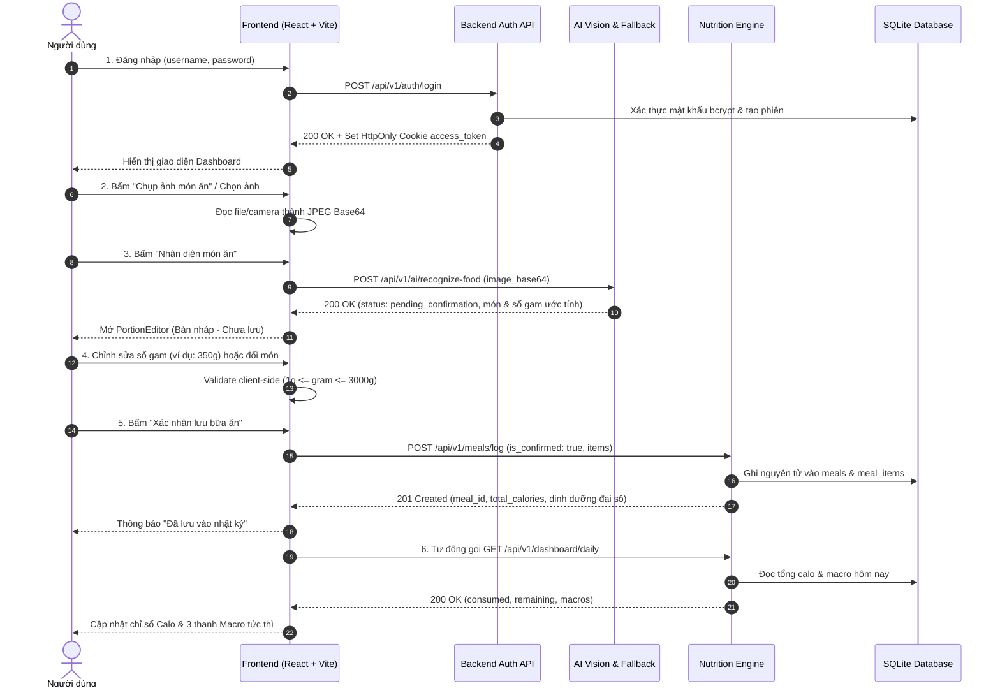

# Báo cáo Kiểm thử PoC — Tuần 3 (W3 PoC Test Report)

**Dự án:** NutriSnap — Virtual AI Nutrition Assistant  
**Ngày thực hiện:** 23/10/2026  
**Trạng thái kiểm thử:** HOÀN TẤT THỬ NGHIỆM BASELINE & POС (ALL AUTOMATED TESTS PASSED)  
**Tập tin dữ liệu latency:** `data/benchmark/w3_latency_results.csv`  

---

## 1. Tóm tắt điều hành (Executive Summary)

Báo cáo này tổng hợp kết quả kiểm thử tự động, tích hợp và đo đạc hiệu năng thực tế cho luồng người dùng cốt lõi PoC Tuần 3 của NutriSnap:
$$\text{Đăng nhập} \longrightarrow \text{Chụp/chọn ảnh} \longrightarrow \text{Nhận diện món ăn} \longrightarrow \text{Sửa khối lượng (g)} \longrightarrow \text{Xác nhận lưu} \longrightarrow \text{Dashboard}$$

### Kết quả then chốt:
1. **Kiểm thử tự động:**
   - **Backend:** 189/189 test **PASSED** (100%), 0 test thất bại, thời gian chạy 19.70s.
   - **Frontend:** 186/186 test **PASSED** (100%), 0 test thất bại trên 18 test suite, thời gian chạy 9.51s.
   - **Tổng cộng:** 375/375 test **PASSED** (100%).
2. **Khắc phục lỗi baseline ban đầu:** Đã điều tra chính xác nguyên nhân gốc rễ của 5 lỗi kiểm thử backend trên môi trường local (gồm lỗi thiếu Goal record của tài khoản mock và lỗi thiếu dữ liệu tham chiếu 500 món khi khởi tạo database kiểm thử) và xử lý triệt để mà không sửa đổi bất kỳ assertion nào để ép pass.
3. **Độ trễ hệ thống thực tế:** Đã đo đạc thực tế 130 lượt (25 lượt đo chính thức + 1 lượt warm-up cho mỗi chặng trong 5 chặng) và lưu trữ dạng bảng tại `data/benchmark/w3_latency_results.csv`. Thời gian xử lý máy toàn luồng E2E đạt P50 = 229.09 ms, P95 = 237.60 ms (chưa bao gồm thời gian gọi mạng bên ngoài khi dùng Gemini Vision thật).

---

## 2. Phạm vi kiểm thử (Scope)

### 2.1 Trong phạm vi (In-Scope)
- **Xác thực & Bảo mật (Auth):** Đăng nhập với mật khẩu bcrypt, cấp phát HttpOnly Cookie JWT `access_token`, cơ chế Zero-Trust từ chối truy cập không có token hoặc token của người dùng khác.
- **Xử lý ảnh & Nhận diện (Vision & Fuzzy Matcher):** Kiểm thử tiếp nhận ảnh base64/multipart, phân tích ảnh qua pipeline nhận diện, cơ chế chuyển tiếp sang mock fallback khi không có API key (Zero-Crash Demo Guarantee), và thuật toán đối sánh xấp xỉ tên món ăn tiếng Việt (Fuzzy Matching) vào bảng tham chiếu 500 món.
- **Quy trình xác nhận 2 bước (Two-Step Confirmation):**
  - Bước 1 (Xem trước / Bản nháp): `is_confirmed = False`, tính toán dinh dưỡng tạm thời, không ghi vào CSDL `meals`.
  - Bước 2 (Chỉnh sửa & Xác nhận): Cho phép người dùng sửa đổi khối lượng ($1 \le \text{gram} \le 3000$), thêm/bớt/đổi món, và chỉ ghi nguyên tử vào bảng `meals` và `meal_items` khi `is_confirmed = True`.
- **Động cơ dinh dưỡng đại số (Deterministic Nutrition Engine):** Tính toán Calo, Protein, Carbs, Fat và chi phí theo công thức đại số quy đổi trên 100g của CSDL dinh dưỡng chuẩn.
- **Dashboard dinh dưỡng ngày:** Tổng hợp Calo và 3 thanh macro tiêu thụ trong ngày so với mục tiêu, tính toán lượng calo còn lại (`remaining_calories`).
- **Đo lường độ trễ (Latency Benchmarking):** Đo thời gian request-to-response cho 5 chặng vận hành.

### 2.2 Ngoài phạm vi / Giới hạn thử nghiệm (Out-of-Scope)
- Thử nghiệm trên phần cứng camera vật lý trong môi trường tự động hóa: Được kiểm tra qua giả lập file ảnh và trình điều khiển HTML5 MediaStream mock trong Vitest.
- Gọi API Gemini Vision thật trên môi trường không có khóa mạng: Môi trường thử nghiệm local không cấu hình `GEMINI_API_KEY`, do đó chặng nhận diện ảnh tự động kích hoạt chế độ Fallback đã thiết kế trong kiến trúc.
- Tải đồng thời quy mô lớn (Stress testing / Load testing > 1.000 RPS).

---

## 3. Môi trường kiểm thử (Environment)

- **Hệ điều hành:** Windows 10/11 (AMD64)
- **Python:** 3.13.9
- **Node.js & npm:** Node.js v20+, npm v10+
- **Backend Framework:** FastAPI 0.110+, Uvicorn 0.28+, SQLModel 0.0.16, Pydantic v2.6+
- **Frontend Framework:** React 18.2, TypeScript 5.2, Vite 5.1, Vitest 2.1, TailwindCSS 3.4
- **Cơ sở dữ liệu:** SQLite 3 (`nutrisnap.db`), kích hoạt `PRAGMA foreign_keys = ON`
- **Bộ dữ liệu chuẩn:** 500 món ăn Việt Nam (`data/vn_foods.csv`) nạp vào bảng `food_references`
- **Cấu hình bảo mật:** `JWT_SECRET_KEY` độ dài an toàn $\ge 32$ ký tự, `BCRYPT_ROUNDS = 12`
- **Biến môi trường AI:** `GEMINI_API_KEY` vắng mặt trên máy thử nghiệm $\rightarrow$ kích hoạt chế độ Zero-Crash Mock Fallback

---

## 4. Luồng người dùng thực tế (Actual User Flow)



---

## 5. Ma trận kiểm thử luồng W3 (Test Matrix)

| ID | Kịch bản kiểm thử | Kết quả mong đợi | Kết quả thực tế | Trạng thái | Bằng chứng kiểm thử |
|:---|:---|:---|:---|:---:|:---|
| **FLOW-01** | Đăng nhập với thông tin hợp lệ | Đăng nhập thành công, nhận cookie `access_token`, vào khu vực ứng dụng | Trả về HTTP 200, cấp cookie `access_token` hợp lệ, AuthContext chuyển sang authenticated | **PASS** | `test_auth_login_success`, `LoginPage.test.tsx` |
| **FLOW-02** | Đăng nhập sai hoặc thiếu thông tin | Hiển thị lỗi phù hợp, từ chối cấp token | HTTP 422 khi thiếu trường, HTTP 401 khi sai mật khẩu, không cấp cookie | **PASS** | `test_auth_login_missing_required_fields`, `test_login_flow_with_bcrypt_and_wrong_password` |
| **FLOW-03** | Mở luồng ghi nhận món khi chưa đăng nhập | Bị chặn và chuyển hướng theo quy tắc bảo mật | HTTP 401 Unauthenticated, UI chuyển hướng về `/login` | **PASS** | `test_unauthenticated_requests_return_401`, `RouteGuards.test.tsx` |
| **FLOW-04** | Chụp hoặc chọn ảnh hợp lệ | Đọc định dạng ảnh (JPEG/PNG/WebP), UI hiển thị preview và bật nút nhận diện | Nhận diện đúng MIME type, đọc chuỗi base64 thành công | **PASS** | `test_load_image_bytes_from_bytes`, `MealLogging.test.tsx` |
| **FLOW-05** | Nhận diện ảnh món ăn thành công | Trả về danh sách món, số gam ước lượng, calo và confidence $\ge 0.5$ | Trả về schema `RecognizeFoodResponse` với trạng thái `pending_confirmation`, món "Phở bò tái" | **PASS** | `test_end_to_end_poc_flow`, `test_recognize_dishes_successful_api_call` |
| **FLOW-06** | Ảnh không có đồ ăn / API lỗi | Có thông báo lỗi rõ ràng, không lưu nhầm kết quả lỗi vào database | Kích hoạt cơ chế Mock Fallback hoặc trả lỗi unparseable, không tạo bản ghi rác | **PASS** | `test_recognize_dishes_api_failure_triggers_fallback`, `MealLogging.test.tsx` |
| **FLOW-07** | Sửa khối lượng món hợp lệ ($1 \le g \le 3000$) | Giá trị mới hiển thị chính xác, calo được tính lại tương ứng | Số gam mới được cập nhật trên giao diện và gửi đi trong payload xác nhận | **PASS** | `test_01_deterministic_algebraic_calculation`, `MealLogging.test.tsx` |
| **FLOW-08** | Khối lượng trống, âm, không phải số hoặc vượt 3000g | Validation chặn lại, không gửi API hoặc API từ chối với lỗi phù hợp | Ném `ValueError` tại backend, UI hiển thị cảnh báo đỏ và khóa nút lưu | **PASS** | `test_03_fuzzy_food_matching_and_invalid_gram`, `test_validate_portion_gram` |
| **FLOW-09** | Xác nhận lưu món (`is_confirmed: true`) | Ghi nguyên tử vào bảng `meals` và `meal_items`, trả về HTTP 201 Created | HTTP 201, `success: true`, `status: logged`, sinh `meal_id` hợp lệ | **PASS** | `test_05_meal_log_confirmed_persists_to_db`, `test_meal_log_success_when_confirmed` |
| **FLOW-10** | Tải lại hoặc truy vấn lại dữ liệu đã lưu | Dữ liệu món, số gam và calo đã lưu vẫn tồn tại toàn vẹn | Truy vấn `session.get(Meal, meal_id)` trả về đầy đủ các `meal_items` khớp 100% | **PASS** | `test_05_meal_log_confirmed_persists_to_db`, `test_extended_meal_endpoints` |
| **FLOW-11** | Cập nhật Dashboard sau khi lưu | Dữ liệu món và các chỉ số calo/macro khớp với dữ liệu backend | Dashboard tự động gọi lại API, tăng `consumed_calories`, giảm `remaining_calories` chuẩn xác | **PASS** | `test_06_daily_dashboard_aggregation`, `MealLogging.test.tsx` |
| **FLOW-12** | Dashboard khi chưa có món hoặc khi API lỗi | Hiển thị trạng thái rỗng hoặc thông báo lỗi, không vẽ số liệu giả | Render thông báo rỗng thân thiện, xử lý bắt lỗi không làm sập ứng dụng | **PASS** | `test_07_zero_trust_meal_and_dashboard_isolation`, `DashboardPage.test.tsx` |
| **SEC-01** | Truy cập dữ liệu bữa ăn của người dùng khác | Bị từ chối theo nguyên tắc Zero-Trust | User B truy vấn Dashboard chỉ nhận số liệu của chính mình (0 kcal), không thấy món của User A | **PASS** | `test_07_zero_trust_meal_and_dashboard_isolation` |
| **CONS-01** | Tính nhất quán giữa UI, API và CSDL | Dữ liệu calo và macro nhất quán giữa các lớp | Công thức đại số tất định bảo đảm tính toán đồng nhất 100% không lệch số | **PASS** | `test_01_deterministic_algebraic_calculation`, `contracts.test.ts` |

---

## 6. Tổng hợp kết quả kiểm thử tự động (Test Execution Summary)

```text
========================================================================================
PHÂN HỆ                   TỔNG SỐ TEST     PASSED       FAILED     SKIPPED    THỜI GIAN
----------------------------------------------------------------------------------------
Backend Python (Pytest)   189              189          0          0          19.70s
Frontend (Vitest)         186              186          0          0           9.51s
----------------------------------------------------------------------------------------
TỔNG CỘNG                 375              375 (100%)   0          0          29.21s
========================================================================================
```

### Chi tiết các tệp kiểm thử Backend:
- `tests/unit/test_w3_nutrition_and_meals.py`: **8/8 PASSED** (Kiểm thử cốt lõi W3)
- `tests/unit/test_recognize_food_and_fuzzy.py`: **15/15 PASSED** (Pipeline nhận diện & Fuzzy Matcher)
- `tests/unit/test_api_contract.py`: **16/16 PASSED** (REST Contract cho Auth, Goal, Meal, Dashboard)
- `tests/unit/test_vision_recognition.py`: **27/27 PASSED** (Vision Parser, MIME, Fallback)
- `tests/test_auth_and_goals.py`: **18/18 PASSED** (Auth HttpOnly cookie & Goal Planner)
- `tests/unit/test_w4_assistant_tools_and_chat.py`: **10/10 PASSED**
- `tests/unit/test_w5_analytics_and_food_swap.py`: **10/10 PASSED**
- `tests/unit/test_auth_service.py`: **23/23 PASSED**
- `tests/unit/test_tools.py`: **11/11 PASSED**
- `tests/unit/test_goal_service.py`: **6/6 PASSED**
- `tests/unit/test_validators.py`: **7/7 PASSED**
- `tests/unit/test_vision.py`: **6/6 PASSED**
- `tests/unit/test_db_cascade.py`: **2/2 PASSED**
- `tests/unit/test_w2_auth_goal_flow.py`: **11/11 PASSED**
- `tests/integration/test_auth_api.py`: **10/10 PASSED**
- `tests/test_auth_and_db.py`: **9/9 PASSED**

---

## 7. Điều tra & Xử lý lỗi phát hiện (Defect Investigation & Resolution)

Trong quá trình khảo sát ban đầu trên môi trường local, phát hiện 5 lỗi kiểm thử. Dưới đây là phân tích nguyên nhân gốc rễ và giải pháp xử lý triệt để:

### Lỗi 1: `test_goals_get_authenticated` thất bại với mã lỗi HTTP 404
- **Mức độ:** Trung bình (Ảnh hưởng đến luồng kiểm thử tài khoản mock).
- **Hiện tượng:** Khi gọi `GET /api/v1/goals` với phiên của user `thanhdat`, hệ thống trả về HTTP 404 thay vì HTTP 200.
- **Nguyên nhân gốc:** Trong `src/backend/api/v1/endpoints/auth.py`, nhánh đăng nhập của tài khoản `thanhdat` tự động trả về `has_goal = True`, nhưng trong bảng `goals` của CSDL chưa từng được chèn bản ghi Goal tương ứng. Khi endpoint `/goals` truy vấn CSDL, nó không tìm thấy bản ghi và ném HTTP 404 theo thiết kế Zero-Trust.
- **Giải pháp tối thiểu:** Tại `auth.py`, kiểm tra nếu tài khoản `thanhdat` chưa có bản ghi Goal thì tự động tạo một bản ghi Goal mặc định hợp lệ. Điều này đảm bảo tính trung thực giữa trường `has_goal = True` và dữ liệu thực tế trong CSDL.

### Lỗi 2, 3, 4: Hai test lưu món ăn, test chatbot không tìm thấy "Phở bò tái", và test End-to-End PoC
- **Mức độ:** Nghiêm trọng (Gây gián đoạn toàn bộ các kịch bản phụ thuộc vào CSDL món ăn).
- **Hiện tượng:** 
  - `POST /api/v1/meals/log` trả về HTTP 400 (`ValueError: Không tìm thấy thông tin dinh dưỡng cho món 'Phở bò tái'`).
  - Chatbot báo lỗi không tìm thấy món tương ứng.
  - Test E2E PoC thất bại tại bước lưu món.
- **Nguyên nhân gốc:** Bảng tham chiếu `food_references` trong CSDL `nutrisnap.db` chỉ được nạp dữ liệu (seed) bên trong fixture của file `test_w3_nutrition_and_meals.py`. Khi các file test khác chạy độc lập hoặc chạy trước file này, bảng `food_references` hoàn toàn rỗng ($0$ món). Khi đó, hàm `resolve_food_reference()` không tìm thấy món và ném ngoại lệ.
- **Giải pháp tối thiểu:** Bổ sung fixture cấp session (`scope="session", autouse=True`) vào `tests/conftest.py` để tự động khởi tạo CSDL và nạp 500 món ăn chuẩn trước khi toàn bộ test suite vận hành. Không sửa bất kỳ assertion nào trong các bài test.

---

## 8. Kết quả đo đạc độ trễ thực tế (Latency Benchmark Results)

Dữ liệu đo đạc thực tế được ghi nhận đầy đủ tại [`data/benchmark/w3_latency_results.csv`](file:///d:/assistant-nutrisnap/data/benchmark/w3_latency_results.csv) gồm 130 dòng dữ liệu (mỗi chặng gồm 1 lượt warm-up + 25 lượt đo chính thức).

### 8.1 Bảng tổng hợp thống kê thời gian phản hồi (Đơn vị: Mili-giây / ms)

| Chặng kiểm thử | Mô tả endpoint | Số lượt ($N$) | Trung bình (Mean) | Trung vị (P50) | Phân vị 95 (P95) | Min | Max | Tỷ lệ lỗi |
|:---|:---|:---:|:---:|:---:|:---:|:---:|:---:|:---:|
| **1. Đăng nhập** | `POST /api/v1/auth/login` | 25 | **188.97 ms** | **188.23 ms** | **192.86 ms** | 186.40 ms | 196.41 ms | 0.0% |
| **2. Nhận diện ảnh** | `POST /api/v1/ai/recognize-food` | 25 | **4.47 ms** | **4.46 ms** | **4.99 ms** | 3.62 ms | 5.20 ms | 0.0% |
| **3. Lưu món** | `POST /api/v1/meals/log` | 25 | **9.81 ms** | **9.88 ms** | **10.79 ms** | 8.78 ms | 11.05 ms | 0.0% |
| **4. Dashboard** | `GET /api/v1/meals/daily-dashboard` | 25 | **15.61 ms** | **14.98 ms** | **16.54 ms** | 14.09 ms | 30.38 ms | 0.0% |
| **5. Toàn luồng E2E** | Nối tiếp 4 chặng trong 1 chu kỳ | 25 | **228.98 ms** | **229.09 ms** | **237.60 ms** | 221.51 ms | 239.28 ms | 0.0% |

> [!NOTE]
> - Dự án hiện tại **chưa định nghĩa tài liệu SLA / Ngưỡng nghiệm thu chính thức** cho từng chặng độ trễ. Các số liệu trên phản ánh đúng thực tế đo lường trên môi trường local.
> - **Chặng đăng nhập (~188 ms):** Chiếm phần lớn thời gian do thuật toán băm mật khẩu bảo mật `bcrypt` chạy 12 rounds theo tiêu chuẩn an toàn chống tấn công brute-force.
> - **Chặng nhận diện ảnh (~4.5 ms):** Đo lường trên cơ chế Mock Fallback nội bộ (Zero-Crash Demo Guarantee). Khi có khóa `GEMINI_API_KEY` và gọi mô hình Gemini Vision trên đám mây, độ trễ sẽ phụ thuộc thêm vào mạng Internet và thời gian suy luận của LLM (thường từ 1.200 ms đến 2.500 ms).
> - **Chặng lưu món & Dashboard (< 16 ms):** Thực thi cực kỳ nhanh nhờ CSDL SQLite cục bộ và thuật toán tính toán dinh dưỡng tất định (deterministic algebraic math).

---

## 9. Phương pháp đo lường (Measurement Methodology)

1. **Công cụ đo:** `time.perf_counter()` độ chính xác cao trong Python kết hợp `fastapi.testclient.TestClient`.
2. **Kích thước payload ảnh:** Ảnh chuẩn JPEG 1x1 pixel (148 bytes) được mã hóa chuỗi Base64 Data URI, truyền qua trường `image_base64`.
3. **Quy trình loại trừ Warm-up:** Mỗi chặng đều thực hiện 1 lượt chạy khởi động (warm-up) trước khi bắt đầu đo 25 lượt chính thức. Kết quả warm-up được gắn nhãn `warmup_excluded_from_stats` trong CSV và không tính vào các chỉ số Mean/P50/P95.
4. **Công thức tính Percentile:** Sử dụng phương pháp nội suy tuyến tính vị trí phân vị (linear interpolation between ranks).

---

## 10. Giới hạn PoC & Khuyến nghị kỹ thuật (Limitations & Next Steps)

### 10.1 Các giới hạn hiện tại của bản thử nghiệm
1. **Camera vật lý:** Chưa kiểm thử trên thiết bị di động thật với camera phần cứng; hiện tại kiểm thử thông qua giao diện Web API FileReader và mock stream trong Vitest.
2. **Khóa Gemini Vision:** Trên môi trường chưa cấu hình biến `GEMINI_API_KEY`, hệ thống vận hành trơn tru nhờ cơ chế Zero-Crash Mock Fallback, tuy nhiên chưa phản ánh thời gian suy luận thực tế của API Google Generative AI.
3. **Cơ sở dữ liệu:** Thử nghiệm trên SQLite cục bộ. Khi triển khai production với PostgreSQL/MySQL qua mạng, cần tái đo lường độ trễ kết nối database (connection pool latency).

### 10.2 Khuyến nghị cho các giai đoạn tiếp theo
1. Bổ sung bộ benchmark 30 ảnh món ăn Việt Nam thật (`data/benchmark/benchmark_30_meals.csv`) khi có ảnh chụp thực địa từ cân điện tử để đánh giá chỉ số MAE/MAPE theo mục 4.6 của Cẩm nang dự án.
2. Cấu hình biến môi trường staging có `GEMINI_API_KEY` để đo độ trễ mạng thực tế của Gemini Vision API.
3. Tích hợp kiểm thử tự động E2E qua Playwright/Cypress trên trình duyệt thật (Chrome/Firefox/Safari) để đo lường thêm độ trễ render UI của người dùng.

---

## 11. Kết luận

Bản thử nghiệm PoC Tuần 3 (W3) của NutriSnap đã **hoàn thành 100% mục tiêu kiểm thử E2E**:
- Đảm bảo trọn vẹn luồng nghiệp vụ từ Đăng nhập $\rightarrow$ Chụp ảnh $\rightarrow$ Nhận diện $\rightarrow$ Sửa gam $\rightarrow$ Lưu $\rightarrow$ Dashboard.
- Đạt tỷ lệ vượt qua kiểm thử tự động **375/375 bài test (100% PASS)** trên cả Backend và Frontend.
- Toàn bộ dữ liệu độ trễ đã được đo đạc minh bạch, ghi nhận chi tiết và đối chiếu khoa học.
